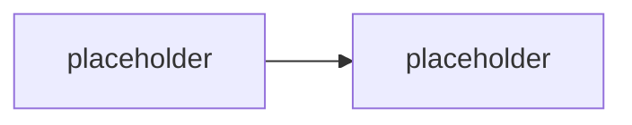

# <Název modulu>

> Typ: povinný | volitelný · Den: <N> · Odhad: <min> min
> Tenant: A `cloudedu.cz` | B `spdemo.online` · Režim: hands-on, vlastní scope | hands-on, celý tenant | instruktorské demo
> Prostředí: [`../../environment.md`](../../environment.md) · Názvosloví: [`../../GLOSSARY.md`](../../GLOSSARY.md)

<nepovinný odstavec: kam blok patří v oblouku týdne a na co navazuje>

## Cíle

- <co student po bloku umí — začínej slovesem, ne „seznámit se s">

## Výklad

<text; názvy proti GLOSSARY.md; žádné tvrzení bez odkazu nebo ověření na tenantu>

## Klíčové rozlišení

- **<A> vs. <B>** — <čím se liší a proč na tom záleží>

## Licence

| Funkce v bloku | Business Premium | E3 | E5 / add-on | Zdroj |
|---|---|---|---|---|
| <funkce> | <ano / ne / ?> | <…> | <…> | [<stránka>](https://learn.microsoft.com/...) |

## Naše prostředí

<co pro tenhle blok platí na kurzovních tenantech; scope studenta; odkaz na go/no-go
položku v environment.md, pokud existuje>

## Lab

Viz [`lab-<slug>.md`](lab-<slug>.md).

## Nosná linka

<co přibylo ve workspace isms-<ini> a které řádky SoA blok zapsal — viz
[`../../scenario-isms-vltava.md`](../../scenario-isms-vltava.md)>

| Opatření | Capability M365 | Důkaz |
|---|---|---|
| A.<x.y> | <…> | <co student odkáže> |

## Zdroje

- [<název stránky>](https://learn.microsoft.com/...)

## Stav produktu / delta

> [!WARNING] Ověřit k datu běhu — stav k <RRRR-MM>.
> <co ověřit: licence, název v UI, preview stav, retirement>
