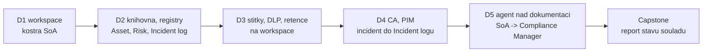

# Agenda — pořadí bloků

Jediný zdroj pravdy o pořadí modulů. Složky jsou slugy; pořadí drží tato tabulka. Změna
pořadí = úprava tohoto souboru, ne přejmenování složek.

Denní briefingy: [`day-1`](./day-1/README.md) · [`day-2`](./day-2/README.md) ·
[`day-3`](./day-3/README.md) · [`day-4`](./day-4/README.md) · [`day-5`](./day-5/README.md).

**5 dní · 16 povinných bloků.** P = povinný, V = volitelný / samostudium. Tenant: A =
`cloudedu.cz`, B = `spdemo.online` (viz [`environment.md`](./environment.md)).

> [!IMPORTANT] Osnova drží katalog, ne jeho časování
> Katalog GOC248 má 5 tematických celků a 19 položek bez časových dotací. Všechny položky mají
> v agendě místo (mapování v [`self-study.md`](./self-study.md)). Proti dřívější pracovní verzi
> je **NIS2 a ISO 27001 zkrácené na rekapitulaci** — katalog uvádí jako předpoklad GOC240
> (NIS2 a ZKB) a GOC222 (správa SharePoint Online) — a uvolněný čas dostaly laby.

> [!WARNING] Timing — publikovaná čísla jsou nominální
> Pracovní kapacita plánu je **~300 min odučeného obsahu denně**, den 5 končí v 15:00
> (~270 min). Celkem **1 470 min povinných ≈ 24,5 h**. Skutečné timingy žijí
> v `instructor-notes.md` jednotlivých modulů a po prvním běhu (leden 2027) se sem vrátí
> naměřené.

> [!WARNING] Ověřit k datu běhu — stav k 2026-10.
> Kurz stojí na stavu produktu k 2026-10 a na zákoně č. 264/2025 Sb. s vyhláškou
> č. 410/2025 Sb. Před prvním během proběhne ověřovací kolo (prosinec 2026) — seznam položek
> v [`environment.md`](./environment.md).

## Den 1 — Rámec a ISMS základy

Motiv: **od zákona k prázdné kostře ISMS v tenantu.**

| # | Blok | Slug | Typ | min | Tenant |
|---|---|---|---|---|---|
| 1 | Onboarding a přístup do obou tenantů, kde se v kurzu objeví AI | `onboarding` | P | 45 | A + B |
| 2 | NIS2 a ISO 27001 — rekapitulace pro Microsoft 365 | `nis2-iso27001-fundamentals` | P | 60 | — |
| 3 | Mapování požadavků na Microsoft 365 a licenční realita | `requirements-mapping-m365` | P | 75 | A |
| 4 | Návrh ISMS v Microsoft 365 | `isms-design-m365` | P | 120 | A |

Celkem **300 min**.

> [!NOTE] Přihlášení do Tenant B už v pondělí
> Na Tenant B se poprvé sahá v úterý (Autofill columns, Skills). Registrace MFA na druhém
> tenantu uprostřed labu stojí 15 minut a celou skupinu — proto patří do `onboarding`.

## Den 2 — Řízená ISMS dokumentace v SharePoint Online a Lists

| # | Blok | Slug | Typ | min | Tenant |
|---|---|---|---|---|---|
| 1 | Knihovny jako úložiště řízené dokumentace | `document-libraries-governance` | P | 100 | A |
| 2 | Content Type Hub a standardizace politik, Autofill columns | `content-type-hub` | P | 80 | A + B |
| 3 | Lists jako živé evidence a workflow, Skills | `lists-registers-workflow` | P | 120 | A + B |

Celkem **300 min**.

## Den 3 — Klasifikace a Information Protection

| # | Blok | Slug | Typ | min | Tenant |
|---|---|---|---|---|---|
| 1 | Klasifikace a sensitivity labels v Purview | `sensitivity-labels` | P | 110 | A |
| 2 | Data Loss Prevention napříč Microsoft 365 | `dlp` | P | 90 | A |
| 3 | Retence, lifecycle a records management, srovnání se SAM | `retention-lifecycle` | P | 100 | A |

Celkem **300 min**.

> [!IMPORTANT] Nezaměňovat
> Tři bloky, tři pilíře Purview, tři různé otázky: **jak je to klasifikované**
> (Information Protection), **co nesmí odejít** (DLP), **jak dlouho se to drží** (Data
> Lifecycle Management).

## Den 4 — Identita, detekce a incidenty

| # | Blok | Slug | Typ | min | Tenant |
|---|---|---|---|---|---|
| 1 | Conditional Access a řízení přístupu, risk-based politiky | `conditional-access` | P | 100 | A |
| 2 | Privilegovaný přístup — PIM | `privileged-access-pim` | P | 90 | A |
| 3 | Detekce, audit a podklad pro hlášení incidentu | `audit-incident-response` | P | 110 | A |

Celkem **300 min**.

> [!WARNING] Ověřit k datu běhu — stav k 2026-10.
> Starší (legacy) risk politiky Microsoft Entra ID Protection byly vyřazeny k 2026-10-01;
> risk-based politiky se stavějí v Conditional Access. Proto jsou v `conditional-access`, ne
> v `privileged-access-pim`.

## Den 5 — AI a důkazování souladu

Den končí v 15:00.

| # | Blok | Slug | Typ | min | Tenant |
|---|---|---|---|---|---|
| 1 | AI agenti uvnitř tenantu | `ai-agents-tenant` | P | 90 | B |
| 2 | Hotový agent z Microsoft Marketplace — Normiqa Navigator | `normiqa-navigator-demo` | P | 30 | B |
| 3 | Governance Copilotu a řízení rizik AI | `copilot-governance-dspm` | P | 60 | A + B |
| 4 | Compliance Manager a capstone | `compliance-manager-capstone` | P | 90 | A |

Celkem **270 min**.

> [!NOTE] Proč governance Copilotu běží na obou tenantech
> Tenant B má Copilot, ale nemá licence Purview — politiky pro Copilot se tam konfigurovat
> nedají. Tenant A má Purview, ale nemá Copilot. Studenti proto politiky DLP a štítků pro
> Copilot **konfigurují na A** a lektor na B předvádí, co Copilot nad daty skutečně vidí.

## Kompresní ventily — v tomto pořadí

Škrtá se odshora. Nic povinného ani capstone nezávisí na tom, co je v seznamu. Konkrétní
kroky labů se doplní, až budou laby napsané.

**Den 1** — 1. legislativní rekapitulace v `nis2-iso27001-fundamentals` jen jako tabulka
povinností (−15); 2. licenční matice v `requirements-mapping-m365` jako hotová tabulka
k přečtení, bez společného vyplňování (−15).
**Nekrátit** `isms-design-m365` — workspace a kostra SoA nesou celý týden.

**Den 2** — 1. Autofill columns v `content-type-hub` jako demo lektora (−20); 2. Skills
v `lists-registers-workflow` jako demo lektora (−15).
**Nekrátit** registry v `lists-registers-workflow` — Risk Register a Incident log používá den 4
i capstone.

**Den 3** — 1. auto-labeling v `sensitivity-labels` jen výklad (−15); 2. vyšetření DLP shody
v `dlp` jako demo (−15); 3. srovnání se SAM v `retention-lifecycle` jen tabulkou (−10).
**Nekrátit** štítky na ISMS knihovně — DLP i Copilot governance na nich stojí.

**Den 4** — 1. risk-based politika v `conditional-access` jen v report-only bez
vyhodnocení (−15); 2. schvalovací tok aktivace v `privileged-access-pim` jako demo (−15).
**Nekrátit** `audit-incident-response` — podklad pro hlášení jde do capstonu.

**Den 5** — 1. `normiqa-navigator-demo` zkrátit na srovnávací tabulku bez živé instalace
(−15); 2. DSPM v `copilot-governance-dspm` jen prohlídka bez vyhodnocení (−15).
**Nekrátit** `compliance-manager-capstone`.

## Nosná linka — jeden ISMS celý týden

Kurz nebuduje sérii nesouvisejících politik, ale **jeden ISMS workspace** fiktivní firmy
Vltava Servis, kterému každý blok něco přidá — a každý blok zapíše své řádky do prohlášení
o aplikovatelnosti (SoA). Scénář: [`scenario-isms-vltava.md`](./scenario-isms-vltava.md).

## Nitě napříč kurzem

- **Nit důkazu** — `requirements-mapping-m365` (D1, mapovací matice) → `isms-design-m365`
  (D1, kostra SoA) → každý blok D2–D4 (řádek SoA s odkazem na důkaz) →
  `compliance-manager-capstone` (D5, důkazy v assessmentu, report). Pokaždé „kterou kontrolu
  to plní a čím to doložím".
- **Licenční nit** — `requirements-mapping-m365` (D1, matice) → každý blok (sekce Licence: co
  zvládne Business Premium / E3 a co až E5) → `copilot-governance-dspm` (D5, proč Tenant B
  nemá Purview) → capstone (co z reportu by vaše organizace s vaší licencí neudělala).
- **Tenantová nit** — `onboarding` (D1, dva tenanty, oddělené profily prohlížeče) →
  `conditional-access` a `privileged-access-pim` (D4, kdo smí co a na jak dlouho; všichni jste
  dnes Global Administrator — to je nález) → `ai-agents-tenant` (D5, datová hranice Copilotu
  vs. shadow AI).
