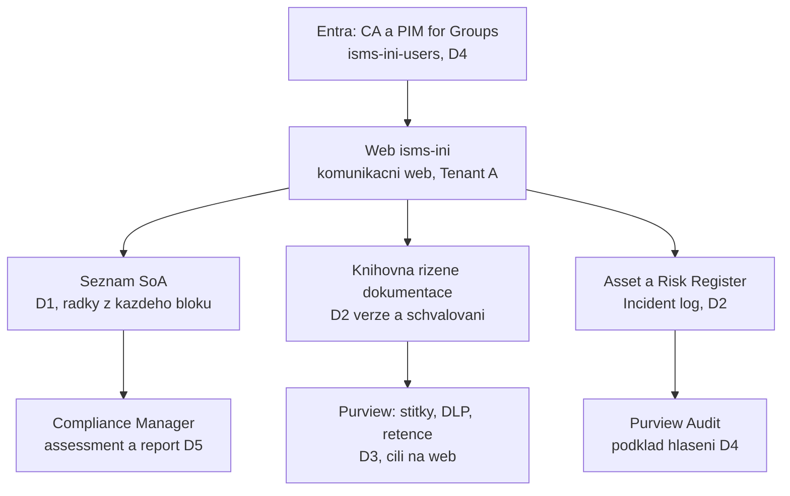

# Návrh ISMS v Microsoft 365

> Typ: povinný · Den: 1 · Odhad: 120 min
> Tenant: A `cloudedu.cz` · Režim: hands-on, vlastní scope
> Prostředí: [`../../environment.md`](../../environment.md) · Názvosloví: [`../../GLOSSARY.md`](../../GLOSSARY.md)

Poslední blok dne a jediný, na kterém visí celý týden. Student navrhne, kde v Microsoft 365
žije která část ISMS, založí web `isms-<ini>` a v něm **seznam SoA v pevném schématu** — do
něj od zítřka zapisuje každý blok. Den končí prvními dvěma řádky SoA s odkazem na skutečný důkaz.

## Cíle

- Přiřadit každé části ISMS (dokumentace, registry, politiky, důkazy) místo v Microsoft 365.
- Zvolit typ webu pro ISMS workspace a obhájit volbu proti tenantové disciplíně.
- Navrhnout informační architekturu webu: co vznikne dnes, co v D2–D5.
- Založit seznam SoA s pevnými interními názvy sloupců a vysvětlit, proč se interní názvy
  zakládají v ASCII a teprve pak přejmenovávají.
- Rozlišit AI asistenta uvnitř hranice tenantu od veřejného chatbota.

## Výklad

### Cílový stav — kde žije která část ISMS

| Část ISMS | Kde v Microsoft 365 | Blok |
|---|---|---|
| Prohlášení o aplikovatelnosti a přehled opatření | seznam **SoA** na webu `isms-<ini>` | dnes |
| Podklady návrhu (mapovací matice) | výchozí knihovna webu | dnes |
| Řízená dokumentace (politiky, směrnice) — kap. 7.5, A.5.1, A.5.37 | knihovna s verzováním, schvalováním a typy obsahu | [`../../day-2/document-libraries-governance/`](../../day-2/document-libraries-governance/), [`../../day-2/content-type-hub/`](../../day-2/content-type-hub/) |
| Evidence aktiv, rizik, incidentů | seznamy Asset Register, Risk Register, Incident log | [`../../day-2/lists-registers-workflow/`](../../day-2/lists-registers-workflow/) |
| Klasifikace, ochrana před únikem, uchování | Purview — politiky cílené na web `isms-<ini>` | D3 |
| Řízení přístupu k ISMS | skupina `isms-<ini>-users` ve členech webu, PIM for Groups | dnes (vazba), [`../../day-4/privileged-access-pim/`](../../day-4/privileged-access-pim/) |
| Důkazy a měření souladu | odkazy ze SoA, Compliance Manager | [`../../day-5/compliance-manager-capstone/`](../../day-5/compliance-manager-capstone/) |

Princip: **jeden web pro jeden ISMS**. Learn doporučuje „plochý" svět moderního SharePointu —
jeden web pro jedno téma, bez podwebů, propojení přes navigaci nebo hub
([Learn: information architecture](https://learn.microsoft.com/en-us/sharepoint/information-architecture-modern-experience)).
Pro ISMS to znamená jasnou hranici, na kterou míří politiky v D3, a jednoho vlastníka.

### Typ webu: komunikační, ne týmový

Learn: týmový web se zakládá jako web **propojený se skupinou Microsoft 365**; komunikační web
skupinu nemá ([Learn: create a site](https://learn.microsoft.com/en-us/sharepoint/create-site-collection),
[Learn: information architecture](https://learn.microsoft.com/en-us/sharepoint/information-architecture-modern-experience)).

| Kritérium | Týmový web | Komunikační web |
|---|---|---|
| Skupina Microsoft 365 | vznikne nová, členství webu = členství skupiny | nevznikne; oprávnění přes skupiny SharePointu |
| Tenantová disciplína | 15 nových skupin v adresáři sdíleného tenantu, vedle `isms-<ini>-users` | žádný nový tenantový objekt |
| Řízení přístupu (D4) | dvě skupiny na studenta — která je „ta" pro PIM? | jedna: `isms-<ini>-users` ve členech webu, pod PIM for Groups |
| Teams, plánovač, skupinová pošta | ano | ne — pro ISMS workspace kurz nepotřebuje |

**Rozhodnutí kurzu: komunikační web.** Rozhoduje jedna věc: přístup k ISMS má řídit **jediná
skupina** `isms-<ini>-users`, kterou zítra a ve čtvrtek dáte pod PIM for Groups. Týmový web by
přidal druhou skupinu, jejíž členové mají do webu přístup mimo PIM. Ve vlastní organizaci, kde
tým ISMS potřebuje Teams kanál, je týmový web legitimní volba — pak je potřeba hlídat, že
členství skupiny webu je řízené stejně přísně.

### Informační architektura webu — dnes kostra, obsah později

Dnes vzniká jen to, co je potřeba pro SoA. Ostatní je **plán** na stránce „Mapa ISMS", aby
každý student stavěl stejně a capstone šel porovnat. Názvy knihoven a seznamů z D2 určují
tamní bloky.

| Kontejner | Typ | Vzniká | Účel |
|---|---|---|---|
| SoA | seznam | dnes | opatření, požadavek, aplikovatelnost, capability, důkaz, stav zavedení |
| Documents (výchozí knihovna) | knihovna | existuje | pracovní podklady návrhu — mapovací matice |
| Mapa ISMS | stránka | dnes | plán kontejnerů a odkazy na ně |
| Knihovna řízené dokumentace | knihovna | D2 | politiky a směrnice pod verzováním a schvalováním |
| Asset Register, Risk Register, Incident log | seznamy | D2 | evidence pro A.5.9, kap. 6.1, A.5.24–A.5.26 |

Metadata místo složek: Learn doporučuje tematické knihovny a sloupce místo hlubokého vnoření
složek ([Learn: information architecture](https://learn.microsoft.com/en-us/sharepoint/information-architecture-modern-experience)).
Proto má SoA sloupce, ne složky po dnech.

### Seznam SoA — pevné schéma

Na tomto schématu stojí všechny další dny. **Neměnit.**

| Zobrazovaný název | Interní název | Typ |
|---|---|---|
| Opatření | `Title` (přejmenovaný) | jeden řádek textu, např. `A.5.12` |
| Požadavek | `Requirement` | jeden řádek textu — § vyhlášky č. 410/2025 Sb. |
| Aplikovatelné | `Applicable` | volba: `ano` / `ne` |
| Zdůvodnění | `Justification` | více řádků textu |
| Capability M365 | `Capability` | jeden řádek textu |
| Důkaz | `Evidence` | hypertextový odkaz |
| Modul | `Module` | jeden řádek textu — slug bloku |
| Tenant | `Tenant` | volba: `A` / `B` |
| Stav zavedení | `ImplementationStatus` | volba: `Zavedeno` / `Částečně zavedeno` / `Plánováno` / `Nezavedeno` |
| Priorita | `Priority` | volba: `Vysoká` / `Střední` / `Nízká` |
| Termín | `DueDate` | datum (bez času) |
| Odpovědná osoba | `ResponsiblePerson` | osoba |

**Proč nejdřív ASCII a pak přejmenovat.** Interní název sloupce vzniká jednou, při založení,
a později ho změnit nejde; mezery a zvláštní znaky se v interním názvu kódují (např. mezera jako
`_x0020_`) ([PnP community docs: SharePoint naming guidelines](https://pnp.github.io/community-docs/articles/sharepoint-naming-guidelines.html)).
Sloupec založený rovnou jako „Požadavek" by měl interní název s kódovanými znaky — a na interní
názvy se odkazují pohledy, formátování, Power Automate i skripty v dalších dnech. Proto: založit
jako `Requirement`, přejmenovat na „Požadavek". Zobrazovaný název se mění kdykoli, interní nikdy.

U sloupce **Opatření** se nic nezakládá — přejmenuje se výchozí `Title`, jehož interní název
zůstane `Title`.

> [!IMPORTANT] Seznam SoA je zároveň přehled bezpečnostních opatření
> Příloha č. 1 vyhlášky č. 410/2025 Sb. chce u opatření, která ještě nejsou zavedená, **stav,
> termín, prioritu a odpovědnou osobu** (viz [`../nis2-iso27001-fundamentals/`](../nis2-iso27001-fundamentals/)).
> Proto má seznam SoA poslední čtyři sloupce: ISO pohled nesou Aplikovatelné, Zdůvodnění
> a Důkaz, zákonný pohled Požadavek, Stav zavedení, Priorita, Termín a Odpovědná osoba.
> Export seznamu je přehled, který se předkládá vedení: aktualizace alespoň 1× ročně, verze
> předložené vedení uchovat alespoň 4 roky (vyhl. č. 410/2025 Sb. § 3 odst. 2 a příloha č. 1 —
> podle [důvodové zprávy NÚKIB](https://portal.nukib.gov.cz/storage/uploads/2025/12/03/duvodova-zprava-vyhlaska-nizsi-rezim_uid_693039f42250d.pdf)).

### AI jako pomocník při návrhu — uvnitř hranice, ne mimo ni

Návrh informační architektury je typická úloha, kterou lidé dnes „hodí do chatbota". Pro ISMS
je rozdíl, **kam** prompt odejde:

| | AI asistent uvnitř tenantu (Microsoft Copilot, Copilot Chat s pracovním účtem) | Veřejný chatbot s osobním účtem |
|---|---|---|
| Smluvní rámec | Data Protection Addendum a Product Terms, Microsoft jako zpracovatel | podmínky služby pro spotřebitele |
| Trénování modelů | prompty a odpovědi se nepoužijí k trénování základních modelů | podle podmínek služby |
| Oprávnění, štítky, audit | Copilot respektuje oprávnění, dědí sensitivity labels, interakce jde auditovat | ne |
| Webové dotazy | jdou do Bing s jiným režimem zpracování — i uvnitř tenantu | — |

Zdroj sloupce „uvnitř tenantu": [Learn: enterprise data protection](https://learn.microsoft.com/en-us/microsoft-365/copilot/enterprise-data-protection).
Konkrétní ovládací prvky se podle Learn liší podle předplatného.

Na Tenant A Copilot není. Pokud zbude čas, lektor na **Tenant B** ukáže, jak asistent navrhne
strukturu ISMS webu z fiktivního zadání — a jak výstup zkontrolovat proti schématu výše.
Pravidla:

- **Výstup AI je koncept ke kontrole**, ne návrh. Schéma SoA je pevné bez ohledu na to, co AI
  navrhne.
- **Do veřejného chatbota nepatří nic z tenantu** — podmínka scénáře: data firmy zůstávají
  v tenantu firmy ([`../../scenario-isms-vltava.md`](../../scenario-isms-vltava.md)).
- Hlubší téma (agenti, governance, DSPM) je v D5.

> [!IMPORTANT] Názvosloví
> **Microsoft 365 Copilot -> Microsoft Copilot**, **Microsoft 365 Copilot Chat -> Microsoft
> Copilot Chat** (Learn, enterprise data protection). V licencích a UI se může objevit staré jméno.

## Klíčové rozlišení

- **Návrh vs. implementace** — dnes kostra a plán; obsah, politiky a registry v D2–D4.
- **Interní vs. zobrazovaný název sloupce** — interní je trvalý identifikátor pro pohledy,
  automatizace a skripty; zobrazovaný je popisek pro lidi.
- **Komunikační vs. týmový web** — skupina Microsoft 365 ano/ne; v kurzu rozhoduje jediná skupina
  pro řízení přístupu.
- **SoA vs. přehled bezpečnostních opatření** — dva různé dokumenty (dobrovolná norma vs.
  právní povinnost nižšího režimu); kurz je z praktických důvodů vede v jednom seznamu.
- **AI v tenantu vs. veřejný chatbot** — smluvní rámec a respekt k oprávněním, ne „lepší model".

## Licence

| Funkce v bloku | Business Premium | Microsoft 365 E3 | E5 / add-on | Zdroj |
|---|---|---|---|---|
| SharePoint Online — weby, seznamy, knihovny | ano | ano | ano | [Plan options](https://learn.microsoft.com/en-us/office365/servicedescriptions/office-365-platform-service-description/office-365-plan-options) |
| Copilot Chat s agenty (demo na B) | PAYG nebo licence Copilot | PAYG nebo licence Copilot | PAYG nebo licence Copilot | [Learn: Copilot PAYG](https://learn.microsoft.com/en-us/microsoft-365/copilot/pay-as-you-go/overview) |

Seznam SoA a celý workspace postavíte v jakékoli licenci se SharePoint Online. Licenční rozdíly
začínají až u politik nad webem — viz [`../requirements-mapping-m365/comparison-licence.md`](../requirements-mapping-m365/comparison-licence.md).

## Naše prostředí

- Web zakládá student v SharePoint admin center jako Global Administrator — vlastník je on sám.
- Adresa musí být přesně `/sites/isms-<ini>`. Když je adresa obsazená, SharePoint nabídne jinou
  (např. s číslem na konci) ([Learn: create a site](https://learn.microsoft.com/en-us/sharepoint/create-site-collection))
  — to znamená pozůstatek z předchozího běhu; řeší lektor, student nepokračuje s jinou adresou.
- Skupinu `isms-<ini>-users` založil lektor skriptem; student ji dnes přidá do členů webu.
- Jazyk webu: **English** — popisky v labu odpovídají anglickému UI; české jsou jen zobrazované
  názvy sloupců.
- Kdo ztratí den, dostane workspace ve stavu po dni 1 ze skriptu (plán: `scripts/New-IsmsWorkspace.ps1`,
  [`../../scenario-isms-vltava.md`](../../scenario-isms-vltava.md)).

## Lab

Viz [`lab-isms-workspace.md`](lab-isms-workspace.md); referenční řešení
[`reseni-isms-workspace.md`](reseni-isms-workspace.md).

## Nosná linka

Přibyl web `isms-<ini>` (komunikační), skupina `isms-<ini>-users` ve členech, seznam **SoA**
v pevném schématu, stránka **Mapa ISMS** a mapovací matice v knihovně Documents. SoA dostala
první dva řádky:

| Opatření | Capability M365 | Důkaz |
|---|---|---|
| A.5.31 | mapovací matice požadavků v knihovně webu | odkaz na sešit `<ini>-mapovaci-matice` |
| kap. 6.1.3 | seznam SoA na webu `isms-<ini>` | odkaz na seznam SoA |

Od zítřka zapisuje každý blok — viz [`../../scenario-isms-vltava.md`](../../scenario-isms-vltava.md).

## Zdroje

- [Introduction to SharePoint information architecture](https://learn.microsoft.com/en-us/sharepoint/information-architecture-modern-experience)
- [Create a site — SharePoint admin center](https://learn.microsoft.com/en-us/sharepoint/create-site-collection)
- [SharePoint naming guidelines — PnP community docs](https://pnp.github.io/community-docs/articles/sharepoint-naming-guidelines.html)
- [Enterprise data protection in Microsoft Copilot and Microsoft Copilot Chat](https://learn.microsoft.com/en-us/microsoft-365/copilot/enterprise-data-protection)

## Stav produktu / delta

> [!WARNING] Ověřit k datu běhu — stav k 2026-10.
> Podoba panelu „Create a site" v SharePoint admin center (názvy šablon komunikačního webu);
> panel „Add column" v moderním seznamu (zda pole Name tvoří interní název beze změny);
> přejmenování Microsoft 365 Copilot -> Microsoft Copilot v UI na Tenant B; dostupnost Copilot
> PAYG na Tenant B pro demo.
