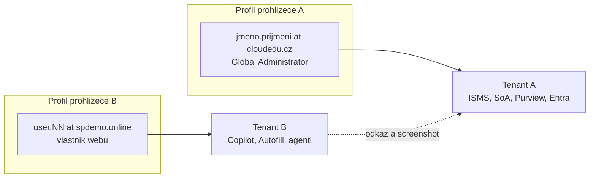

# Onboarding a přístup do obou tenantů

> Typ: povinný · Den: 1 · Odhad: 45 min
> Tenant: A `cloudedu.cz` + B `spdemo.online` · Režim: hands-on, vlastní scope
> Prostředí: [`../../environment.md`](../../environment.md) · Názvosloví: [`../../GLOSSARY.md`](../../GLOSSARY.md)

První blok týdne. Cílem není „přihlásit se", ale nastavit **tenantovou disciplínu**, která vydrží
pět dní: dva tenanty, dva profily prohlížeče, na jednom z nich Global Administrator. Druhá
polovina bloku je krátká mapa, kde se v kurzu objeví AI a proč právě na kterém tenantu.

## Cíle

- Přihlásit se do Tenant A i Tenant B, každý v **odděleném profilu prohlížeče**, a zaregistrovat
  MFA na obou.
- Ověřit, kdo jsi na kterém tenantu: na A Global Administrator, na B jen vlastník svého webu.
- Najít svůj vlastní scope na Tenant A (`isms-<ini>-users`, `test-<ini>`) a vysvětlit, proč se
  mimo něj nic nemění.
- Poznat chybu „správný účet, špatný profil" dřív, než způsobí škodu.
- Popsat, kde se v kurzu objeví AI a proč na kterém tenantu.

## Výklad

### Dva tenanty — každý na to, co skutečně umí

| | Tenant A `cloudedu.cz` | Tenant B `spdemo.online` |
|---|---|---|
| K čemu | ISMS workspace, SoA, registry, Purview, Entra, Compliance Manager | Autofill columns, Skills, agenti, ukázky Copilota |
| Tvoje role | **Global Administrator** + tenantová disciplína | **vlastník svého webu**, bez admin rolí |
| Co nemá | Copilot, Document processing | licence Purview a E5 |
| Tvůj web | `/sites/isms-<ini>` — založíš v [`../isms-design-m365/`](../isms-design-m365/) | `/sites/isms-<ini>` — založil lektor skriptem |

Podrobnosti a matice per blok: [`../../environment.md`](../../environment.md). **Mezi tenanty se
nestěhují data** — výsledky z B se do SoA na A dokládají odkazem a screenshotem
([`../../scenario-isms-vltava.md`](../../scenario-isms-vltava.md)).

### Tenantová disciplína — pravidla týdne

Na Tenant A je každý z vás Global Administrator. Jedna chybně zacílená politika mění prostředí
všem, chybná politika Conditional Access zamkne celou učebnu i lektora. Proto platí po celý
týden (závazně v [`../../CONVENTIONS.md`](../../CONVENTIONS.md)):

1. **Vlastní scope.** Web `isms-<ini>`, skupina `isms-<ini>-users`, testovací uživatel
   `test-<ini>`. Každá politika, kterou vytvoříš, cílí **jen na ně**.
2. **Prefix `<ini>-`** v názvu každé politiky, štítku a pravidla. Bez prefixu nejde dohledat,
   čí to je, a úklid po kurzu se nedá udělat skriptem.
3. **Bezpečné režimy.** Conditional Access jen **report-only**, vynucení jen na `test-<ini>`;
   DLP jen v **simulaci**; nouzové (break-glass) účty jsou z každé politiky CA vyloučené.
4. **PIM jen přes PIM for Groups** na vlastní skupině — nastavení PIM pro role Entra je
   tenantové a 15 lidí by se v něm přepisovalo.
5. **Na Tenant B nic tenantového.** Jsi tam jen vlastník svého webu; nasazení agenta pro
   organizaci nebo admin consent je demo lektora.
6. **Oddělený profil prohlížeče pro každý tenant.** Global Administrator ve špatném okně je
   reálný dopad, ne zmatek.

> [!IMPORTANT] Že jste všichni Global Administrator, je nález — ne pohodlí
> Kurz o řízení přístupu běží na tenantu, kde má každý nejvyšší roli. V bloku
> [`../../day-4/privileged-access-pim/`](../../day-4/privileged-access-pim/) se z toho stane
> položka auditu: „jaké role by stačily". Do té doby drží tenant pohromadě jen pravidla výše.

### Proč dva profily prohlížeče, ne dvě záložky

Profil prohlížeče drží vlastní sadu přihlášených účtů, cookies a historie. Dvě záložky v jednom
profilu sdílejí přihlášení, takže odkaz z Tenant B otevřený v okně Tenant A buď nabídne výběr
účtu, nebo tě přihlásí účtem, který zrovna platí. Kurz proto pracuje s pravidlem:

- **Profil „GOC248 A"** — jen účet `@cloudedu.cz`. Jiná barva motivu.
- **Profil „GOC248 B"** — jen účet `@spdemo.online`. Jiná barva motivu.
- Než cokoli uložíš: **pohled vpravo nahoru** — avatar a doména účtu odpovídají tenantu, ve
  kterém chceš pracovat.

Chování přihlašování mezi profily (automatické přepínání profilů, jednotné přihlášení přes účet
Windows) se liší podle nastavení stroje — na učebních strojích **neověřeno**. Proto pravidlo
„pohled vpravo nahoru" platí bez výjimky.

### MFA na obou tenantech

Registrace metod MFA a samoobslužného resetu hesla je v Microsoft Entra ID sjednocená
(*combined registration*): uživatel je při přihlášení vyzván k registraci, nebo si metody spravuje
sám na stránce **Security info** (`aka.ms/mysecurityinfo`)
([Learn: combined registration](https://learn.microsoft.com/en-us/entra/identity/authentication/concept-registration-mfa-sspr-combined)).
Každý tenant má vlastní registraci — MFA na Tenant A nic neříká o Tenant B.

> [!WARNING] Nikdy neschvaluj výzvu MFA, kterou jsi sám nevyvolal
> Neočekávané oznámení v Authenticatoru = zamítnout a říct lektorovi. Na tenantu, kde je každý
> Global Administrator, je to i ukázka, proč je MFA první opatření v bloku
> [`../../day-4/conditional-access/`](../../day-4/conditional-access/).

### Kde se v kurzu objeví AI

AI není páteční přívěsek — je to nit, na které se ukazuje **datová hranice**: AI uvnitř tenantu
(respektuje oprávnění, štítky a audit) vs. veřejný chatbot mimo smluvní rámec organizace.

| Den | Blok | Co AI dělá | Tenant |
|---|---|---|---|
| 1 | [`../isms-design-m365/`](../isms-design-m365/) | AI jako **pomocník při návrhu** — rozdíl mezi asistentem uvnitř tenantu a veřejným chatbotem; případná ukázka lektora | B (demo) |
| 2 | [`../../day-2/content-type-hub/`](../../day-2/content-type-hub/) | **Autofill columns** vyplní metadata dokumentu z jeho obsahu | B |
| 2 | [`../../day-2/lists-registers-workflow/`](../../day-2/lists-registers-workflow/) | **Skills** v Copilotu nad registry | B |
| 5 | [`../../day-5/ai-agents-tenant/`](../../day-5/ai-agents-tenant/) | vlastní **declarative agent** nad kopií ISMS dokumentace | B |
| 5 | demo lektora v D5 | hotový agent z Microsoft Marketplace — hodnocení stejnými kritérii jako jakýkoli jiný | B (demo) |
| 5 | [`../../day-5/copilot-governance-dspm/`](../../day-5/copilot-governance-dspm/) | **governance**: DLP a štítky pro Copilot, DSPM | A + B |

Proč AI jen na B: Tenant A nemá Copilot ani Document processing, Tenant B nemá Purview. Politiky
pro Copilot se proto v pátek **konfigurují na A** a lektor na B ukazuje, co Copilot nad daty
skutečně vidí.

> [!IMPORTANT] Názvosloví
> **Microsoft 365 Copilot -> Microsoft Copilot**, **Microsoft 365 Copilot Chat -> Microsoft Copilot
> Chat.** Learn uvádí, že licence a některá místa v UI mohou staré jméno nést dál během přechodu
> ([Learn: enterprise data protection](https://learn.microsoft.com/en-us/microsoft-365/copilot/enterprise-data-protection)).

## Klíčové rozlišení

- **Role vs. licence** — Global Administrator rozhoduje, co *smíš nastavit*; licence rozhoduje,
  která funkce *v tenantu vůbec je*. Na B máš Copilot (PAYG), ale žádnou admin roli; na A máš
  všechny role, ale Copilot ne.
- **Profil prohlížeče vs. záložka / InPrivate** — pravidlo kurzu: jeden tenant = jeden trvalý
  profil. Záložky v témže profilu sdílejí přihlášení; InPrivate okno je jednorázové, a proto se
  na celý týden nehodí.
- **Vlastní scope vs. tenantový objekt** — web, skupina a testovací uživatel jsou tvoje; štítky,
  label policies a nastavení Content Type Hub jsou tenantové a vidí je všichni. Kde lab sahá na
  tenantový objekt, říká to výslovně.

## Licence

| Funkce v bloku | Business Premium | Microsoft 365 E3 | E5 / add-on | Zdroj |
|---|---|---|---|---|
| MFA pro uživatele (Authenticator) | ano | ano | ano | [Entra licensing — Authentication](https://learn.microsoft.com/en-us/entra/fundamentals/licensing) |
| Conditional Access (vynucení MFA politikou) | ano (Entra ID P1) | ano (Entra ID P1) | ano | [Entra licensing](https://learn.microsoft.com/en-us/entra/fundamentals/licensing) |
| Copilot Chat s agenty | PAYG nebo licence Copilot | PAYG nebo licence Copilot | PAYG nebo licence Copilot | [Learn: Copilot pay-as-you-go](https://learn.microsoft.com/en-us/microsoft-365/copilot/pay-as-you-go/overview) |

Security defaults (MFA pro všechny bez Conditional Access) jsou podle stejné stránky dostupné
všem zákazníkům. Na Tenant A jsou security defaults vypnuté, protože kurz staví Conditional
Access (go/no-go v [`../../environment.md`](../../environment.md)).

## Naše prostředí

- **Tenant A**: účet `jmeno.prijmeni@cloudedu.cz`, role Global Administrator po celý týden. Skupinu
  `isms-<ini>-users` a uživatele `test-<ini>` už založil lektor skriptem — v labu je jen najdeš.
- **Tenant B**: účet `user.NN@spdemo.online`, vlastník webu `/sites/isms-<ini>`, který lektor
  založil skriptem s kopií fiktivní vzorové dokumentace Vltava Servis.
- Adresy SharePointu obou tenantů sdělí lektor; v materiálech jsou jako `<tenant>.sharepoint.com`.

## Lab

Viz [`lab-pristup-dva-tenanty.md`](lab-pristup-dva-tenanty.md).

## Nosná linka

Ve workspace zatím nic nepřibylo a **do SoA se nezapisuje** — web `isms-<ini>` ani seznam SoA
ještě neexistují (vzniknou v [`../isms-design-m365/`](../isms-design-m365/)). Blok dodává
předpoklad celé nosné linky: správný účet ve správném profilu a znalost vlastního scope.
Tenantová nit pokračuje v [`../../day-4/conditional-access/`](../../day-4/conditional-access/)
a [`../../day-4/privileged-access-pim/`](../../day-4/privileged-access-pim/).

## Zdroje

- [Combined registration for SSPR and Microsoft Entra multifactor authentication](https://learn.microsoft.com/en-us/entra/identity/authentication/concept-registration-mfa-sspr-combined)
- [Microsoft Entra licensing](https://learn.microsoft.com/en-us/entra/fundamentals/licensing)
- [Enterprise data protection in Microsoft Copilot and Microsoft Copilot Chat](https://learn.microsoft.com/en-us/microsoft-365/copilot/enterprise-data-protection)
- [Microsoft Copilot pay-as-you-go service overview](https://learn.microsoft.com/en-us/microsoft-365/copilot/pay-as-you-go/overview)

## Stav produktu / delta

> [!WARNING] Ověřit k datu běhu — stav k 2026-10.
> Podoba průvodce registrací MFA a stránky Security info; přejmenování Microsoft 365 Copilot ->
> Microsoft Copilot v UI na Tenant B; chování přihlašování mezi profily prohlížeče na učebních
> strojích; zda je PAYG pro Copilot na Tenant B zapnuté (go/no-go v environment.md).
