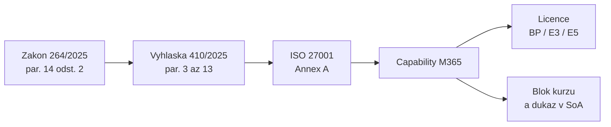

# Mapování požadavků na Microsoft 365 a licenční realita

> Typ: povinný · Den: 1 · Odhad: 75 min
> Tenant: A `cloudedu.cz` · Režim: hands-on, vlastní scope (admin centra jen čtení)
> Prostředí: [`../../environment.md`](../../environment.md) · Názvosloví: [`../../GLOSSARY.md`](../../GLOSSARY.md)

Most mezi právem a tenantem. Blok převádí 13 oblastí zákona na tři sloupce, které nese celý
týden: **ustanovení vyhlášky -> opatření ISO/IEC 27001 Annex A -> capability Microsoft 365** —
a ke každé capability licenční realitu. Výstupem je mapovací matice, která se v
[`../isms-design-m365/`](../isms-design-m365/) stane prvním důkazem v SoA.

## Cíle

- Sestavit řádek mapovací matice: oblast zákona -> § vyhlášky č. 410/2025 Sb. -> opatření Annex A
  -> capability Microsoft 365 -> blok kurzu.
- U každé capability určit, zda ji zvládne Business Premium, Microsoft 365 E3, nebo až E5 /
  add-on — podle service description, ne podle paměti.
- Rozpoznat oblasti, které Microsoft 365 nepokrývá, a říct to v SoA nahlas.
- Orientovat se ve čtyřech konzolích, kde se capability nastavují.

## Výklad

### Tvar mapovací matice

Jeden řádek matice = jedna věta „**požadavek X plníme opatřením Y pomocí Z, licence W, důkaz
uvidíš v bloku K**". Matice je návrh kurzu, ne oficiální mapování NÚKIB ani Microsoftu —
vyhláška na Annex A přímo neodkazuje.

### Matice — kostra

| Oblast (§ 14 odst. 2 zákona) | Vyhláška č. 410/2025 Sb. | Opatření Annex A | Capability Microsoft 365 | Blok kurzu |
|---|---|---|---|---|
| a) systém zajišťování min. KB — přehled opatření | § 3 odst. 2, příloha č. 1 | kap. 6.1.3, A.5.31 | seznam SoA na webu `isms-<ini>` | [`../isms-design-m365/`](../isms-design-m365/) |
| a) bezpečnostní politika a dokumentace | § 3 odst. 3 | A.5.1, A.5.37, kap. 7.5 | knihovna s verzováním a schvalováním, typy obsahu | [`../../day-2/document-libraries-governance/`](../../day-2/document-libraries-governance/), [`../../day-2/content-type-hub/`](../../day-2/content-type-hub/) |
| c) řízení aktiv; pravidla pro technická aktiva | zákon; § 3 odst. 4 | A.5.9, A.5.10 | Asset Register (SharePoint seznam) | [`../../day-2/lists-registers-workflow/`](../../day-2/lists-registers-workflow/) |
| c) označování a manipulace s informacemi | § 3 odst. 4 | A.5.12, A.5.13, A.8.12 | sensitivity labels, DLP | [`../../day-3/sensitivity-labels/`](../../day-3/sensitivity-labels/), [`../../day-3/dlp/`](../../day-3/dlp/) |
| c) likvidace aktiv; uchování přehledů 4 roky | § 3 odst. 4; § 3 odst. 2 | A.5.33, A.8.10 | retenční politiky a štítky | [`../../day-3/retention-lifecycle/`](../../day-3/retention-lifecycle/) |
| d) řízení rizik | zákon; **vyhláškou neupraveno** | kap. 6.1.2, 8.2 | Risk Register (SharePoint seznam) | [`../../day-2/lists-registers-workflow/`](../../day-2/lists-registers-workflow/) |
| g) řízení přístupu | § 7 | A.5.15, A.5.18, A.8.2 | Conditional Access, PIM for Groups, oprávnění webu | [`../../day-4/conditional-access/`](../../day-4/conditional-access/), [`../../day-4/privileged-access-pim/`](../../day-4/privileged-access-pim/) |
| h) řízení identit a jejich oprávnění | § 8 | A.5.16, A.5.17, A.8.5 | Microsoft Entra ID, MFA, Conditional Access | [`../../day-4/conditional-access/`](../../day-4/conditional-access/) |
| i) detekce a zaznamenávání událostí | § 9 | A.8.15, A.8.16 | Purview Audit, Defender XDR (přehled) | [`../../day-4/audit-incident-response/`](../../day-4/audit-incident-response/) |
| j) řešení incidentů; významnost dopadu | § 10; § 14 | A.5.24, A.5.25, A.5.26, A.5.28 | Incident log, audit jako podklad hlášení | [`../../day-4/audit-incident-response/`](../../day-4/audit-incident-response/) |
| m) kryptografické algoritmy | § 13 | A.8.24 | šifrování ve sensitivity labels | [`../../day-3/sensitivity-labels/`](../../day-3/sensitivity-labels/) |
| AI v tenantu (dodavatel cloudové služby) | § 3 odst. 5, příloha č. 2 | A.5.23 | governance Copilota, DLP pro Copilot | [`../../day-5/copilot-governance-dspm/`](../../day-5/copilot-governance-dspm/) |

Mimo rozsah kurzu (v SoA se zapíše výslovně, s odůvodněním): § 4 vrcholné vedení (organizační;
důkaz je report z capstonu), § 5 lidské zdroje, § 6 kontinuita, § 11 komunikační sítě, § 12
aplikační bezpečnost, § 3 odst. 5 a 6 mimo cloudové služby.

> [!IMPORTANT] Nezaměňovat — retence není záloha
> Retenční politika v Purview drží obsah, aby nebyl smazán dřív, než má (A.5.33). Kontinuita
> činností a obnova po incidentu (§ 6, A.8.13) jsou jiná otázka, kterou kurz neřeší. Řádek
> § 6 v SoA nesmí odkazovat na retenci jako na zálohu.

> [!WARNING] Ověřit k datu běhu — stav k 2026-10.
> Čísla § vyhlášky jsou převzatá z důvodové zprávy NÚKIB a Manuálu v1.1 (znění na e-Sbírce se
> nepodařilo strojově načíst) — viz [`../nis2-iso27001-fundamentals/`](../nis2-iso27001-fundamentals/).
> Přiřazení opatření Annex A je návrh kurzu.

### Licenční realita — princip

Plná tabulka s odkazem u každého řádku: [`comparison-licence.md`](comparison-licence.md).
Tři věty, které si odnést:

1. **Business Premium a Microsoft 365 E3** zvládnou ruční štítky, DLP pro Exchange, SharePoint
   a OneDrive, retenční politiky a ruční retenční štítky, Audit (Standard) a Conditional Access.
2. **Až E5 nebo add-on**: automatické a výchozí štítky, DLP pro Teams a Endpoint, výchozí
   a automatické retenční štítky, records management, Audit (Premium), risk-based Conditional
   Access a PIM (Entra ID P2).
3. **Compliance Manager** má každý, ale šablony ISO/IEC 27001:2022 a NIS2 jsou prémiové; E5
   dostane tři prémiové šablony zdarma.

Pro Vltava Servis to znamená: na Tenant A (E5 a Entra ID P2) jde v kurzu všechno; ve vaší
organizaci s Business Premium bude v SoA u části řádků poznámka „vyžaduje add-on". Licenční nit
pokračuje v sekci Licence každého modulu a končí v capstonu.

### Čtyři konzole

| Konzole | Vrstva | V kurzu |
|---|---|---|
| Microsoft 365 admin center | licence, uživatelé, PAYG | dnes (licence), D5 (agenti, B) |
| SharePoint admin center | weby, Content Type Hub, SAM | dnes (založení webu), D2 |
| Microsoft Purview portál | štítky, DLP, DLM, Audit, Compliance Manager, DSPM | D3–D5 |
| Microsoft Entra admin center | identity, Conditional Access, PIM | D4 |

## Klíčové rozlišení

- **Požadavek vs. opatření vs. capability** — vyhláška říká *co*, Annex A *jakým typem opatření*,
  Microsoft 365 *čím v tenantu*. Capability bez opatření je konfigurace bez důvodu; opatření bez
  capability je papír.
- **Licence vs. role** — licence určuje, zda funkce v tenantu je; role, kdo ji smí nastavit.
- **„Ne" vs. „?"** v licenční tabulce — „ne" = zdroj plán pro funkci neuvádí; „?" = zdroj
  chybí. DSPM je dnes „?".
- **Microsoft 365 E3 vs. Office 365 E3** — Office 365 E3 nemá Entra ID P1, takže ani Conditional
  Access.

## Licence

| Funkce v bloku | Business Premium | Microsoft 365 E3 | E5 / add-on | Zdroj |
|---|---|---|---|---|
| Prohlížení licencí v Microsoft 365 admin center | ano | ano | ano | otázka role, ne licence; v kurzu Global Administrator |
| Funkce v mapovací matici | podle řádku | podle řádku | podle řádku | [`comparison-licence.md`](comparison-licence.md) |
| Šablony ISO/IEC 27001:2022 a NIS2 v Compliance Manageru | koupě | koupě | 3 prémiové zdarma | [Learn: regulations list](https://learn.microsoft.com/en-us/purview/compliance-manager-regulations-list) |

## Naše prostředí

- Tenant A má podle [`../../environment.md`](../../environment.md) licence E5 a Entra ID P2 —
  ověření je go/no-go položka. Co na Tenant A uvidíte, je strop, ne typická organizace.
- Mapovací matici si student vede v **sešitě Excel ve svém OneDrive na Tenant A**. Data
  scénáře zůstávají v tenantu; do webu `isms-<ini>` se sešit přesune v dalším bloku.
- Admin centra v tomto bloku jen čtete.

## Lab

Viz [`lab-mapovaci-matice.md`](lab-mapovaci-matice.md); referenční řešení
[`reseni-mapovaci-matice.md`](reseni-mapovaci-matice.md).

## Nosná linka

Přibyl **sešit `<ini>-mapovaci-matice`** (zatím v OneDrive). Do SoA se v tomto bloku nezapisuje —
seznam ještě neexistuje. V [`../isms-design-m365/`](../isms-design-m365/) se sešit přesune na web
a stane se důkazem řádku:

| Opatření | Capability M365 | Důkaz |
|---|---|---|
| A.5.31 | mapovací matice požadavků v knihovně webu `isms-<ini>` | odkaz na sešit `<ini>-mapovaci-matice` |

## Zdroje

- [Microsoft Purview service description](https://learn.microsoft.com/en-us/office365/servicedescriptions/microsoft-365-service-descriptions/microsoft-365-tenantlevel-services-licensing-guidance/microsoft-purview-service-description)
- [Microsoft Entra licensing](https://learn.microsoft.com/en-us/entra/fundamentals/licensing)
- [Microsoft 365 and Office 365 plan options](https://learn.microsoft.com/en-us/office365/servicedescriptions/office-365-platform-service-description/office-365-plan-options)
- [Microsoft Purview Compliance Manager regulations list](https://learn.microsoft.com/en-us/purview/compliance-manager-regulations-list)
- [Důvodová zpráva k vyhlášce č. 410/2025 Sb. — NÚKIB](https://portal.nukib.gov.cz/storage/uploads/2025/12/03/duvodova-zprava-vyhlaska-nizsi-rezim_uid_693039f42250d.pdf)
- [Manuál pro režim nižších povinností, v1.1 — NÚKIB](https://portal.nukib.gov.cz/storage/uploads/2026/06/02/manual-nizsi-rezim-v1-1_uid_6a1eaedd0ce9f.pdf)

## Stav produktu / delta

> [!WARNING] Ověřit k datu běhu — stav k 2026-10.
> Licenční tabulka (Purview SD ms.date 2026-08-03, Entra licensing ms.date 2026-06-18); názvy
> add-onů (Purview Suite, Defender Suite); licencování DSPM; zda Compliance Manager přidal
> šablonu pro zákon č. 264/2025 Sb.; licence na Tenant A (E5, Entra ID P2).
