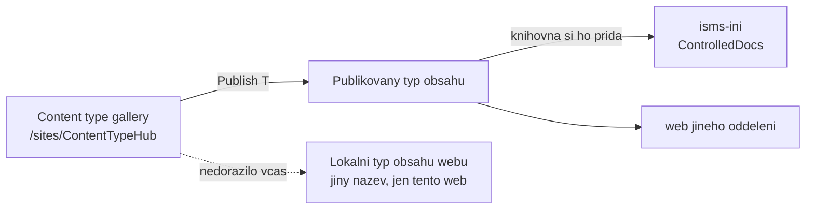
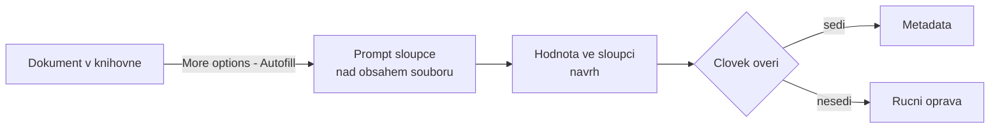

# Content Type Hub a standardizace politik, Autofill columns

> Typ: povinný · Den: 2 · Odhad: 80 min
> Tenant: A `cloudedu.cz` + B `spdemo.online` · Režim: hands-on, vlastní scope; publikace typu obsahu je **tenantový krok (T)** na A
> Prostředí: [`../../environment.md`](../../environment.md) · Názvosloví: [`../../GLOSSARY.md`](../../GLOSSARY.md)

Dopoledne vznikla knihovna, která řídí **verze a schválení**. Teď řešíme druhou půlku kap. 7.5:
každý dokument musí být **identifikovaný a popsaný** — kdo ho vlastní, odkdy platí, kdy se
reviduje, jak je klasifikovaný. Ručně to nikdo dlouho nevyplňuje. Proto dvě cesty: typy obsahu
s povinnými metadaty na Tenant A a **Autofill columns** na Tenant B, které metadata navrhnou
z textu dokumentu.

## Cíle

- Navrhnout typy obsahu `Politika`, `Směrnice` a `Záznam` s metadaty pro dohledatelnost
  a vysvětlit, proč se liší (záznam se nereviduje, ale uchovává).
- Vytvořit typy obsahu v **Content type gallery** (Content Type Hub) a publikovat je — jako
  vědomý tenantový krok s prefixem `<ini>-`.
- Připojit typy obsahu ke knihovně `Řízená dokumentace` — nebo, když publikace nedorazí,
  použít lokální typy obsahu webu a umět vysvětlit rozdíl.
- Nastavit Autofill columns na kopii dokumentace na Tenant B a doložit, kde se AI spletla.
- Spočítat, kolik Autofill na Tenant B stál, z ceníku a počtu stránek — ne odhadem.

## Výklad

### Typ obsahu je smlouva o metadatech

Typ obsahu spojuje sloupce, šablonu a chování: když knihovna nabízí typ `Politika`, formulář
se zeptá na vlastníka a datum revize a bez nich dokument neuloží
([Learn: add columns to a content type](https://learn.microsoft.com/en-us/sharepoint/add-columns-content-type)
— sloupec typu obsahu lze nastavit jako povinný). Pro ISMS tři typy:

| Typ obsahu | K čemu | Povinná metadata | Revize |
|---|---|---|---|
| **Politika** | co organizace chce a proč (A.5.1) | Vlastník dokumentu, Datum příští revize, Klasifikace | ano, v intervalu |
| **Směrnice** | jak se to dělá (A.5.37) | totéž + Nadřazená politika | ano, v intervalu |
| **Záznam** | důkaz, že se to stalo (zápis, protokol) | Vlastník dokumentu, Datum vzniku záznamu, Klasifikace | **ne** — záznam se nemění, uchovává se (D3) |

Verze a stav schválení **nejsou** vlastní sloupce — drží je knihovna (dopolední blok).

### Content Type Hub: jedna definice pro celý tenant

Typy obsahu vytvořené v SharePoint admin centru (**Content services** -> **Content type gallery**)
se ukládají do hubu `/sites/ContentTypeHub`. Aby je weby mohly použít, musí se **publikovat**;
změny se šíří **republikací**; zrušením publikace se kopie na webech převedou na lokální typy
obsahu ([Learn: create or customize a content type](https://learn.microsoft.com/en-us/sharepoint/create-customize-content-type),
[Learn: publish a content type](https://learn.microsoft.com/en-us/sharepoint/publish-content-type)).
Galerie vyžaduje roli správce SharePointu; pro Global Reader není dostupná.

> [!WARNING] Latence publikace — neověřeno na tenantu
> Stránka Learn o publikaci **neuvádí**, za jak dlouho je publikovaný typ obsahu na webech
> k dispozici. Údaj „až hodina" na Learn patří jiné funkci (přiřazení typu obsahu k hub webům,
> licencované zvlášť) a sem se nepřenáší. Kurz proto publikuje **na začátku** bloku, mezitím
> pracuje na Tenant B a k typům obsahu se vrací na konci. Naměřená čísla patří do
> [`mereni-publikace-typu-obsahu.md`](mereni-publikace-typu-obsahu.md).

**Hub vs. lokální typ obsahu.** Lokální typ obsahu webu je stejně dobrý pro jeden web —
ale každý web má svou kopii a změna se dělá N-krát. Hub dává jednu definici politiky pro
celou firmu. Pro kurz: lokální typ je **fallback**, když publikace nedorazí, a dostává jiný
název (`L-Politika` …), aby se při pozdějším příchodu hubové verze nepletly.

### Autofill columns: metadata z obsahu dokumentu

**Autofill columns** je nastavení sloupce knihovny: prompt v přirozeném jazyce, jehož odpověď
nad obsahem souboru se uloží do sloupce
([Learn: overview of autofill columns](https://learn.microsoft.com/en-us/microsoft-365/documentprocessing/autofill-overview)).
Fakta, na kterých stojí lab:

| Fakt | Důsledek pro ISMS | Zdroj |
|---|---|---|
| Podporované typy sloupců: Text, Multiple lines of text, Number, Yes/No, Date and time, Choice, Hyperlink, Currency, Managed metadata. **Person or Group a Lookup ne.** | „Vlastník dokumentu" na B je **text**, ne osoba. Na A je osoba — jiný sloupec, jiný účel. | [autofill overview](https://learn.microsoft.com/en-us/microsoft-365/documentprocessing/autofill-overview) |
| Nové soubory se zpracují samy; **existující** se zpracují až výběrem a **More options (...)** -> **Autofill**. | Vzorová dokumentace na B už v knihovně je — bez ručního spuštění se nevyplní nic. | [create an autofill column](https://learn.microsoft.com/en-us/microsoft-365/documentprocessing/autofill) |
| Změny dokumentu se promítnou jen po **ručním** znovuzpracování. | Autofill nehlídá, že se politika změnila. Revizi hlídá proces, ne AI. | [autofill overview](https://learn.microsoft.com/en-us/microsoft-365/documentprocessing/autofill-overview) |
| Doporučeno nejvýš 10 sloupců na knihovnu a soubory do 65 stránek; šifrované soubory se neanalyzují. | Dokument se štítkem s šifrováním (D3) Autofill nezpracuje. | [autofill overview](https://learn.microsoft.com/en-us/microsoft-365/documentprocessing/autofill-overview) |
| Jazyky: všechny jazyky podporované Microsoft Copilot. | Čeština je v seznamu jazyků Copilota (stav 2026-10). | [autofill overview](https://learn.microsoft.com/en-us/microsoft-365/documentprocessing/autofill-overview) |
| Výsledek může být chybný; Microsoft vyzývá výsledky kontrolovat. | Hodnota z Autofill je **návrh**, ne schválený údaj. | [autofill overview](https://learn.microsoft.com/en-us/microsoft-365/documentprocessing/autofill-overview) |

### Kolik to stojí

Autofill se účtuje přes **Document processing PAYG** za transakci: stránka u Word, PDF a TIFF,
list u Excelu, snímek u PowerPointu, soubor u ostatních typů; **cena je stejná pro jeden i víc
promptů na stránku** — $0.005 za transakci
([Learn: PAYG pricing](https://learn.microsoft.com/en-us/microsoft-365/documentprocessing/syntex-pay-as-you-go-services)).
Proto Microsoft radí dokončit nastavení **všech** autofill sloupců před zpracováním
([Learn: create an autofill column](https://learn.microsoft.com/en-us/microsoft-365/documentprocessing/autofill)).

Výpočet pro skupinu: 7 dokumentů × (počet stránek) × 15 studentů × $0.005 × (počet zpracování).
Každé znovuzpracování se platí znovu. Zda se účtuje i **Test the prompt**, dokumentace neříká —
otevřená otázka.

> [!WARNING] Ověřit k datu běhu — stav k 2026-10.
> Cena $0.005/transakce podle pricing stránky (aktualizováno 2026-10-12). Zkušební měsíční
> kapacita zdarma platila podle Learn „through June 2026" — k datu běhu ji nepočítat. S licencí
> Microsoft 365 Copilot je Autofill součástí Copilot in SharePoint bez PAYG; Tenant B jede PAYG
> cestou ([Learn: autofill setup](https://learn.microsoft.com/en-us/microsoft-365/documentprocessing/autofill-setup),
> [Learn: Copilot in SharePoint](https://learn.microsoft.com/en-us/sharepoint/copilot-in-sharepoint-get-started)).

## Klíčové rozlišení

- **Typ obsahu vs. sloupec knihovny** — typ obsahu se publikuje napříč weby a nese povinnost
  metadat; sloupec knihovny žije jen v jedné knihovně.
- **Hubový vs. lokální typ obsahu** — jedna definice pro tenant vs. kopie na jednom webu.
- **Povinné metadata vs. Autofill** — povinnost vynutí, že **někdo** hodnotu vyplní; Autofill
  navrhne, **jakou**. Ani jedno neručí za správnost — to je schválení (dopolední blok).
- **Document processing PAYG vs. Copilot PAYG** — Autofill se platí za stránky, ne za
  konverzace s Copilotem ([`../../GLOSSARY.md`](../../GLOSSARY.md)).

## Licence

| Funkce v bloku | Business Premium | E3 | E5 / add-on | Zdroj |
|---|---|---|---|---|
| Typy obsahu, Content type gallery, publikace | ano (odvozeno) | ano (odvozeno) | ano (odvozeno) | service description typy obsahu výslovně nejmenuje; uvádí knihovny a term store (managed metadata) pro všechny plány se SharePointem ([SharePoint service description](https://learn.microsoft.com/en-us/office365/servicedescriptions/sharepoint-online-service-description/sharepoint-online-service-description)) a stránka galerie licenční omezení neuvádí ([Learn](https://learn.microsoft.com/en-us/sharepoint/create-customize-content-type)) |
| Autofill columns | PAYG (Azure subscription) | PAYG | PAYG; s licencí Microsoft 365 Copilot součást Copilot in SharePoint | [autofill setup](https://learn.microsoft.com/en-us/microsoft-365/documentprocessing/autofill-setup), [PAYG pricing](https://learn.microsoft.com/en-us/microsoft-365/documentprocessing/syntex-pay-as-you-go-services) |

Zapnutí Autofill je tenantové: po připojení Azure subscription je zapnutý pro **všechny** weby;
správce ho může omezit na vybrané weby (nejvýš 100) nebo vypnout
([Learn: autofill setup](https://learn.microsoft.com/en-us/microsoft-365/documentprocessing/autofill-setup)).

## Naše prostředí

- **Tenant A:** studenti jsou Global Administrator, takže do Content type gallery smějí. Každý
  vytváří **jen** typy obsahu s prefixem `<ini>-` v kategorii `<ini>-ISMS`. Sdílené sloupce
  `VS ISMS` (níže) založil lektor předem — **nikdo je neupravuje**.
- **Tenant B:** student je vlastník webu `isms-<ini>` s knihovnou `Dokumentace` (7 vzorových
  dokumentů). Autofill sloupce si přidává sám; PAYG a rozsah webů nastavil lektor (go/no-go
  v [`../../environment.md`](../../environment.md)).
- Mezi tenanty se nic nekopíruje. Výsledek z B se do SoA dokládá odkazem a screenshotem.

### Sdílené sloupce v hubu (kategorie `VS ISMS`)

Zakládá lektor před během, s ASCII interními názvy:

| Display name | Internal name | Type |
|---|---|---|
| Vlastník dokumentu | DocOwner | person |
| Datum účinnosti | EffectiveDate | date |
| Datum příští revize | DocNextReview | date |
| Klasifikace | DocClassification | choice: Veřejné / Interní / Důvěrné / Přísně důvěrné |
| Nadřazená politika | ParentPolicy | text |
| Datum vzniku záznamu | RecordDate | date |

> [!WARNING] Ověřit k datu běhu — stav k 2026-10.
> Hodnoty sloupce Klasifikace musí odpovídat taxonomii štítků citlivosti z `sensitivity-labels`
> (D3). Při rozporu platí D3 a tento sloupec se upraví.

## Lab

Viz [`lab-typy-obsahu-autofill.md`](lab-typy-obsahu-autofill.md), referenční řešení
[`reseni-typy-obsahu-autofill.md`](reseni-typy-obsahu-autofill.md).

## Nosná linka

Na Tenant A přibudou typy obsahu `<ini>-Politika`, `<ini>-Směrnice` a `<ini>-Záznam`
(publikované z hubu, nebo lokální `L-*`) připojené ke knihovně `ControlledDocs`; `POL-01` je
typu Politika s vyplněným vlastníkem, datem revize a klasifikací a schválený záznam
`ZAZ-01 Zápis z přezkoumání vedením 2026` je typu Záznam (na něm stojí retence v D3). Na Tenant B má knihovna
`Dokumentace` tři Autofill sloupce s ověřenými hodnotami. Viz
[`../../scenario-isms-vltava.md`](../../scenario-isms-vltava.md).

| Opatření | Capability M365 | Důkaz |
|---|---|---|
| 7.5 (Tenant A) | typy obsahu Politika / Směrnice / Záznam s povinnými metadaty z Content Type Hubu | odkaz na typy obsahu knihovny `ControlledDocs` |
| 7.5 (Tenant B) | Autofill columns navrhují metadata z obsahu, člověk je ověřuje | odkaz na knihovnu `Dokumentace` na B + screenshot jako příloha položky SoA |

## Zdroje

- [Create or customize a content type](https://learn.microsoft.com/en-us/sharepoint/create-customize-content-type)
- [Add columns to a content type](https://learn.microsoft.com/en-us/sharepoint/add-columns-content-type)
- [Publish a content type](https://learn.microsoft.com/en-us/sharepoint/publish-content-type)
- [Overview of autofill columns](https://learn.microsoft.com/en-us/microsoft-365/documentprocessing/autofill-overview)
- [Create an autofill column](https://learn.microsoft.com/en-us/microsoft-365/documentprocessing/autofill)
- [Set up and manage autofill columns](https://learn.microsoft.com/en-us/microsoft-365/documentprocessing/autofill-setup)
- [Pay-as-you-go pricing for document processing](https://learn.microsoft.com/en-us/microsoft-365/documentprocessing/syntex-pay-as-you-go-services)
- [Get started with Copilot in SharePoint](https://learn.microsoft.com/en-us/sharepoint/copilot-in-sharepoint-get-started)

## Stav produktu / delta

> [!WARNING] Ověřit k datu běhu — stav k 2026-10.
>
> - Latence publikace typu obsahu z hubu na weby — Learn ji neuvádí, změřit na Tenant A.
> - Popisky v knihovně pro přidání hubového typu obsahu (**Allow management of content types**,
>   **Add from existing site content types**) — neověřeno na tenantu.
> - Cena Autofill a zda se účtuje **Test the prompt**; konec zkušební kapacity (červen 2026).
> - Copilot in SharePoint je od 2026-09-30 v GA rolloutu; Autofill v rámci Copilot licence
>   a v rámci PAYG se může dál rozcházet.

> [!IMPORTANT] Názvosloví
> Syntex / SharePoint Premium -> **Document processing for Microsoft 365**. Adresy na Learn
> přešly pod `/documentprocessing/`; stránka s cenami má v adrese dál `syntex`.
