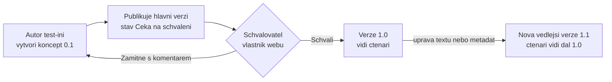

# Knihovny jako úložiště řízené dokumentace

> Typ: povinný · Den: 2 · Odhad: 100 min
> Tenant: A `cloudedu.cz` · Režim: hands-on, vlastní scope (`isms-<ini>`, `test-<ini>`, `isms-<ini>-users`)
> Prostředí: [`../../environment.md`](../../environment.md) · Názvosloví: [`../../GLOSSARY.md`](../../GLOSSARY.md)

Včera vznikla prázdná kostra ISMS a seznam SoA. Dnes do ní přijde první **řízený dokument**:
politika, která má verzi, autora, schvalovatele a čtenáře — a kterou nikdo neuvidí, dokud ji
někdo jiný než autor neschválí. Základy knihoven (vytvoření, sloupce, zobrazení, koš) jsou
předpoklad z GOC222; tady jde jen o to, čím se z knihovny stane úložiště, které unese audit.

## Cíle

- Převést požadavek ISO/IEC 27001 kap. 7.5 na konkrétní nastavení knihovny: verze, schválení,
  viditelnost konceptů, oprávnění.
- Nastavit knihovnu `Řízená dokumentace` s hlavními a vedlejšími verzemi a schvalováním obsahu.
- Rozhodnout, zda knihovna vyžaduje rezervaci (check-out), a rozhodnutí zdůvodnit.
- Projít celý cyklus koncept -> čeká na schválení -> schváleno se dvěma identitami (autor
  `test-<ini>`, schvalovatel ty) a doložit, že koncept nevidí, kdo ho vidět nemá.
- Vysvětlit, kde končí nastavení knihovny a začíná správa oversharingu napříč tenantem (SharePoint
  Advanced Management) — jako výhled, ne jako lab.

## Výklad

### Co po knihovně chce kap. 7.5

ISO/IEC 27001 kap. 7.5 žádá, aby dokumentované informace systému řízení byly **identifikované,
přezkoumané a schválené, dostupné tomu, kdo je potřebuje, chráněné a pod řízením změn**
(vlastní parafráze, text normy se necituje). Do SharePointu se to přeloží takto:

| Požadavek (parafráze 7.5) | Nastavení v knihovně | Kde v kurzu |
|---|---|---|
| Identifikace a popis (název, autor, datum, verze) | metadata a typy obsahu | [`../content-type-hub/`](../content-type-hub/) |
| Přezkoumání a schválení před vydáním | schvalování obsahu (content approval) | tento blok |
| Řízení změn, historie verzí | verzování: hlavní a vedlejší verze | tento blok |
| Dostupnost pro ty, kdo ji potřebují | oprávnění knihovny, viditelnost konceptů | tento blok |
| Ochrana (důvěrnost, integrita) | oprávnění; štítky citlivosti | tento blok; `sensitivity-labels` (D3) |
| Uchování a likvidace | retenční politiky a štítky | `retention-lifecycle` (D3) |

### Verzování: hlavní a vedlejší verze

Knihovna umí ukládat buď jen **hlavní verze** (1, 2, 3), nebo **hlavní a vedlejší** (0.1, 0.2,
1.0, 1.1). Pro řízenou dokumentaci je podstatný druhý režim: vedlejší verze je **koncept**,
hlavní verze je **vydaný dokument**. V kombinaci se schvalováním obsahu se z hlavní verze stává
vydání, které prošlo schválením.

Kolik verzí se drží, dnes neurčuje jen nastavení knihovny. SharePoint má **limity historie
verzí** na úrovni organizace, webu a knihovny ve dvou režimech: **automatický** (doporučený;
s věkem verzí řídne, které se drží) a **ruční** (počet hlavních verzí, volitelně s expirací)
([Learn: version history limits](https://learn.microsoft.com/en-us/sharepoint/document-library-version-history-limits),
[Learn: plan version storage](https://learn.microsoft.com/en-us/sharepoint/plan-version-storage)).

> [!IMPORTANT] Verze trimované limitem se neobnovují z koše
> Verze nad limitem knihovny se mažou trvale, mimo koš. U položek pod retenční politikou nebo
> eDiscovery hold se limity knihovny **ignorují**, dokud retence neskončí
> ([Learn: version history limits](https://learn.microsoft.com/en-us/sharepoint/document-library-version-history-limits)).
> Historie verzí tedy **není** nástroj uchování — to je retence v `retention-lifecycle` (D3).

### Schvalování obsahu a viditelnost konceptů

Schvalování obsahu (**Require content approval for submitted items**) se zapíná v nastavení
verzování knihovny. Dokument čekající na schválení má stav *Pending*; po schválení ho vidí
uživatelé s právem čtení. Schvalovat smí ten, kdo má oprávnění **Approve Items** — ve výchozích
úrovních ho mají *Full Control* a *Design*, ne *Edit* ani *Contribute*
([Learn: permission levels — SharePoint Server](https://learn.microsoft.com/en-us/sharepoint/sites/user-permissions-and-permission-levels);
tabulka je psaná pro SharePoint Server, v labu ji ověřuje negativní checkpoint).

V téže stránce je volba **kdo smí vidět koncepty** (*Set who can see draft items*). Pro řízenou
dokumentaci volíme nejužší variantu: koncept vidí jen autor a ti, kdo smějí schvalovat.

> [!WARNING] Zdroj mechaniky — ověřit na tenantu
> Detailní popis stavů (Draft / Pending / Approved) a toho, kdo který stav vidí, má Microsoft
> Learn jen v plánovací příručce pro **SharePoint Server**
> ([Learn: versioning, content approval, check-out planning](https://learn.microsoft.com/en-us/sharepoint/governance/versioning-content-approval-and-check-out-planning)),
> která výslovně uvádí, že se na SharePoint v Microsoft 365 **nevztahuje**. Princip je v SharePoint
> Online stejný, ale každé tvrzení o viditelnosti v labu je **checkpoint**, ne převzatý fakt.

### Tři mechanismy, které se pletou

| Mechanismus | Co řídí | Pro ISMS politiky |
|---|---|---|
| **Schvalování obsahu** (classic, v nastavení verzování) | stav verze: koncept / čeká / schváleno; viditelnost konceptů | **ano** — jádro tohoto bloku |
| **Approvals v seznamech a knihovnách** (moderní, *Configure approvals*) | žádost o schválení položky; odpověď v seznamu nebo v aplikaci Approvals v Teams | na registry — `lists-registers-workflow` |
| **Rezervace** (*Require documents to be checked out*) | výhradní úpravy, komentář při vrácení | **ne** — rozhodnutí níže |

Moderní Approvals podle nápovědy Microsoftu **nejsou integrované** s klasickým schvalováním
obsahu. Zda je jde na jedné knihovně zapnout současně, dokumentace neříká — otevřená otázka,
v kurzu je nekombinujeme.

**Rezervaci v kurzu nezapínáme.** Dokument rezervovaný jedním autorem nemůže nikdo jiný
upravovat a zapomenutá rezervace blokuje revizi; plánovací příručka navíc doporučuje
rezervaci nepoužívat spolu se spoluprací více autorů na dokumentu
([Learn: planning](https://learn.microsoft.com/en-us/sharepoint/governance/versioning-content-approval-and-check-out-planning)).
Řízení změn zajišťuje kombinace vedlejších verzí a schválení. Organizace s jediným autorem
politik může rozhodnout jinak — důležité je mít rozhodnutí zapsané.

### Oprávnění knihovny a oversharing

Knihovna řízené dokumentace má **vlastní oprávnění**, odlišná od zbytku webu:

| Kdo | Úroveň na knihovně | Proč |
|---|---|---|
| Vlastníci webu (ty) | Full Control | schvalují, spravují nastavení |
| `test-<ini>` | Contribute | autor: vytváří a upravuje koncepty, neschvaluje |
| `isms-<ini>-users` | Read | čtenáři: vidí jen schválené hlavní verze |
| Členové a návštěvníci webu | — | přerušené dědění; přístup se dává vědomě |

Oddělení autora a schvalovatele je samo o sobě opatření: kdo dokument napsal, ten ho nevydává.

**Oversharing** je opačný problém: obsah, ke kterému má přístup víc lidí, než má. Na úrovni
jedné knihovny ho řeší přerušené dědění a kontrola *Manage access*. Napříč tenantem na to
Microsoft nabízí **SharePoint Advanced Management (SAM)**: reporty data access governance,
kontrolu přístupu k webům vlastníky, omezení přístupu k webu skupinou (restricted access
control) a vyřazení webu z Copilota (restricted content discovery)
([Learn: SAM overview](https://learn.microsoft.com/en-us/sharepoint/advanced-management)).

> [!IMPORTANT] Nezaměňovat — oprávnění knihovny vs. SAM
> Oprávnění knihovny řídí **jednu knihovnu** a nastavuje je vlastník webu. SAM je **tenantová**
> vrstva správce SharePointu: najde, kde je oversharing, a vynutí pravidla napříč weby. Kurz SAM
> jen ukazuje jako výhled — viz Licence.

## Klíčové rozlišení

- **Verzování vs. retence** — verzování drží historii změn a limit ho prořezává; retence
  rozhoduje, jak dlouho se obsah **musí** držet, a limity verzí přebíjí.
- **Schvalování obsahu vs. oprávnění** — schválení řídí **stav verze** (koncept / vydáno),
  oprávnění řídí **kdo** smí číst, psát a schvalovat. Správná oprávnění bez schvalování
  vydávají koncepty; schvalování bez správných oprávnění dovolí autorovi schválit sám sebe.
- **Classic content approval vs. moderní Approvals** — první je nastavení verzování knihovny
  s vlivem na viditelnost konceptů; druhé je žádost o schválení položky s odpovědí v Teams.

## Licence

| Funkce v bloku | Business Premium | E3 | E5 / add-on | Zdroj |
|---|---|---|---|---|
| Knihovny, verzování, schvalování obsahu, oprávnění | ano | ano | ano | [SharePoint service description](https://learn.microsoft.com/en-us/office365/servicedescriptions/sharepoint-online-service-description/sharepoint-online-service-description) (document libraries ve všech plánech se SharePointem) |
| Limity historie verzí (automatický / ruční režim) | ano | ano | ano | [Learn: version history limits](https://learn.microsoft.com/en-us/sharepoint/document-library-version-history-limits) — licenci neomezuje |
| SharePoint Advanced Management | ? (Business Premium není v seznamu základních předplatných) | add-on SAM Plan 1, nebo aspoň jedna licence Microsoft 365 Copilot v organizaci | totéž; E7 obsahuje | [Learn: SAM prerequisites](https://learn.microsoft.com/en-us/sharepoint/sharepoint-advanced-management-prerequisites) |

> [!WARNING] Ověřit k datu běhu — stav k 2026-10.
> Prerekvizity SAM uvádějí jako základní předplatné Office 365 E3/E5/A5 a Microsoft 365
> E1/E3/E5/A5 — **Business Premium v seznamu není**. Pro organizaci na Business Premium je SAM
> otevřená otázka, ne „ano s add-onem".

## Naše prostředí

- Tenant A, web `isms-<ini>` založený v `isms-design-m365` (D1). Pracuješ jako vlastník webu.
- `test-<ini>` je autor dokumentu. Přihlašuješ se za něj v **okně InPrivate profilu Tenant A**,
  ne v profilu Tenant B. Heslo a MFA pro `test-<ini>` předává lektor (go/no-go).
- SAM na Tenant A **není** (bez licence Copilot i bez add-onu) — jen výhled.

## Lab

Viz [`lab-rizena-dokumentace.md`](lab-rizena-dokumentace.md), referenční řešení
[`reseni-rizena-dokumentace.md`](reseni-rizena-dokumentace.md).

## Nosná linka

Ve workspace `isms-<ini>` přibude knihovna **Řízená dokumentace** (`/ControlledDocs`)
s hlavními a vedlejšími verzemi, schvalováním obsahu a vlastními oprávněními a v ní první
schválená politika `POL-01 Politika bezpečnosti informací` ve verzi 1.0. Na tuto knihovnu
navážou typy obsahu ([`../content-type-hub/`](../content-type-hub/)), štítky, DLP a retence
(D3) i agent (D5). Viz [`../../scenario-isms-vltava.md`](../../scenario-isms-vltava.md).

| Opatření | Capability M365 | Důkaz |
|---|---|---|
| kap. 7.5 | knihovna s hlavními a vedlejšími verzemi, schvalováním obsahu a omezenou viditelností konceptů | odkaz na nastavení verzování knihovny `ControlledDocs` |
| A.5.1 | politika bezpečnosti informací vydaná schválením, čtenáři vidí jen schválenou verzi | odkaz na `POL-01` ve verzi 1.0 |
| A.5.37 | dokumentované postupy dostupné čtenářům (`isms-<ini>-users` Read), upravuje jen autor | odkaz na *Manage access* knihovny |

## Zdroje

- [Version history limits for document library and OneDrive overview](https://learn.microsoft.com/en-us/sharepoint/document-library-version-history-limits)
- [Plan version storage for document libraries](https://learn.microsoft.com/en-us/sharepoint/plan-version-storage)
- [Plan document versioning, content approval, and check-out controls (SharePoint Server)](https://learn.microsoft.com/en-us/sharepoint/governance/versioning-content-approval-and-check-out-planning) — jen princip, viz varování výše
- [User permissions and permission levels (SharePoint Server)](https://learn.microsoft.com/en-us/sharepoint/sites/user-permissions-and-permission-levels) — výchozí úrovně, ověřit na tenantu
- [SharePoint Advanced Management overview](https://learn.microsoft.com/en-us/sharepoint/advanced-management)
- [Prerequisites for SharePoint Advanced Management](https://learn.microsoft.com/en-us/sharepoint/sharepoint-advanced-management-prerequisites)
- [SharePoint service description](https://learn.microsoft.com/en-us/office365/servicedescriptions/sharepoint-online-service-description/sharepoint-online-service-description)

## Stav produktu / delta

> [!WARNING] Ověřit k datu běhu — stav k 2026-10.
>
> - Popisky v **Versioning settings** (schvalování, hlavní/vedlejší verze, viditelnost konceptů,
>   rezervace) a jejich vztah k novým limitům historie verzí — zda knihovna s automatickým
>   limitem stále nabízí vedlejší verze. Uživatelská nápověda je jen na support.microsoft.com.
> - Zda lze na jedné knihovně kombinovat classic content approval a moderní Approvals.
> - Licenční prerekvizity SAM (Business Premium; Copilot licence jako brána).
