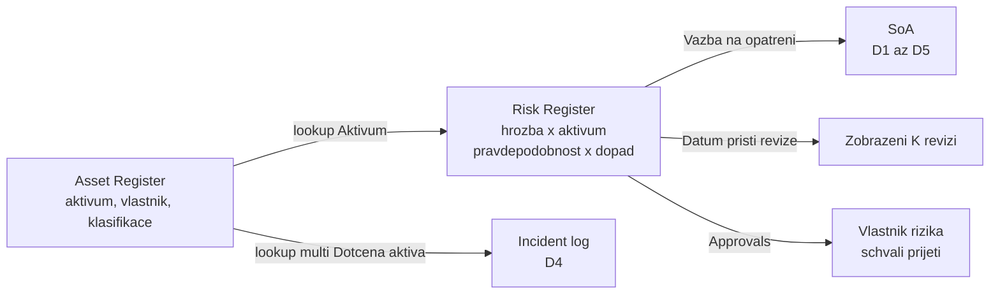

# Lists jako živé evidence a workflow, Skills

> Typ: povinný · Den: 2 · Odhad: 120 min
> Tenant: A `cloudedu.cz` + B `spdemo.online` · Režim: hands-on, vlastní scope (registry na A); Skills na B instruktorské demo
> Prostředí: [`../../environment.md`](../../environment.md) · Názvosloví: [`../../GLOSSARY.md`](../../GLOSSARY.md)

Dokumenty říkají, **jak** má ISMS fungovat. Evidence říkají, **co v něm je**: jaká aktiva
firma má, jaká rizika na nich visí, kdo za ně odpovídá a kdy se na ně má znovu podívat — a kam
se zapíše incident. Registry jsou seznamy, protože se mění po řádcích, filtrují se a hlídají
se termínem. Na tomhle bloku stojí den 4 (Incident log) i capstone (Risk Register).

## Cíle

- Založit **Asset Register**, **Risk Register** a **Incident log** jako seznamy s přesným
  schématem (ASCII interní názvy, typy sloupců, vazby mezi seznamy).
- Modelovat riziko jako **aktivum × hrozba**, ohodnotit ho **pravděpodobností × dopadem**
  a přiřadit mu vlastníka, způsob zvládání a datum revize.
- Postavit revizní mechanismus bez prémiových konektorů: zobrazení „K revizi" podle data
  a schválení přijetí rizika vlastníkem přes Approvals v seznamu.
- Vysvětlit, co je **Skill** v Copilot in SharePoint, jakou licenci potřebuje, a navrhnout
  Skill, který kontroluje náležitosti řízených dokumentů (předvádí lektor na Tenant B).
- Doložit negativním testem, že Copilot na Tenant B registry z Tenant A nevidí.

## Výklad

### Registry jako seznamy

| Seznam | Otázka, na kterou odpovídá | Opatření / kapitola |
|---|---|---|
| **Asset Register** | co chráníme, kdo to vlastní, jak je to citlivé a kritické | A.5.9 |
| **Risk Register** | co se může stát kterému aktivu, jak moc to vadí, co s tím děláme a kdy to znovu posoudíme | 6.1, 8.2 |
| **Incident log** | co se stalo, kdy to bylo zjištěné a vyhodnocené jako incident, do kdy se hlásí | A.5.24 (příprava), naplní D4 |
| **SoA** (D1) | která opatření platí a čím jsou doložená | 6.1 (prohlášení o aplikovatelnosti) |

Kap. 6.1 normy chce opakovatelný proces posouzení rizik s určeným vlastníkem rizika a plán
zvládání, který vlastník rizika schválí včetně přijetí zbytkového rizika; kap. 8.2 chce
posouzení rizik provádět v plánovaných intervalech a uchovat výsledky (vlastní parafráze).
A.5.9 chce inventář informací a dalších aktiv s vlastníky (parafráze).

### Riziko = aktivum × hrozba, míra = pravděpodobnost × dopad

Kurz používá jednoduchou metodu, kterou si organizace může nahradit vlastní: pravděpodobnost
a dopad na škále 1–5 a **míra rizika** jako jejich součin (1–25), počítaná sloupcem. Hranici
přijatelnosti (např. „nad 12 se riziko snižuje") stanoví vedení — v kurzu je to diskusní bod,
ne fakt.

> [!IMPORTANT] Interní názvy sloupců se píšou ASCII — a hned
> Seznamy vytvoříš klikáním, ale dál s nimi pracují skripty (dohnání skluzu, úklid) a den 4.
> Sloupec založený rovnou česky dostane interní název typu `Zji_x0161_t_x011b_no`. Postup
> v labu: **všechny sloupce nejdřív ASCII** (`DetectedAt`), počítané sloupce s ASCII odkazy,
> **teprve pak** přejmenovat na češtinu. Interní název se přejmenováním nemění.

### Revizní workflow bez prémiových konektorů

| Mechanismus | Co dělá | Licence | V labu |
|---|---|---|---|
| **Zobrazení s filtrem `[Today]`** | ukáže rizika, kterým prošlo datum revize | součást seznamů | **ano** |
| **Approvals v seznamech** (*Configure approvals*) | žádost o schválení položky; odpověď v seznamu nebo v aplikaci Approvals v Teams; stav ve sloupci *Approval status* | dokumentace licenci neuvádí — neověřeno | **ano** — přijetí rizika |
| **Power Automate**, plánovaný cloud flow | pravidelně najde rizika po termínu a pošle e-mail vlastníkovi | konektory SharePoint, Standard approvals, Office 365 Outlook a Microsoft Teams jsou **standardní** ([Learn: standard connectors](https://learn.microsoft.com/en-us/connectors/connector-reference/connector-reference-standard-connectors)); i licence Power Automate Free dovoluje cloud flow se standardními konektory, bez sdílení ([Learn: Power Automate licences](https://learn.microsoft.com/en-us/power-platform/admin/power-automate-licensing/types)) | volitelně: [`guide-revizni-flow.md`](guide-revizni-flow.md) |

**SharePoint alerts** jako připomínka revize nepřipadají v úvahu: podle service description
jsou od července 2026 zcela vyřazené a Microsoft doporučuje Power Automate
([SharePoint service description](https://learn.microsoft.com/en-us/office365/servicedescriptions/sharepoint-online-service-description/sharepoint-online-service-description)).

Approvals v seznamech mají pár pravidel, na která se v labu narazí (nápověda Microsoft
Support, stav 2026-10): schvalovatel bez přístupu k položce ho **nedostane automaticky**;
**úprava položky s běžící žádostí žádost zruší**; po zapnutí Approvals přestane pro seznam
fungovat synchronizace (Lists sync); sloupce ukazují jen poslední aktivitu, celá historie je
v aplikaci Approvals v Teams.

### Skills v Copilot in SharePoint

**Skill** je opakovatelný vícekrokový postup uložený jako Markdown soubor; Copilot in
SharePoint ho načte podle dotazu nebo na výslovnou výzvu „Run *název* on the selected
documents" ([Learn: Skills](https://learn.microsoft.com/en-us/sharepoint/copilot-in-sharepoint-skills)).

| | Osobní skill | Skill webu |
|---|---|---|
| Uložení | OneDrive uživatele | knihovna **Agent Assets** webu, `/Agent Assets/Skills/<název>/SKILL.md` |
| Kdo vytváří / spouští | vlastník | výchozí: **Edit** na webu vytváří, **View** spouští |
| Kde platí | na všech webech, kam má vlastník přístup | jen na svém webu |

Co Skill **neumí**: připojit externí systém, spustit vlastní kód, rozšířit oprávnění — dělá jen
to, co smí uživatel a co umí Copilot in SharePoint (porozumění obsahu, organizace souborů,
práce se seznamy). Samostatný admin vypínač Skills nemají; řídí se oprávněními na knihovně
Agent Assets, kterou nejde smazat. Vestavěné skills vypíše v chatu `/skills`
([Learn: Skills](https://learn.microsoft.com/en-us/sharepoint/copilot-in-sharepoint-skills)).

Pro ISMS je Skill **kontrolní postup**: „u vybraných dokumentů ověř, že uvádějí vlastníka,
účinnost, datum revize a klasifikaci, a nálezy zapiš do seznamu". Stejná kontrola pokaždé
stejně, bez psaní flow.

> [!WARNING] Ověřit k datu běhu — stav k 2026-10. Licence Copilot in SharePoint.
> Learn (aktualizováno 2026-09-25) uvádí jako prerekvizitu **licenci Microsoft 365 Copilot**;
> pokročilá práce („advanced work") čerpá Copilot Credits přes usage-based billing; GA se
> rozbíhá od **2026-09-30**; preview přepínače `KnowledgeAgentScope` v `Set-SPOTenant` se ctí
> do **2026-11-01**, pak dostupnost řídí **Site AI settings** a Restricted Content Discovery
> ([Learn: Copilot in SharePoint](https://learn.microsoft.com/en-us/sharepoint/copilot-in-sharepoint-get-started)).
> Tenant B má pro studenty Business Basic a Copilot PAYG **bez** licencí Copilot — Skills
> tam nespustí (potvrdil autor kurzu, 2026-10). Skill předvádí lektor účtem s licencí
> Microsoft 365 Copilot. **Autofill columns jdou přes PAYG, Skills ne** — licenční rozdíl,
> který si student odnáší.

## Klíčové rozlišení

- **Registr (seznam) vs. řízený dokument (knihovna)** — seznam se mění po řádcích a hlídá
  termíny; dokument se mění celý a prochází schválením verze.
- **Zobrazení „K revizi" vs. workflow** — zobrazení jen ukáže, co je po termínu; workflow
  (Approvals, flow) někoho vyzve k akci a nechá stopu.
- **Approvals v seznamech vs. schvalování obsahu v knihovně** — první je žádost o rozhodnutí
  o položce; druhé řídí, kterou verzi dokumentu kdo vidí.
- **Power Automate vs. Skill** — flow je pevný postup se spouštěčem (čas, změna položky);
  Skill je postup, který spustí člověk v chatu nad obsahem, který vidí. Skill nemá plánovač
  ani externí systémy.
- **Copilot na B vs. data na A** — Copilot vidí jen tenant, ve kterém běží; registry z A pro
  něj neexistují. Datová hranice tenantu, ne nastavení.

## Licence

| Funkce v bloku | Business Premium | E3 | E5 / add-on | Zdroj |
|---|---|---|---|---|
| Seznamy, lookup a počítané sloupce, zobrazení | ano | ano | ano | [SharePoint service description](https://learn.microsoft.com/en-us/office365/servicedescriptions/sharepoint-online-service-description/sharepoint-online-service-description) (Lists ve všech plánech se SharePointem) |
| Approvals v seznamech | ? | ? | ? | licenci dokumentace neuvádí — otevřená otázka |
| Power Automate se standardními konektory | ano (i licence Free, bez sdílení flow) | ano | ano | [Power Automate licences](https://learn.microsoft.com/en-us/power-platform/admin/power-automate-licensing/types) |
| Copilot in SharePoint, Skills | licence Microsoft 365 Copilot; advanced work + Copilot Credits | totéž | totéž | [Copilot in SharePoint](https://learn.microsoft.com/en-us/sharepoint/copilot-in-sharepoint-get-started) |

`?` = otevřená otázka, ne „ne".

## Naše prostředí

- **Tenant A:** tři seznamy ve webu `isms-<ini>` s ASCII adresami `AssetRegister`,
  `RiskRegister`, `IncidentLog`. Approvals zapínáš jen na vlastním `RiskRegister`.
- **Tenant B:** lektor předvádí Skill webu na `isms-lektor` nad knihovnou `Dokumentace` se
  stejnou vzorovou dokumentací, jakou máš na svém webu.
- **Data se mezi tenanty nestěhují.** Skill na B nedostane obsah registrů z A a nemá ho dostat.

## Lab

- [`lab-registry-revize.md`](lab-registry-revize.md) — tři registry a revizní mechanismus
  (Tenant A, ~65 min). Referenční řešení a schémata:
  [`reseni-registry-revize.md`](reseni-registry-revize.md).
- [`demo-skill-kontrola-dokumentace.md`](demo-skill-kontrola-dokumentace.md) — Skill nad
  kopií dokumentace (demo lektora na Tenant B, ~15 min; studenti zapisují do SoA na A).
- Volitelně [`guide-revizni-flow.md`](guide-revizni-flow.md) — plánovaný flow se standardními
  konektory.

## Nosná linka

Ve workspace `isms-<ini>` na A přibudou **Asset Register** (5 aktiv), **Risk Register**
(3 rizika, jedno se schváleným přijetím, jedno po termínu revize) a prázdný **Incident log**
s jedním cvičným záznamem — přesně v schématu, které den 4 plní a capstone čte. Z dema na B
si student odnese zadání skillu jako návrh kontrolního postupu. Viz
[`../../scenario-isms-vltava.md`](../../scenario-isms-vltava.md).

| Opatření | Capability M365 | Důkaz |
|---|---|---|
| A.5.9 | Asset Register: aktiva s vlastníkem, klasifikací, kritičností a datem revize | odkaz na `AssetRegister` |
| kap. 6.1 | Risk Register: aktivum × hrozba, pravděpodobnost × dopad, vlastník, způsob a plán zvládání; přijetí schválené přes Approvals | odkaz na `RiskRegister` |
| kap. 8.2 | zobrazení „K revizi" podle data příští revize | odkaz na zobrazení `K revizi` |
| A.5.24 | Incident log s lhůtou prvotního hlášení počítanou od zjištění | odkaz na `IncidentLog` |
| kap. 7.5 (Tenant B) | Skill webu kontroluje náležitosti řízených dokumentů (vyžaduje licenci Copilot) | odkaz na lektorův `SKILL.md` v Agent Assets na B + zadání skillu |

## Zdroje

- [Extend Copilot in SharePoint with skills](https://learn.microsoft.com/en-us/sharepoint/copilot-in-sharepoint-skills)
- [Get started with Copilot in SharePoint](https://learn.microsoft.com/en-us/sharepoint/copilot-in-sharepoint-get-started)
- [Types of Power Automate licenses](https://learn.microsoft.com/en-us/power-platform/admin/power-automate-licensing/types)
- [List of all Standard tier connectors](https://learn.microsoft.com/en-us/connectors/connector-reference/connector-reference-standard-connectors)
- [SharePoint service description](https://learn.microsoft.com/en-us/office365/servicedescriptions/sharepoint-online-service-description/sharepoint-online-service-description)

## Stav produktu / delta

> [!WARNING] Ověřit k datu běhu — stav k 2026-10.
>
> - Copilot in SharePoint: GA rollout od 2026-09-30, licence Microsoft 365 Copilot jako
>   prerekvizita, Copilot Credits pro advanced work, konec `KnowledgeAgentScope` 2026-11-01.
>   Lektorský účet na B musí mít licenci Microsoft 365 Copilot.
> - Approvals v seznamech: umístění v menu (**Integrate** vs. **Automate** — nápověda uvádí
>   obojí), licence, chování na Developer tenantu. Uživatelská nápověda je jen na
>   support.microsoft.com.
> - Formát `SKILL.md` a chování skill indicator card jsou nové; struktura se může měnit.

> [!IMPORTANT] Názvosloví
> Knowledge Agent (preview) -> **Copilot in SharePoint**. Parametry PowerShellu si nechávají
> název `KnowledgeAgent*`.
