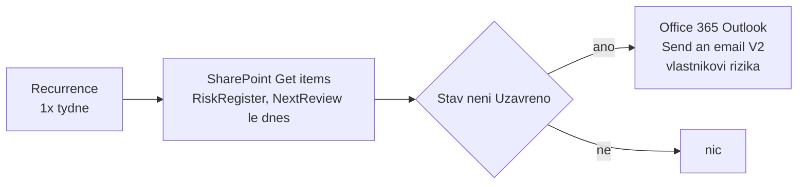

# Návod · Plánovaný revizní flow se standardními konektory (volitelné)

> Modul: `lists-registers-workflow` · Odhad: 20 min · Režim: volitelné, vlastní scope · Tenant: A `cloudedu.cz`
> Stav: **neověřeno na tenantu** (2026-10-17) — názvy akcí a chování filtru ověřit při zkušebním průchodu.

Zobrazení `K revizi` ukáže rizika po termínu jen tomu, kdo se podívá. Tento flow jednou týdně
najde rizika, kterým prošlo datum příští revize, a pošle vlastníkovi rizika e-mail. Používá jen
**standardní** konektory — SharePoint a Office 365 Outlook jsou v seznamu standardních
konektorů ([Learn](https://learn.microsoft.com/en-us/connectors/connector-reference/connector-reference-standard-connectors))
a cloud flow se standardními konektory spustí i licence Power Automate Free, bez sdílení flow
([Learn](https://learn.microsoft.com/en-us/power-platform/admin/power-automate-licensing/types)).



## Postup

### 1. Vytvoř plánovaný flow

Power Automate (profil Tenant A) -> **Create** -> **Scheduled cloud flow**. Název
`<ini>-revize-rizik`, opakování každý 1 týden.

**Checkpoint:** flow `<ini>-revize-rizik` existuje v **My flows** a má spouštěč Recurrence.

### 2. Načti rizika po termínu

Akce **SharePoint** -> **Get items**: Site Address = `isms-<ini>` na Tenant A, List Name =
`Risk Register`. Do **Filter Query** zadej:

```text
NextReview le '@{formatDateTime(utcNow(),'yyyy-MM-dd')}'
```

Filtr pracuje s **interním** názvem sloupce — proto ASCII názvy z labu.

**Checkpoint:** akce Get items ukazuje tvůj web a seznam `Risk Register` (ne cizí web).

### 3. Pošli e-mail vlastníkovi rizika

Přidej **Condition**: dynamická hodnota *Stav Value* se nerovná `Uzavřeno`. Do větve *True*
přidej **Office 365 Outlook** -> **Send an email (V2)**: To = *Vlastník rizika Email*,
Subject = `Revize rizika: ` + *Název rizika*, Body = Míra rizika a Datum příští revize.
Návrhář zabalí akci do **Apply to each** sám.

**Checkpoint:** flow se uloží bez chyby kontroly.

### 4. Otestuj

**Test** -> **Manually** -> **Run flow**.

**Checkpoint:** běh skončil *Succeeded* a do tvé schránky přišel e-mail o riziku „Ztráta
notebooku technika" — a o žádném jiném.

**Checkpoint (negativní):** flow čte jen tvůj `isms-<ini>`; v **My flows** nemáš žádný flow
jiného studenta a nikomu jsi flow nesdílel.

## Do SoA

Pokud flow běží, doplň v řádku **8.2** do Capability „+ týdenní připomínka vlastníkovi
(Power Automate, standardní konektory)" — nový řádek nezakládej.

## Fallback

- **Filtr vrací všechna rizika nebo žádné:** odstraň Filter Query a podmínku na datum dej do
  Condition (porovnání *Datum příští revize* s `utcNow()`).
- **Flow nejde vytvořit** (licence, prostředí): zůstává zobrazení `K revizi`; do Zdůvodnění
  řádku 8.2 napiš, že připomínka je ruční.
