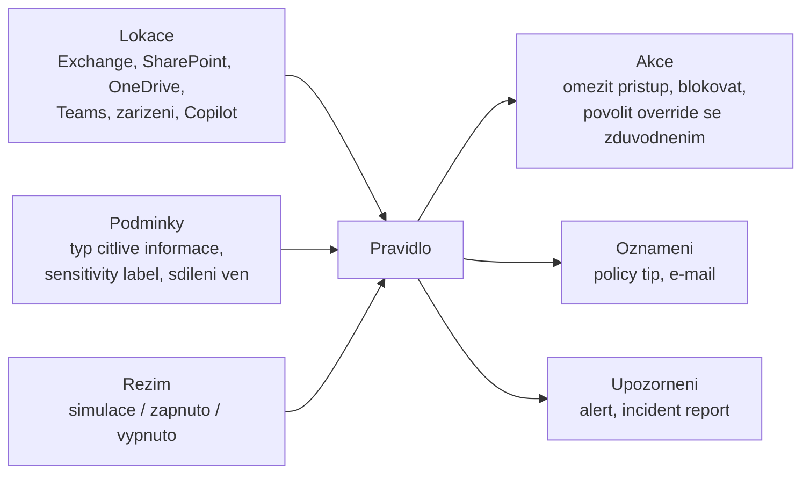

# Data Loss Prevention napříč Microsoft 365

> Typ: povinný · Den: 3 · Odhad: 90 min
> Tenant: A `cloudedu.cz` · Režim: hands-on, vlastní scope (DLP politika jen v simulaci, jen na vlastní web)
> Prostředí: [`../../environment.md`](../../environment.md) · Názvosloví: [`../../GLOSSARY.md`](../../GLOSSARY.md)

Druhý pilíř a druhá otázka dne: **co nesmí odejít.** Štítek z předchozího bloku říká, jak je
dokument citlivý. Sám nic neblokuje — pokud nešifruje, dokument se dá sdílet, stáhnout,
přeposlat. DLP politika sleduje, co se s citlivým obsahem děje, a v ostrém režimu to umí
zastavit. V kurzu běží jen v **simulaci**.

## Cíle

- Popsat, co DLP politika je: lokace, podmínky, akce, oznámení uživateli, upozornění.
- Vytvořit DLP politiku v simulaci scopovanou jen na `isms-<ini>` s podmínkou na sensitivity
  label a na typ citlivé informace *Czech personal identity number*.
- Najít výsledek simulace, upozornění a událost v Activity exploreru — a vědět, proč tam ještě
  nemusí být.
- Rozhodnout, kdy a podle čeho politiku přepnout do vynucení.
- Zapsat do SoA řádek A.8.12.

## Výklad

### Z čeho se DLP politika skládá

- **Lokace** — Exchange, SharePoint sites (zahrnutí po webech), OneDrive (po účtech nebo
  skupinách), Teams chat a kanály, zařízení s Windows 10/11 a macOS (Endpoint DLP), Defender for
  Cloud Apps, on-prem úložiště, Fabric a Power BI, Microsoft 365 Copilot (preview)
  ([Learn: DLP](https://learn.microsoft.com/en-us/purview/dlp-learn-about-dlp)).
- **Podmínky** — typy citlivých informací (SIT), sensitivity labels, retenční štítky, sdílení
  uvnitř nebo ven.
- **Akce** — podle lokace: zablokovat přístup lidem mimo organizaci, ukázat policy tip, blokovat
  s možností přepsání a zdůvodnění, u Teams skrýt zprávu.
- **Vše, co DLP sleduje, se zapisuje do auditu** a odtud do Activity exploreru.

### Typ citlivé informace pro Česko

Purview má vestavěný SIT **Czech personal identity number** (rodné číslo): devět číslic (starý
formát) nebo deset číslic s kontrolní číslicí (nový formát), volitelně s lomítkem. Vysoká
spolehlivost vyžaduje vzor + kontrolní součet + klíčové slovo do 300 znaků (mezi nimi
„rodné číslo", „rč", „osobní číslo"); střední spolehlivost stačí vzor nového formátu s kontrolním
součtem ([Learn: Czech personal identity number](https://learn.microsoft.com/en-us/purview/sit-defn-czech-personal-identity-number)).

> [!IMPORTANT] Reálná data do labů nepatří
> Platné rodné číslo může patřit skutečnému člověku. Testovací hodnotu vybírá lektor, ověřuje
> ji testem SIT v Purview a píše ji na tabuli. Hlavní podmínka labu je proto **štítek** —
> deterministická shoda; SIT je druhá podmínka.

### Simulace: jak se politika zkouší

Režim **Run the policy in simulation mode** vyhodnocuje, jako by politika platila, ale nic
nevynucuje ([Learn: simulation mode](https://learn.microsoft.com/en-us/purview/dlp-simulation-mode-learn)):

- Simulace běží až **15 dní**; data drží **30 dní**.
- Pro SharePoint a OneDrive se vyhodnocuje **existující i nový / změněný obsah**; pro Exchange,
  Teams a zařízení jen nové položky.
- Výsledky jsou ve vlastním přehledu: **Simulation overview**, **Items for review** (prvních 100
  položek ze SharePointu a OneDrivu) a **Alerts**.
- **Upozornění ze simulace nejsou v DLP alerts konzoli ani v Defender portálu** — jen na kartě
  simulace.
- Volba **Show policy tips while in simulation mode** ukáže uživatelům tipy bez vynucení.
- Volba **Turn the policy on if it's not edited within fifteen days** politiku sama zapne —
  na kurzovním tenantu **nikdy**
  ([Learn](https://learn.microsoft.com/en-us/purview/dlp-simulation-mode-get-started)).
- Activity explorer umí filtrovat **Policy mode** (`TestWithNotifyUser`, `TestWithoutNotifyUser`,
  `enforce`).

> [!WARNING] Ověřit k datu běhu — kdy se co ukáže.
> Learn: politika obecně platí asi hodinu po zapnutí
> ([Learn: DLP](https://learn.microsoft.com/en-us/purview/dlp-learn-about-dlp)); generování
> upozornění po vytvoření nebo změně politiky „may take up to 3 hours"
> ([Learn: DLP alerts](https://learn.microsoft.com/en-us/purview/dlp-alerts-get-started)).
> V 55 minutách labu tedy výsledek přijít nemusí — proto lektorská demo politika vytvořená
> předem (kompresní ventil 2).

### Upozornění, Activity explorer, vyšetření

- **Upozornění (alerts)** se nastavují v pravidle (incident reports). Jednotlivé upozornění na
  každou shodu má každé předplatné s DLP; **agregovaná** upozornění podle prahu vyžadují E5 nebo
  vybrané add-ony. Ve výchozím stavu se shody jednoho pravidla slučují v okně 1 min (E5) nebo
  15 min (E3) ([Learn: DLP alerts](https://learn.microsoft.com/en-us/purview/dlp-alerts-get-started)).
- Ostrá upozornění jsou v DLP alerts dashboardu 30 dní a v Defender portálu šest měsíců;
  doporučené místo vyšetřování je Defender portál
  ([Learn: DLP](https://learn.microsoft.com/en-us/purview/dlp-learn-about-dlp)).
- **Activity explorer** ukazuje posledních 30 dní: *DLP rule matched*, *DLP rule undo*
  (shoda zanikla po úpravě obsahu nebo pravidla), u zařízení i kontext kolem shody.

### Od simulace k vynucení

Rozhodnutí o přepnutí je řízení rizika, ne technika. Typické kritérium: politika běží v simulaci,
výsledky prochází vlastník procesu, falešné shody se ladí (podmínky, počty výskytů, výjimky),
uživatelé dostávají policy tips — a teprve pak blokace, nejdřív s možností přepsání se
zdůvodněním. Learn tento postup popisuje jako DLP lifecycle (plan → prepare → deploy v simulaci
→ ladit → zapnout).

### Endpoint DLP — jen zmínka

Endpoint DLP rozšiřuje politiky na soubory v zařízeních (kopie na USB, tisk, nahrání do
cloudových aplikací). Vyžaduje onboarding zařízení a licenci E5 / E5 IPG
([service description](https://learn.microsoft.com/en-us/office365/servicedescriptions/microsoft-365-service-descriptions/microsoft-365-tenantlevel-services-licensing-guidance/microsoft-purview-service-description)).
Učební stroje pod správou tenantu nejsou — samostudium, viz
[`../../self-study.md`](../../self-study.md).

### Mapování na požadavky

| Opatření ISO/IEC 27001:2022 | Vlastní parafráze | Capability |
|---|---|---|
| A.8.12 | na systémy a zařízení s citlivými informacemi se uplatňují opatření proti jejich úniku | DLP politika nad SharePointem (v kurzu v simulaci) |

## Klíčové rozlišení

- **DLP vs. sensitivity label** — štítek říká, *co to je* (a případně šifruje); DLP říká, *co se
  s tím nesmí stát*, a štítek používá jako podmínku.
- **DLP vs. Data Lifecycle Management** — DLP hlídá odchod obsahu; DLM hlídá, jak dlouho obsah
  musí nebo smí existovat. Obojí se lidově řekne „ochrana dat".
- **Simulace vs. Test (dřívější režim)** — simulace nahradila režimy *Test* a *Test with policy
  tips* a má oddělený přehled výsledků.
- **Upozornění ze simulace vs. ostrá upozornění** — první jen na kartě simulace, druhá v DLP
  alerts a Defender portálu.

## Licence

| Funkce v bloku | Business Premium | E3 | E5 / add-on | Zdroj |
|---|---|---|---|---|
| DLP pro Exchange, SharePoint, OneDrive | ano | ano | ano | [Purview service description](https://learn.microsoft.com/en-us/office365/servicedescriptions/microsoft-365-service-descriptions/microsoft-365-tenantlevel-services-licensing-guidance/microsoft-purview-service-description) |
| DLP pro Teams chat a kanály | ne | ne | E5 / E5 IPG | tamtéž |
| Endpoint DLP | ne | ne | E5 / E5 IPG | tamtéž |
| Upozornění na jednotlivou shodu | ? | ano | ano | [DLP alerts](https://learn.microsoft.com/en-us/purview/dlp-alerts-get-started) (Business Premium výčet neuvádí) |
| Agregovaná upozornění podle prahu | ? | add-on | ano | tamtéž |
| Activity explorer (prohlížení) | ne | ne | E5 | service description |

## Naše prostředí

- Politika `<ini>-DLP-ISMS-osobni-udaje` jen v **simulaci**, jen lokace **SharePoint sites**,
  jen web `isms-<ini>` — Exchange, OneDrive, Teams a zařízení vypnuté.
- Lektorská politika `LEKTOR-DLP-demo` běží v simulaci od T−2 dnů; na ní se ukazuje vyšetření,
  když studentská politika ještě nemá výsledky.
- Pro zobrazení výsledků simulace je potřeba role Information Protection Admin; Global
  Administrator by měl stačit — **neověřeno na tenantu**.

## Lab

Viz [`lab-dlp-simulace.md`](lab-dlp-simulace.md). Referenční nastavení a řádek SoA:
[`reseni-dlp-simulace.md`](reseni-dlp-simulace.md).

## Nosná linka

Web `isms-<ini>` je pod DLP politikou v simulaci: dokumenty se studentovým štítkem nebo
s rodným číslem by v ostrém režimu nešly zpřístupnit lidem mimo organizaci. V pátek se k téže
politice přidá lokace Microsoft 365 Copilot v [`../../day-5/copilot-governance-dspm/`](../../day-5/copilot-governance-dspm/).
Viz [`../../scenario-isms-vltava.md`](../../scenario-isms-vltava.md).

| Opatření | Capability M365 | Důkaz |
|---|---|---|
| A.8.12 | DLP politika `<ini>-DLP-ISMS-osobni-udaje` v simulaci nad `isms-<ini>` | snímek nastavení politiky (lokace, pravidlo, režim) + snímek Simulation overview |

## Zdroje

- [Learn about data loss prevention](https://learn.microsoft.com/en-us/purview/dlp-learn-about-dlp)
- [Learn about DLP simulation mode](https://learn.microsoft.com/en-us/purview/dlp-simulation-mode-learn)
- [Get started with DLP simulation mode](https://learn.microsoft.com/en-us/purview/dlp-simulation-mode-get-started)
- [Get started with DLP alerts](https://learn.microsoft.com/en-us/purview/dlp-alerts-get-started)
- [Czech personal identity number entity definition](https://learn.microsoft.com/en-us/purview/sit-defn-czech-personal-identity-number)
- [Microsoft Purview service description](https://learn.microsoft.com/en-us/office365/servicedescriptions/microsoft-365-service-descriptions/microsoft-365-tenantlevel-services-licensing-guidance/microsoft-purview-service-description)

## Stav produktu / delta

> [!WARNING] Ověřit k datu běhu — stav k 2026-10.
> Průvodce tvorbou DLP politiky (kategorie *Enterprise applications & devices*, názvy voleb
> simulace); lokace Microsoft 365 Copilot (preview); licence upozornění pro Business Premium;
> latence výsledků simulace a upozornění na kurzovním tenantu (zapsat s datem); výsledek testu
> SIT pro testovací rodné číslo.
