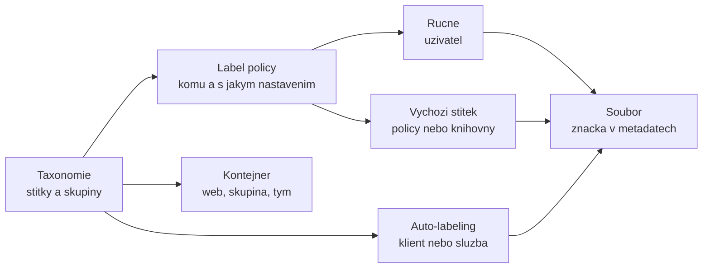

# Klasifikace a sensitivity labels v Purview

> Typ: povinný · Den: 3 · Odhad: 110 min
> Tenant: A `cloudedu.cz` · Režim: hands-on, vlastní scope (štítek a label policy jsou tenantové objekty — výslovně označené kroky)
> Prostředí: [`../../environment.md`](../../environment.md) · Názvosloví: [`../../GLOSSARY.md`](../../GLOSSARY.md)

První pilíř Purview a první otázka dne: **jak je to klasifikované.** Knihovna „Řízená
dokumentace" z úterý má verzování, schvalování a typy obsahu — ale nic v ní neříká, jak citlivý
dokument je, a nic tu informaci neponese, až dokument z knihovny odejde. To dělá sensitivity
label.

## Cíle

- Navrhnout taxonomii štítků pro ISMS dokumentaci (úrovně, skupiny, co která úroveň vynucuje).
- Vytvořit vlastní štítek a label policy scopovanou jen na vlastní skupinu — a ověřit, že
  nezasáhla nikoho dalšího.
- Nastavit výchozí sensitivity label knihovny a kontejnerový štítek webu.
- Rozlišit ruční, výchozí a automatické označování a říct, co z toho zvládne vaše licence.
- Zapsat do SoA řádky A.5.12 a A.5.13 s odkazem na důkaz.

## Výklad

### Co štítek je a co umí

Sensitivity label je značka uložená **v metadatech souboru jako čitelný text**; zůstává se
souborem, ať se uloží kamkoli. Položka má vždy nejvýš jeden sensitivity label (vedle něj může mít
i retenční štítek — ten je až v `retention-lifecycle`). Štítek může
([Learn: sensitivity labels](https://learn.microsoft.com/en-us/purview/sensitivity-labels)):

- **šifrovat** a omezit, kdo smí obsah otevřít a co s ním smí dělat,
- **označit obsah** — záhlaví, zápatí, vodoznak,
- **chránit kontejner** — web, skupinu, tým (soukromí, externí sdílení, přístup z nespravovaných
  zařízení),
- být **aplikován automaticky** nebo doporučen,
- nebo **jen klasifikovat** bez jakékoli ochrany — i to má hodnotu: reporty, podmínky DLP.

### Taxonomie: málo úrovní, jasné pořadí

Pořadí štítků v seznamu je **priorita**: nejméně citlivý nahoře, nejcitlivější dole. Priorita
rozhoduje, co je „snížení" (a vyžaduje zdůvodnění), co přebije výchozí štítek knihovny a kdy
SharePoint upozorní na dokument citlivější než web. Learn uvádí praktickou hranici: účinnost
klesá nad pět hlavních štítků nebo pět podštítků na jeden hlavní
([Learn](https://learn.microsoft.com/en-us/purview/sensitivity-labels)).

> [!IMPORTANT] Názvosloví
> **Parent label a sublabels -> label groups (modern label scheme).** Nadřazené štítky nahrazují
> skupiny štítků, které mají jen název, popis, barvu a prioritu. Tenanty založené od 2025-10-01
> mají moderní schéma automaticky; starší tenanty migrují ručně a **nevratně**
> ([Learn](https://learn.microsoft.com/en-us/purview/migrate-sensitivity-label-scheme)). Uživatel
> vidí v obou případech „Důvěrné \ Vltava".

Kurzovní taxonomie na Tenant A (připravil lektor, zdůvodnění v
[`reseni-stitky-isms.md`](reseni-stitky-isms.md)):

| Priorita | Štítek | Co vynucuje |
|---|---|---|
| 1 | Veřejné | nic — jen klasifikace |
| 2 | Interní | zápatí; jako kontejner: externí sdílení jen se stávajícími hosty |
| 3 | Důvěrné \ Vltava (+ studentské `Důvěrné \ <ini>-ISMS důvěrné`) | záhlaví; jako kontejner: sdílení jen v organizaci |
| 4 | Přísně důvěrné | šifrování pro uživatele organizace, vodoznak |

### Label policy: komu a s jakým nastavením

Štítky se nepublikují do míst, ale **uživatelům a skupinám** — na rozdíl od retenčních štítků.
Policy navíc nese nastavení ([Learn](https://learn.microsoft.com/en-us/purview/sensitivity-labels)):

- **výchozí štítek** pro nové dokumenty, e-maily, kontejnery,
- **zdůvodnění** při odstranění štítku nebo jeho nahrazení štítkem s nižší prioritou — neplatí
  mezi štítky v téže skupině a neplatí pro kontejnery; administrátor zdůvodnění vidí
  v Activity exploreru,
- **povinné označování** (mandatory labeling),
- odkaz na vlastní nápovědu.

Uživatel může být ve více policies; při konfliktu nastavení vyhrává policy **s nejvyšším
pořadovým číslem** (nejníž v seznamu). Proto je chybně scopovaná studentská policy nebezpečná:
je novější, má vyšší číslo a její nastavení přebije kurzovní policy každému, koho zasáhne.

> [!WARNING] Ověřit k datu běhu — latence je až 24 h, se skupinami 24–48 h.
> Learn: „allow 24 hours for the changes to propagate"; nové a smazané štítky se ve Word, Excel
> a PowerPoint for the web mohou objevit do hodiny; změny závislé na naplnění skupiny 24–48 h
> ([Learn](https://learn.microsoft.com/en-us/purview/create-sensitivity-labels)). Proto laby
> stojí na kurzovních štítcích publikovaných předem.

### Štítky v SharePointu, Office a Teams

Aby SharePoint a OneDrive se štítky vůbec pracovaly, musí být zapnuté **sensitivity labels for
Office files in SharePoint and OneDrive** — tenantové nastavení. Bez něj SharePoint nezpracuje
obsah šifrovaných souborů (spoluautorství, vyhledávání, eDiscovery a DLP pro ně nefungují)
a výchozí štítek knihovny nejde nastavit
([Learn](https://learn.microsoft.com/en-us/purview/sensitivity-labels-sharepoint-onedrive-files)).
Po zapnutí lze štítek aplikovat v Office for the web, v podokně podrobností knihovny
a z karty **Files** v Teams a vznikají auditní události *Applied / Changed / Removed sensitivity
label to file* — na ty se ve čtvrtek podíváme.

### Výchozí štítek knihovny vs. výchozí štítek policy

| | Výchozí štítek knihovny | Výchozí štítek z label policy |
|---|---|---|
| Kde platí | jen ta knihovna v SharePointu | všude, kde uživatel pracuje |
| Přebije existující štítek | ano, automatický nebo výchozí s nižší prioritou; **ruční nikdy** | nikdy |
| Na co se uplatní | nové nahrané a upravené soubory s obsahem; **ne na soubory v klidu** | nové neoznačené položky |
| Licence | E5 / IPG | jako ruční označování |

Zdroj: [Learn: default label for a library](https://learn.microsoft.com/en-us/purview/sensitivity-labels-sharepoint-default-label).
Nahraný soubor dostane štítek „za pár minut", z desktopové aplikace až po jejím zavření; prázdný
soubor až po doplnění obsahu.

### Štítek kontejneru

Kontejnerový štítek (scope **Groups & sites**) nastaví web — soukromí, externí sdílení, přístup
z nespravovaných zařízení, kontext ověřování. **Dokumenty ve webu tím označené nejsou** a nedědí
šifrování ani značení ([Learn](https://learn.microsoft.com/en-us/purview/sensitivity-labels-teams-groups-sites)).
Když někdo nahraje dokument s vyšší prioritou, než má web, SharePoint to nezablokuje, ale pošle
e-mail autorovi a vlastníkům webu a zapíše auditní událost *Detected document sensitivity
mismatch*. Pozor na delegaci: štítek s nastavením externího sdílení dává vlastníkovi webu možnost
měnit to, co jinak smí jen administrátor.

### Ručně, výchozí, automaticky

| Způsob | Kdo rozhoduje | Licence |
|---|---|---|
| Ručně | uživatel v aplikaci nebo v knihovně | Business Premium, E3, E5 |
| Výchozí štítek knihovny | správce webu nastavením knihovny | E5 / IPG |
| Klientský auto-labeling (doporučení nebo aplikace při úpravě) | podmínka ve štítku, uživatel může odmítnout | E5 / IPG (EMS E5 jen klientský) |
| Služba: auto-labeling policy nad SharePointem, OneDrivem, Exchange | administrátor, obsah v klidu | E5 / IPG |

Auto-labeling policy služby se nejdřív pouští **v simulaci**, která může trvat až 12 hodin;
průvodce nabízí **automatické zapnutí, když policy nikdo 7 dní neupraví** — na kurzovním tenantu
nikdy. Služba označí nejvýš 100 000 souborů denně a ruční štítek s nižší prioritou přepíše jen
na výslovné nastavení ([Learn: auto-labeling](https://learn.microsoft.com/en-us/purview/apply-sensitivity-label-automatically)).

### Mapování na požadavky

| Opatření ISO/IEC 27001:2022 | Vlastní parafráze | Capability |
|---|---|---|
| A.5.12 | informace se třídí podle potřeby ochrany, kterou určí organizace | taxonomie štítků, label policy |
| A.5.13 | pro označování informací podle klasifikace existují zavedené postupy | výchozí štítek knihovny, záhlaví/zápatí, kontejnerový štítek |

Sloupec **Požadavek** (ustanovení vyhlášky č. 410/2025 Sb.) se doplňuje z mapovací matice
v [`../../day-1/requirements-mapping-m365/`](../../day-1/requirements-mapping-m365/) — tady se
nevymýšlí.

## Klíčové rozlišení

- **Štítek na dokumentu vs. štítek na kontejneru** — první putuje se souborem a může šifrovat;
  druhý nastavuje web a dokumenty neoznačí.
- **Výchozí štítek knihovny vs. výchozí štítek policy** — první je vázaný na místo a umí přebít
  automatický štítek s nižší prioritou; druhý platí všude a nepřebije nic.
- **Odebrat štítek z policy vs. smazat štítek** — odebrání je vratné; smazaný štítek v SharePointu
  přestane být vidět a jím aplikované šifrování SharePoint odstraní
  ([Learn](https://learn.microsoft.com/en-us/purview/create-sensitivity-labels)).
- **Sensitivity label vs. retenční štítek** — „jak citlivé" vs. „jak dlouho". Dva nezávislé
  štítky na téže položce.

## Licence

| Funkce v bloku | Business Premium | E3 | E5 / add-on | Zdroj |
|---|---|---|---|---|
| Ruční sensitivity labels | ano | ano | ano | [Purview service description](https://learn.microsoft.com/en-us/office365/servicedescriptions/microsoft-365-service-descriptions/microsoft-365-tenantlevel-services-licensing-guidance/microsoft-purview-service-description) |
| Automatické označování (klient i služba) | ne | ne | E5 / E5 IPG | tamtéž |
| Výchozí sensitivity label knihovny SharePoint | ne | ne | E5 / E5 IPG | tamtéž |
| Kontejnerové štítky | ? | ? | ? | service description to neuvádí; Entra vyžaduje aspoň jednu licenci Entra ID P1 ([Learn](https://learn.microsoft.com/en-us/entra/identity/users/groups-assign-sensitivity-labels)) |
| Activity explorer, Content explorer (prohlížení) | ne | ne (data se sbírají) | E5 | service description |

> [!WARNING] Ověřit k datu běhu — stav k 2026-10. Service description si odporuje.
> Tabulka v service description uvádí ruční označování pro E3 i Business Premium, ale odstavec
> nad ní říká, že „sensitivity labeling, including automatic or policy-based labeling, requires
> a Microsoft 365 E5 license or IPG". Kurz se drží tabulky; rozpor je otevřená otázka.

## Naše prostředí

- Kurzovní taxonomie a policy `GOC248 - kurzovni stitky` (publikovaná všem `isms-<ini>-users`
  se zapnutým zdůvodněním) existují **před během** — připravuje lektor podle
  [`guide-priprava-tenantu.md`](guide-priprava-tenantu.md).
- Student je Global Administrator, ale **jen jeden štítek a jedna label policy jsou jeho**:
  štítek `<ini>-ISMS důvěrné` ve skupině Důvěrné, policy `<ini>-ISMS label policy` jen pro
  `isms-<ini>-users`. Pořadí štítků je sdílené pro celý tenant — **nikdo nepřeřazuje**.
- Go/no-go položky (schéma štítků, zapnuté štítky pro SharePoint a kontejnery) jsou v
  [`instructor-notes.md`](instructor-notes.md) a v environment.md.

## Lab

Viz [`lab-stitky-isms.md`](lab-stitky-isms.md). Referenční řešení a návrh taxonomie:
[`reseni-stitky-isms.md`](reseni-stitky-isms.md).

## Nosná linka

Knihovna „Řízená dokumentace" ve webu `isms-<ini>` má výchozí sensitivity label, aspoň jeden
dokument typu Politika nese studentův štítek se záhlavím a web má kontejnerový štítek. Vlastní
štítek studenta je podmínkou DLP pravidla v [`../dlp/`](../dlp/) a cílem stopy pro den 4 v
[`../retention-lifecycle/`](../retention-lifecycle/). Viz
[`../../scenario-isms-vltava.md`](../../scenario-isms-vltava.md).

| Opatření | Capability M365 | Důkaz |
|---|---|---|
| A.5.12 | taxonomie sensitivity labels + label policy `<ini>-ISMS label policy` | snímek policy (scope jen `isms-<ini>-users`) v knihovně důkazů |
| A.5.13 | výchozí štítek knihovny „Řízená dokumentace", záhlaví ve štítku, kontejnerový štítek webu | odkaz na dokument se štítkem + snímek nastavení knihovny |

## Zdroje

- [Learn about sensitivity labels](https://learn.microsoft.com/en-us/purview/sensitivity-labels)
- [Create and publish sensitivity labels](https://learn.microsoft.com/en-us/purview/create-sensitivity-labels)
- [Migrate parent sensitivity labels to label groups](https://learn.microsoft.com/en-us/purview/migrate-sensitivity-label-scheme)
- [Enable sensitivity labels for files in SharePoint and OneDrive](https://learn.microsoft.com/en-us/purview/sensitivity-labels-sharepoint-onedrive-files)
- [Configure a default sensitivity label for a SharePoint document library](https://learn.microsoft.com/en-us/purview/sensitivity-labels-sharepoint-default-label)
- [Use sensitivity labels to protect collaborative workspaces](https://learn.microsoft.com/en-us/purview/sensitivity-labels-teams-groups-sites)
- [Assign sensitivity labels to groups (Entra)](https://learn.microsoft.com/en-us/entra/identity/users/groups-assign-sensitivity-labels)
- [Automatically apply a sensitivity label to Microsoft 365 data](https://learn.microsoft.com/en-us/purview/apply-sensitivity-label-automatically)
- [Microsoft Purview service description](https://learn.microsoft.com/en-us/office365/servicedescriptions/microsoft-365-service-descriptions/microsoft-365-tenantlevel-services-licensing-guidance/microsoft-purview-service-description)

## Stav produktu / delta

> [!WARNING] Ověřit k datu běhu — stav k 2026-10.
> Schéma štítků na Tenant A (modern / classic) a s tím názvy voleb v UI (*Create label in
> group* vs. *Create sublabel*); rozpor v licenční service description u ručního označování;
> licence kontejnerových štítků; latence propagace label policy na kurzovním tenantu (zapsat do
> `mereni-propagace.md` s datem); stav PDF podpory a podpory MP4/Clipchamp (rollout 2026-09/10).
