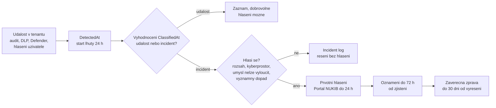

# Detekce, audit a podklad pro hlášení incidentu

> Typ: povinný · Den: 4 · Odhad: 110 min
> Tenant: A `cloudedu.cz` · Režim: hands-on, vlastní scope (audit nad `isms-<ini>` a `test-<ini>`, záznam v Incident logu); Microsoft Defender jako instruktorské demo
> Prostředí: [`../../environment.md`](../../environment.md) · Názvosloví: [`../../GLOSSARY.md`](../../GLOSSARY.md)

Vedení Vltava Servis zadalo v pondělí tři věci; třetí zněla: **když se něco stane, do 24 hodin
od zjištění incidentu sestavit prvotní hlášení z podkladů, které tenant už má**
([`../../scenario-isms-vltava.md`](../../scenario-isms-vltava.md)). Včera na konci
[`../../day-3/retention-lifecycle/`](../../day-3/retention-lifecycle/) jste jako `test-<ini>`
udělali s řízeným dokumentem čtyři věci, které by se dělat neměly. Dnes je najdete, vyhodnotíte
a připravíte podklad — tak, jak by to musel udělat manažer kybernetické bezpečnosti.

## Cíle

- Vyhledat a exportovat auditní záznamy v Microsoft Purview Audit, se správným časovým pásmem.
- Rozlišit Audit (Standard) a Audit (Premium) podle retence a licence.
- Rozhodnout, zda jde o kybernetickou bezpečnostní **událost**, nebo **incident**, a zda se
  incident v režimu nižších povinností **hlásí**.
- Posoudit významnost dopadu podle § 14 vyhlášky č. 410/2025 Sb. (postupem z materiálu NÚKIB).
- Založit záznam v Incident logu a sestavit podklad pro prvotní hlášení přes Portál NÚKIB.

## Výklad

### Od události k hlášení

Diagram shrnuje podpůrné materiály NÚKIB citované níže; přesné znění podmínek je v textu.

### Purview Audit — co se zaznamenává a jak dlouho

Unified audit log zaznamenává tisíce uživatelských a administrátorských operací napříč službami
Microsoft 365; Audit (Standard) je **zapnutý ve výchozím stavu**
([Auditing solutions](https://learn.microsoft.com/en-us/purview/audit-solutions-overview)).

| | Audit (Standard) | Audit (Premium) |
|---|---|---|
| Retence | 180 dní | Entra ID, Exchange, OneDrive, SharePoint 1 rok výchozí; ostatní 180 dní; vlastní retenční politiky až 1 rok, 10 let s doplňkovou licencí |
| Vyhledávání v portálu, export CSV | ano | ano |
| Audit log retention policies | ne | ano |
| Intelligent insights (např. MailItemsAccessed se štítkem) | ne | ano |
| Šířka pásma Management Activity API | základ | zhruba dvojnásobná |

Zdroj: [Auditing solutions](https://learn.microsoft.com/en-us/purview/audit-solutions-overview).
Retence se určuje podle licence **uživatele, který akci provedl**; uživatelé s E5, Purview Suite
nebo doplňkem E5 eDiscovery and Audit mají roční retenci pro Entra ID, Exchange a SharePoint
([Search the audit log](https://learn.microsoft.com/en-us/purview/audit-search)).

> [!IMPORTANT] 180 dní a incident
> Útočník, který byl v tenantu půl roku, je v Audit (Standard) vidět jen zčásti. Pro SoA to není
> technický detail — je to zdůvodnění, proč A.8.15 bez Premium (nebo exportu do SIEM) splňuje
> organizace jen částečně.

### Vyhledávání — pět věcí, které rozhodnou o výsledku

Z [Search the audit log](https://learn.microsoft.com/en-us/purview/audit-search):

1. **Čas je v UTC.** Rozsah data a času i výsledky jsou v UTC; maximální rozsah 180 dní.
2. **Filtry**: uživatelé, aktivity (přátelské názvy i přesné názvy operací), typy záznamů,
   workload a **File, folder, or site** — lze zadat i URL webu se zástupným znakem `*` na konci.
3. **Vyhledávání je úloha** (search job): běží i po zavření prohlížeče, výsledky se drží 30 dní,
   nejvýš 10 souběžných úloh na účet.
4. **Export** do CSV: až 50 000 řádků v Standard, až 1 000 000 v Premium. Detail události je ve
   sloupci AuditData (JSON).
5. **Latence**: Microsoft negarantuje, kdy se záznam objeví; pro hlavní služby (Exchange,
   SharePoint, OneDrive, Teams) je dostupnost **typicky 60–90 minut** po události, u jiných
   služeb může být delší.

K vyhledávání je potřeba role *Audit Logs* nebo *View-Only Audit Logs* — výchozí role groups
**Audit Reader** a **Audit Manager**
([Get started with auditing](https://learn.microsoft.com/en-us/purview/audit-get-started)).

> [!WARNING] Ověřit k datu běhu — stav k 2026-10.
> Latence ingestu na Tenant A **nebyla změřena**. Studenti zanechali stopu včera odpoledne;
> lektor ráno ověří, že je vyhledatelná, a zapíše čas (go/no-go). „Typicky 60–90 minut" je
> výrok dokumentace, ne vlastnost našeho tenantu.

### Které operace hledat

Stopa z dne 3 se v auditu projeví podle toho, **jak** student akci provedl
([Audit log activities](https://learn.microsoft.com/en-us/purview/audit-log-activities)):

| Akce `test-<ini>` | Operace (přátelský název) | Poznámka |
|---|---|---|
| stažení dokumentu | `FileDownloaded` (Downloaded file) | — |
| změna / odebrání štítku citlivosti | `FileSensitivityLabelChanged`, `FileSensitivityLabelRemoved` | z webu / podokna podrobností SharePointu |
| totéž v desktopové aplikaci Office | `SensitivityLabelUpdated`, `SensitivityLabelRemoved` | jiný název operace pro stejnou akci |
| vytvoření odkazu ke sdílení | `CompanyLinkCreated`, `AnonymousLinkCreated`, `SecureLinkCreated`, `SharingSet`, `AddedToSecureLink` | podle typu odkazu; sdílení konkrétní osobě často dvě události |
| pokus o smazání záznamu | `RecordDelete` (Deleted file marked as a record) je jen pro **provedené** smazání | zda se **zablokovaný** pokus vůbec zaznamená, Learn neříká — otevřená otázka |

Zdůvodnění při snížení štítku: dokumentace zmiňuje u neúspěšné změny důvod
`DowngradeJustificationTextMissing`; zda je **text** zdůvodnění v záznamu, je neověřené.

### Microsoft Defender XDR — kam audit zapadá

Defender pracuje se dvěma druhy signálů: **výstrahy** (alerts) z detekčních mechanismů a
**incidenty** — kontejnery souvisejících výstrah s časovou osou, dotčenými uživateli a zařízeními
a důkazy; korelaci dělá Defender automaticky
([Incidents and alerts](https://learn.microsoft.com/en-us/defender-xdr/incidents-overview)).

> [!IMPORTANT] Nezaměňovat
> **Incident v Defenderu** (technický kontejner výstrah) ≠ **kybernetický bezpečnostní incident
> podle zákona č. 264/2025 Sb.** (právní pojem). Defender může mít incident, který zákon za
> incident nepovažuje, a naopak — dnešní stopa z dne 3 výstrahu v Defenderu vyvolat nemusí.

V kurzu je Defender jen demo lektora (5 minut): kde je fronta incidentů a co v ní je — nebo není.

### Událost, incident a povinnost hlásit

Podpůrný materiál NÚKIB *Hlášení kybernetických bezpečnostních incidentů* (verze 1.2,
8. 6. 2026)
([PDF](https://portal.nukib.gov.cz/storage/uploads/2026/06/08/podpurny-material-ke-hlaseni-incidentu_v1-2_uid_6a267e393778b.pdf)):

- **Kybernetická bezpečnostní událost** je událost, která může vyústit v incident. Hlášení
  události je dobrovolné.
- **Kybernetický bezpečnostní incident** je narušení bezpečnosti informací v kybernetickém
  prostoru — v zásadě každé **neplánované** narušení důvěrnosti, integrity nebo dostupnosti.
  Plánované zásahy (servisní okna) incidentem nejsou.
- Poskytovatel regulované služby hlásí incident, který **(1)** se projevil ve stanoveném rozsahu,
  **(2)** má původ v kybernetickém prostoru a **(3)** u něj nelze bez zbytečného odkladu,
  nejpozději do 24 hodin, vyloučit úmyslné zavinění.
- V **režimu nižších povinností** se navíc hlásí jen incidenty s **významným dopadem**
  na poskytování regulované služby; významnost si poskytovatel posuzuje sám podle § 14 vyhlášky
  č. 410/2025 Sb.
- **Prvotní hlášení** bez zbytečného odkladu, **nejpozději do 24 hodin** (začátek lhůty viz
  návod níže). Vyhodnocení události jako incidentu musí proběhnout co nejrychleji a jde
  o naplnění definice, ne o subjektivní názor.
- Kanál: **Portál NÚKIB**; když není dostupný, e-mail nebo datová schránka podle § 16 odst. 4
  zákona. Portál NÚKIB upravuje vyhláška č. 334/2025 Sb.
  ([`../../GLOSSARY.md`](../../GLOSSARY.md)); její znění v této verzi materiálů ověřené
  není.
- Samotný vznik incidentu není přestupek; přestupkem je incident, který měl být nahlášen,
  neohlásit vůbec nebo včas.

Návod NÚKIB pro nižší režim (publikováno 14. 8. 2026)
([Portál NÚKIB](https://portal.nukib.gov.cz/informacni-servis/podpurne-materialy/6a1d9256fc2a7b93040173db))
uvádí prvotní hlášení **do 24 hodin od zjištění** incidentu — to je **pravidlo kurzu**
(`ReportDeadline` = `DetectedAt` + 1 den). Dále doplňuje: u významného incidentu **oznámení do
72 hodin** od zjištění, **závěrečná zpráva do 30 dnů** od vyřešení; průběžná zpráva na
vyžádání nebo když incident trvá déle než 30 dní od oznámení. Formulář vyplňuje statutární orgán nebo pověřený zástupce, přihlášení přes Identitu
občana s úrovní záruky značná nebo vysoká.

> [!WARNING] Ověřit k datu běhu — stav k 2026-10. Dva materiály NÚKIB, dvě formulace začátku lhůty.
> Podpůrný materiál (PDF v1.2) počítá 24 h **od vyhodnocení události jako incidentu**. Kurz drží
> novější návod pro nižší režim („do 24 hodin **od jeho zjištění**"), protože je konzervativnější:
> lhůta začíná dřív. Znění vyhlášky č. 410/2025 Sb. ověřit
> na [e-Sbírce](https://e-sbirka.gov.cz/) (v této verzi materiálů ověřeno jen
> prostřednictvím materiálů NÚKIB).

### Významnost dopadu (§ 14 vyhlášky č. 410/2025 Sb.)

Postup podle materiálu NÚKIB *Stanovení významnosti incidentu v režimu nižších povinností*
(verze 1.0, 24. 2. 2026)
([PDF](https://portal.nukib.gov.cz/storage/uploads/2026/02/24/vyznamnost-incidentu-nizsi-rezim_uid_699dada722caf.pdf)):

1. **Únosná míra újmy** — organizace si předem stanoví, co ještě unese (finanční ztráta,
   nedostupnost, počet dotčených osob, právní a reputační dopad).
2. **Šest oblastí posouzení**: provozní dopad; množství zasažených osob; zdroje potřebné
   k obnově; typ a umístění dotčených aktiv; citlivost zasažených informací a újma z jejich
   narušení; přímá příčina (lidská chyba, technická závada, úmysl), je-li známa.
3. **Rozhodovací pravidlo** — dopad je významný, pokud je **překročena únosná míra újmy a zároveň
   prahová hodnota u oblastí** posouzení. Jak se práh u oblastí určí (např. jedna oblast na
   stupni 4, nebo tři na stupni 3, nebo vážené skóre), si organizace zvolí a zdokumentuje.

Prahy a příklady v materiálu jsou **ilustrační**; Vltava Servis potřebuje vlastní metodiku. Tu
lab nevytváří — použije vzorovou tabulku v šabloně a výslovně ji označí jako fiktivní.

## Klíčové rozlišení

- **Mít záznam v auditu ≠ splnit hlásicí povinnost** — audit je důkaz; hlášení je procesní krok
  s lhůtou a odpovědnou osobou.
- **Událost vs. incident vs. hlášený incident** — tři různé stavy; v nižším režimu se hlásí jen
  ten s významným dopadem.
- **Incident v Defenderu vs. incident podle zákona** — technický kontejner vs. právní pojem.
- **Zjištění vs. vyhodnocení** — dva časy, dvě pole v Incident logu (`DetectedAt`,
  `ClassifiedAt`); lhůta 24 h běží od zjištění, vyhodnocení ji neposouvá.
- **Audit (Standard) vs. (Premium)** — stejné události, jiná retence a analytika; ne „víc
  logování".

## Licence

| Funkce v bloku | Business Premium | E3 | E5 / add-on | Zdroj |
|---|---|---|---|---|
| Audit (Standard), 180 dní, vyhledávání a export | ano? | ano? | ano | [Search the audit log](https://learn.microsoft.com/en-us/purview/audit-search) — „non-E5" licence = 180 dní; seznam podporovaných předplatných ověřit |
| Audit (Premium) — roční retence, retenční politiky, insights | ne | ne | ano (E5, Purview Suite, E5 eDiscovery and Audit) | tamtéž |
| 10letá retence auditu | ne | ne | doplňková licence per uživatel | [Auditing solutions](https://learn.microsoft.com/en-us/purview/audit-solutions-overview) |
| Microsoft Defender XDR — incidenty | ? | ? | ? | neověřeno |
| Incident log, šablona podkladu | ano | ano | ano | SharePoint list z dne 2 |

`?` = neověřeno, ne „ne".

## Naše prostředí

- Hledá se **jen** nad `test-<ini>` a webem `isms-<ini>`. Export CSV obsahuje osobní údaje
  (UPN, IP adresy) — ukládá se do workspace jako důkaz, lokální kopie se maže. Data zůstávají
  v tenantu.
- **Na Portál NÚKIB se nic neodesílá.** Podklad je cvičný; Vltava Servis je fiktivní.
- Incident log a Asset Register vznikly v
  [`../../day-2/lists-registers-workflow/`](../../day-2/lists-registers-workflow/).
- Když stopa z dne 3 chybí, lektor má náhradní události — viz Fallback v labu.

## Lab

Viz [`lab-incident-evidence.md`](lab-incident-evidence.md). Šablona:
[`template-podklad-hlaseni.md`](template-podklad-hlaseni.md). Referenční řešení:
[`reseni-incident-evidence.md`](reseni-incident-evidence.md).

## Nosná linka

Incident log ve workspace `isms-<ini>` dostane **první záznam** s vyhodnocením, lhůtou,
posouzením významnosti, odkazem na podklad pro hlášení a na export z auditu. Podklad jde do
capstonu ([`../../day-5/compliance-manager-capstone/`](../../day-5/compliance-manager-capstone/)).
SoA dostane řádky:

| Opatření | Capability M365 | Důkaz |
|---|---|---|
| A.5.24 | Incident log + šablona podkladu pro hlášení | odkaz na šablonu ve workspace |
| A.5.25 | záznam vyhodnocení v Incident logu (`ClassifiedAt`, významnost) | odkaz na záznam v Incident logu |
| A.5.26 | podklad pro prvotní hlášení, stav záznamu | odkaz na podklad (`ReportDraft`) |
| A.5.28 | export z Purview Audit uložený ve workspace | odkaz na CSV (`Evidence`) |
| A.8.15 | Purview Audit (Standard / Premium) | odkaz na CSV (`Evidence`) |
| A.8.16 | Purview Audit jako zpětné dohledání; Defender XDR — přehled | odkaz na podklad (jak byla událost zjištěna); v Zdůvodnění mezera — průběžné sledování v kurzu nenastaveno |

Viz [`../../scenario-isms-vltava.md`](../../scenario-isms-vltava.md).

## Zdroje

- [Learn about auditing solutions in Microsoft Purview](https://learn.microsoft.com/en-us/purview/audit-solutions-overview)
- [Search the audit log](https://learn.microsoft.com/en-us/purview/audit-search)
- [Get started with auditing solutions](https://learn.microsoft.com/en-us/purview/audit-get-started)
- [Audit log activities](https://learn.microsoft.com/en-us/purview/audit-log-activities)
- [Incidents and alerts in the Microsoft Defender portal](https://learn.microsoft.com/en-us/defender-xdr/incidents-overview)
- NÚKIB: [Hlášení kybernetických bezpečnostních incidentů, v1.2](https://portal.nukib.gov.cz/storage/uploads/2026/06/08/podpurny-material-ke-hlaseni-incidentu_v1-2_uid_6a267e393778b.pdf)
- NÚKIB: [Stanovení významnosti incidentu v režimu nižších povinností, v1.0](https://portal.nukib.gov.cz/storage/uploads/2026/02/24/vyznamnost-incidentu-nizsi-rezim_uid_699dada722caf.pdf)
- NÚKIB: [Návod k hlášení incidentů pro nižší režim](https://portal.nukib.gov.cz/informacni-servis/podpurne-materialy/6a1d9256fc2a7b93040173db)
- [e-Sbírka](https://e-sbirka.gov.cz/) — zákon č. 264/2025 Sb., vyhláška č. 410/2025 Sb.

## Stav produktu / delta

> [!WARNING] Ověřit k datu běhu — stav k 2026-10.
> Verze materiálů NÚKIB (hlášení v1.2 z 2026-06, návod pro nižší režim z 2026-08, významnost
> v1.0 z 2026-02) a začátek 24h lhůty; pole formuláře prvotního hlášení na Portálu NÚKIB;
> názvy operací v auditu pro štítky a sdílení; zda se zablokovaný pokus o smazání záznamu
> audituje; licence Audit (Standard) pro Business Premium; legacy incidenty vs. *incident cases*
> v Defenderu (Learn uvádí incident cases jako preview).
