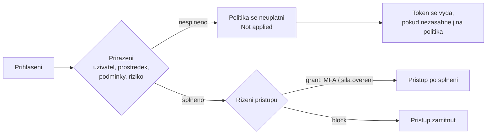

# Conditional Access a řízení přístupu, risk-based politiky

> Typ: povinný · Den: 4 · Odhad: 100 min
> Tenant: A `cloudedu.cz` · Režim: hands-on, vlastní scope (`test-<ini>`); vynucení jen MFA pilotu na `test-<ini>`
> Prostředí: [`../../environment.md`](../../environment.md) · Názvosloví: [`../../GLOSSARY.md`](../../GLOSSARY.md)

Dny 2 a 3 řešily, **co** je v ISMS workspace a jak je to chráněné. Dnes ráno se řeší dveře:
**za jakých podmínek** se k tomu vůbec někdo přihlásí. Conditional Access (CA) je v Microsoft 365
místo, kde se z „máme MFA" stane ověřitelné pravidlo s názvem, rozsahem a záznamem v logu.

## Cíle

- Navrhnout sadu CA politik podle person a pojmenovat je tak, aby šly auditovat bez otevírání.
- Rozlišit „vyžadovat MFA" a **authentication strength** (síla ověření) včetně phishing-resistant
  MFA.
- Vysvětlit roli nouzových (break-glass) účtů a proč jsou z každé politiky vyloučené.
- Postavit risk-based politiky (sign-in risk, user risk) v CA — legacy politiky ID Protection
  už neexistují.
- Ověřit dopad politiky **dřív**, než se zapne: report-only, What If a záložka Report-only
  v sign-in logu.
- Použít Temporary Access Pass (TAP) pro bezpečný onboarding testovacího uživatele.

## Výklad

### Politika = když (přiřazení) → pak (řízení přístupu)

Learn popisuje CA politiku jako příkaz *if-then*: když platí přiřazení (uživatelé, cílové
prostředky, podmínky), uplatní se řízení přístupu (grant nebo session). Důležitá a často
přehlížená věta: **pokud žádná politika nespustí řízení přístupu, token se vydá**
([Plan a Conditional Access deployment](https://learn.microsoft.com/en-us/entra/identity/conditional-access/plan-conditional-access)).
CA tedy neříká „co není povoleno, je zakázáno" — mezera v pokrytí je otevřené okno.

### Persony a pojmenování politik

Learn doporučuje pojmenovací standard, ze kterého je bez otevření politiky vidět **pořadové
číslo, cílové aplikace, reakce, na koho a kdy** se politika vztahuje, a protože CA politika nemá
atribut vlastníka, doporučuje vlastnictví zakódovat do názvu (např. prefix týmu)
([Plan a Conditional Access deployment](https://learn.microsoft.com/en-us/entra/identity/conditional-access/plan-conditional-access)).
V kurzu je „týmem" student: prefix `<ini>-`.

| Část názvu | Příklad | Proč |
|---|---|---|
| Prefix vlastníka | `jn-` | 15 studentů v jednom tenantu; úklid po kurzu |
| Pořadové číslo | `CA01` | „otevři CA01" po telefonu |
| Persona | `Pilot`, `Users`, `Admins` | na koho — návrh po personách, ne po aplikacích |
| Prostředek | `AllResources` | co politika chrání |
| Podmínka | `SigninRiskMedHigh` | kdy |
| Reakce | `MFA`, `Block`, `RiskRemediation` | co se stane |

Limit je **240 politik na tenant** ve všech stavech včetně report-only (stejný zdroj). Čtyři
politiky na studenta × 15 studentů se vejdou, ale není to nekonečno — úklid po běhu je go/no-go položka.

### MFA a síla ověření (authentication strength)

Authentication strength je řízení přístupu v CA, které určuje, **které kombinace metod** smí
uživatel k přístupu použít. Vestavěné síly jsou tři: *Multifactor authentication*, *Passwordless
MFA* a *Phishing-resistant MFA*
([Authentication strengths](https://learn.microsoft.com/en-us/entra/identity/authentication/concept-authentication-strengths)).

| Metoda (výběr) | MFA | Passwordless MFA | Phishing-resistant MFA |
|---|---|---|---|
| FIDO2 bezpečnostní klíč / passkey | ano | ano | ano |
| Windows Hello for Business | ano | ano | ano |
| Certificate-based authentication (vícefaktorová) | ano | ano | ano |
| Microsoft Authenticator (phone sign-in) | ano | ano | ne |
| Temporary Access Pass | ano | ne | ne |
| Heslo + push / SMS / OATH kód | ano | ne | ne |

Zdroj tabulky: tamtéž. Dvě praktické poznámky ze stejné stránky:

- *Require multifactor authentication* a *Require authentication strength* **nejdou v jedné
  politice zároveň** — vestavěná síla MFA je ekvivalent prvního.
- CA se vyhodnocuje až **po** prvotním ověření; síla ověření tedy nebrání zadat heslo, jen
  nepustí dál bez požadované metody.

**Phishing-resistant MFA** je to, co z MFA zbude, když útočník stojí mezi uživatelem a přihlašovací
stránkou: metoda je svázaná s přihlašovacím povrchem, takže ji nejde „přeposlat". Pro
privilegované role ji Learn řadí do první fáze nasazení CA
([Plan a Conditional Access deployment](https://learn.microsoft.com/en-us/entra/identity/conditional-access/plan-conditional-access)).

### Temporary Access Pass — onboarding bez sdíleného hesla

TAP je časově omezený kód pro jedno nebo více přihlášení, kterým si uživatel zaregistruje
silnější metodu (passkey, Authenticator) nebo obnoví přístup po ztrátě metody
([Temporary Access Pass](https://learn.microsoft.com/en-us/entra/identity/authentication/howto-authentication-temporary-access-pass)).
Fakta z téže stránky:

- TAP se musí **povolit v Authentication methods policy** a určit, kdo ho smí použít — to je
  **tenantové** nastavení (v kurzu ho dělá lektor předem).
- Výchozí životnost 1 h, rozsah 10 minut až 30 dní; jednorázový nebo vícenásobný.
- Vytvořit TAP pro běžného uživatele smí *Authentication Administrator*, pro adminy
  *Privileged Authentication Administrator*; nikdo sám pro sebe.
- Uživatel má nejvýš jeden TAP; hodnota se zobrazí **jen jednou** při vytvoření.
- Tokeny vydané při přihlášení TAP mají životnost omezenou koncem TAP, ale už založenou relaci
  vypršení TAP zpětně neruší.

TAP splňuje sílu *Multifactor authentication*, ne *Phishing-resistant MFA* (tabulka výše). Pro
lab to znamená: `test-<ini>` projde MFA pilotem i s TAP, ale na politiku pro adminy s
phishing-resistant MFA by nestačil.

### Nouzové (break-glass) účty

Learn doporučuje **dva a více** cloudových nouzových účtů na doméně `*.onmicrosoft.com`,
s trvale aktivní rolí Global Administrator (v PIM *permanent active*, ne eligible),
s phishing-resistant metodou odlišnou od běžných adminů, s monitoringem každého přihlášení
a ověřením funkčnosti **aspoň jednou za 90 dní**; pro vyloučení z politik doporučuje vyhrazenou
bezpečnostní skupinu
([Manage emergency access accounts](https://learn.microsoft.com/en-us/entra/identity/role-based-access-control/security-emergency-access)).

> [!IMPORTANT] Kurz je přísnější než Learn — a proč
> Learn říká, že politiky v **report-only** nouzové účty vylučovat nemusí, protože nic neblokují
> (tamtéž). Kurz je vylučuje **z každé** politiky bez výjimky
> ([`../../CONVENTIONS.md`](../../CONVENTIONS.md)): přepnout report-only na On je jedno kliknutí
> a politika, která „byla jen na zkoušku", se pak chová jako ostrá. Vyloučení musí být hotové
> dřív, než se kdokoli dotkne přepínače.

### Security defaults vs. Conditional Access

Security defaults jsou bezplatný základ (registrace MFA pro všechny, MFA pro adminy, blokace
legacy autentizace a device code flow). Kdo chce CA politiky, musí security defaults **vypnout** —
kombinovat je nelze
([Security defaults](https://learn.microsoft.com/en-us/entra/fundamentals/security-defaults)).
Na Tenant A je vypíná lektor před během (go/no-go).

### Microsoft-managed politiky

V tenantu se mohou objevit CA politiky, které **vytvořil Microsoft** (sloupec *Created by* =
Microsoft): např. MFA pro adminy v admin portálech, MFA pro všechny, blokace legacy autentizace,
politiky pro rizikové přihlášení a rizikové uživatele. Vznikají v report-only a Microsoft je
zapne, pokud je správce nevypne — podle Learn **ne dřív než 30 dní** po zavedení, ale **v
některých případech i dřív**; o tom informuje e-mail, Message center a detail politiky. Dva
týdny předem přijde oznámení. Přejmenovat ani smazat je nejde, lze měnit stav a vyloučení
([Microsoft-managed policies](https://learn.microsoft.com/en-us/entra/identity/conditional-access/managed-policies)).

> [!WARNING] Ověřit k datu běhu — stav k 2026-10.
> Které Microsoft-managed politiky na Tenant A existují a v jakém stavu jsou, se mění bez zásahu
> lektora. V What If a v sign-in logu je studenti uvidí vedle svých `<ini>-` politik — a jedna
> z nich (*Require phishing resistant authentication for admins*) míří přesně na Global
> Administratory, tedy na všechny v učebně.

### Risk-based politiky — teď už jen v Conditional Access

Microsoft Entra ID Protection vyhodnocuje dva druhy rizika:

- **Sign-in risk** — jak pravděpodobné je, že toto konkrétní přihlášení není od vlastníka účtu
  (anonymní IP, password spray, ...).
- **User risk** — jak pravděpodobné je, že je účet kompromitovaný (např. uniklé přihlašovací
  údaje).

> [!WARNING] Ověřit k datu běhu — stav k 2026-10.
> Legacy user risk a sign-in risk politiky nastavované přímo v ID Protection byly vyřazeny
> **1. října 2026**. Na riziko dnes reaguje jen politika Conditional Access
> ([Risk policies](https://learn.microsoft.com/en-us/entra/id-protection/howto-identity-protection-configure-risk-policies)).

> [!IMPORTANT] Názvosloví
> „User risk policy" / „Sign-in risk policy" v ID Protection -> risk-based politika
> Conditional Access (podmínka *User risk* / *Sign-in risk*). Starší návody a screenshoty
> ukazují obrazovku, která už nic nevynucuje.

Doporučení Microsoftu ze stejné stránky:

| Politika | Podmínka | Řízení přístupu | Session |
|---|---|---|---|
| Sign-in risk | riziko přihlášení **Medium a High** | *Require authentication strength* — vestavěná MFA | *Sign-in frequency: Every time* |
| User risk | riziko uživatele **High** | *Require risk remediation* (automaticky doplní authentication strength) | *Sign-in frequency: Every time* (povinné, doplní se samo) |

Dvě pravidla navíc: **sign-in risk a user risk nekombinovat v jedné politice** a uživatel musí
mít zaregistrovanou MFA dřív, než ho samoobslužná náprava rizika potká — jinak je zablokovaný
a potřebuje správce (tamtéž). Riziko vyžaduje **Entra ID P2**
([ID Protection overview](https://learn.microsoft.com/en-us/entra/id-protection/overview-identity-protection)).

### Report-only, What If a sign-in log

Report-only politika se při přihlášení **vyhodnotí, ale nevynutí**; výsledek se zapíše do sign-in
logu na záložky *Conditional Access* a *Report-only*
([Report-only mode](https://learn.microsoft.com/en-us/entra/identity/conditional-access/concept-conditional-access-report-only)):

| Výsledek | Význam |
|---|---|
| Report-only: Success | podmínky splněné, požadavky by byly splněné |
| Report-only: Failure | podmínky splněné, požadavky ne (např. block) — přihlášení by bylo zamítnuto |
| Report-only: User action required | uživatel by musel něco udělat (např. MFA) — v report-only se ho nikdo nezeptá |
| Report-only: Not applied | podmínky nesplněné (např. uživatel vyloučený) |

**What If** simuluje přihlášení zadaného uživatele a vrátí politiky, které by se uplatnily, i ty,
které ne, **s důvodem** (první nesplněná podmínka). Hodnotí politiky zapnuté a v report-only.
Současná verze stojí na What If Evaluation API, které očekává **všechny parametry přihlášení**;
skupiny aplikací jako *Office 365* se nespárují — vybírá se jedna konkrétní aplikace. Povinné
vstupy jsou identita, cílový prostředek, platforma zařízení a klientská aplikace
([What If tool](https://learn.microsoft.com/en-us/entra/identity/conditional-access/what-if-tool)).
Pro risk-based politiky z toho plyne: bez zadaného *Sign-in risk* / *User risk* je What If
neuvidí jako uplatněné.

## Klíčové rozlišení

- **Conditional Access vs. role** — CA rozhoduje, **za jakých podmínek** se kdo přihlásí;
  role (Entra, SharePoint) rozhodují, **co** pak smí. Global Administrator s MFA je pořád Global
  Administrator. Role řeší [`../privileged-access-pim/`](../privileged-access-pim/).
- **MFA vs. phishing-resistant MFA** — obojí je „dvoufaktor", ale jen druhé odolá útočníkovi
  uprostřed přihlášení.
- **Report-only vs. vyloučení** — report-only nic neblokuje *dnes*; vyloučení chrání *i zítra*,
  až politiku někdo zapne.
- **Sign-in risk vs. user risk** — riziko jednoho přihlášení (napraví ho silné ověření) vs. riziko
  účtu (napraví ho náprava rizika, typicky bezpečná změna hesla).
- **What If vs. sign-in log** — simulace s parametry, které zadám já, vs. záznam skutečného
  přihlášení. Do SoA patří obojí, ale důkazem provozu je log.

## Licence

| Funkce v bloku | Business Premium | E3 | E5 / add-on | Zdroj |
|---|---|---|---|---|
| Conditional Access (vyžaduje Entra ID P1) | ano (P1 v balíčku) | ano (P1 v balíčku) | ano | [Licensing fundamentals](https://learn.microsoft.com/en-us/entra/id-governance/licensing-fundamentals), [Security defaults](https://learn.microsoft.com/en-us/entra/fundamentals/security-defaults) |
| Authentication strengths | ano | ano | ano | [Authentication strengths](https://learn.microsoft.com/en-us/entra/identity/authentication/concept-authentication-strengths) (prerekvizita P1) |
| Risk-based politiky (sign-in / user risk) | ne | ne | ano (P2 v E5) | [ID Protection overview](https://learn.microsoft.com/en-us/entra/id-protection/overview-identity-protection) |
| Report-only, What If | ano | ano | ano | součást CA; [Report-only](https://learn.microsoft.com/en-us/entra/identity/conditional-access/concept-conditional-access-report-only) |
| Conditional Access Insights workbook | ? | ? | ? | vyžaduje P1 **a** Log Analytics workspace (Azure) — [Report-only](https://learn.microsoft.com/en-us/entra/identity/conditional-access/concept-conditional-access-report-only) |
| Temporary Access Pass | ? | ? | ? | stránka TAP licenci neuvádí — otevřená otázka |

`?` = neověřeno, ne „ne". Business Premium a E3 obsahují P1, E5 obsahuje P2 — podle
[Licensing fundamentals](https://learn.microsoft.com/en-us/entra/id-governance/licensing-fundamentals).
Organizace bez P2 tedy risk-based politiky nepostaví — v SoA to patří do zdůvodnění, ne pod
koberec.

## Naše prostředí

- **Jen `test-<ini>`.** Každá politika zahrnuje **přímo uživatele** `test-<ini>` (ne skupinu,
  ne „All users"). Vlastní studentský účet v žádné politice není — ani v report-only.
- **Vyloučená skupina nouzových účtů** ve všech politikách. Název skupiny sdělí lektor; v repu
  záměrně není.
- **Vynucení (On) jen u MFA pilotu** a jen po kontrole sousedem (čtyři oči).
- TAP politiku a security defaults nastavuje lektor před během — viz go/no-go v
  [`../../environment.md`](../../environment.md).
- Tenant A má podle plánu Entra ID P2 (go/no-go „Licence na Developer tenantu"). Bez P2 se
  risk-based politiky jen vysvětlí.

## Lab

Viz [`lab-ca-policy-set.md`](lab-ca-policy-set.md). Referenční řešení:
[`reseni-ca-policy-set.md`](reseni-ca-policy-set.md).

## Nosná linka

Ve workspace `isms-<ini>` přibude stránka nebo dokument **„Návrh CA politik"** (tabulka person
a politik) a v tenantu sada `<ini>-CA0x` politik. SoA dostane řádky:

| Opatření | Capability M365 | Důkaz |
|---|---|---|
| A.5.15 | Conditional Access — pravidla přístupu podle persony, aplikace a rizika | odkaz na dokument „Návrh CA politik" ve workspace |
| A.5.17 | Temporary Access Pass pro onboarding, authentication methods policy | odkaz na dokument „Návrh CA politik", sekce Onboarding |
| A.8.5 | MFA / authentication strength, risk-based CA, report-only ověření | odkaz na dokument „Návrh CA politik" s výsledky ze sign-in logu `test-<ini>` |

Viz [`../../scenario-isms-vltava.md`](../../scenario-isms-vltava.md).

## Zdroje

- [Plan a Conditional Access deployment](https://learn.microsoft.com/en-us/entra/identity/conditional-access/plan-conditional-access)
- [Conditional Access: report-only mode and policy impact](https://learn.microsoft.com/en-us/entra/identity/conditional-access/concept-conditional-access-report-only)
- [The Conditional Access What If tool](https://learn.microsoft.com/en-us/entra/identity/conditional-access/what-if-tool)
- [Authentication strengths](https://learn.microsoft.com/en-us/entra/identity/authentication/concept-authentication-strengths)
- [Temporary Access Pass](https://learn.microsoft.com/en-us/entra/identity/authentication/howto-authentication-temporary-access-pass)
- [Manage emergency access accounts](https://learn.microsoft.com/en-us/entra/identity/role-based-access-control/security-emergency-access)
- [Security defaults](https://learn.microsoft.com/en-us/entra/fundamentals/security-defaults)
- [Microsoft-managed Conditional Access policies](https://learn.microsoft.com/en-us/entra/identity/conditional-access/managed-policies)
- [Risk policies (ID Protection)](https://learn.microsoft.com/en-us/entra/id-protection/howto-identity-protection-configure-risk-policies)
- [What is Microsoft Entra ID Protection](https://learn.microsoft.com/en-us/entra/id-protection/overview-identity-protection)
- [Least privileged roles by task](https://learn.microsoft.com/en-us/entra/identity/role-based-access-control/delegate-by-task)

## Stav produktu / delta

> [!WARNING] Ověřit k datu běhu — stav k 2026-10.
> Vyřazení legacy risk politik ID Protection (2026-10-01) a jejich případné zbytky v UI;
> seznam a stav Microsoft-managed politik na Tenant A; cesta v Entra admin center
> (Entra ID > Conditional Access > Policies, What If v liště); složení vestavěných
> authentication strengths; zda TAP vyžaduje samostatnou licenci.
