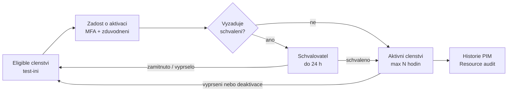

# Privilegovaný přístup — PIM

> Typ: povinný · Den: 4 · Odhad: 90 min
> Tenant: A `cloudedu.cz` · Režim: hands-on, vlastní scope (PIM for Groups na vlastní skupině); PIM pro role Microsoft Entra jako instruktorské demo
> Prostředí: [`../../environment.md`](../../environment.md) · Názvosloví: [`../../GLOSSARY.md`](../../GLOSSARY.md)

Conditional Access ráno určil, **za jakých podmínek** se kdo přihlásí. Tento blok řeší, **kdo smí
víc než ostatní a jak dlouho**. Končí nálezem, který kurz celý týden odkládal: všichni v učebně
jsou Global Administrator — a pro nic z toho, co jsme dělali, to nebylo potřeba.

## Cíle

- Rozlišit eligible a active přiřazení a vysvětlit just-in-time (JIT) přístup.
- Nastavit pravidla aktivace: maximální délka, MFA, zdůvodnění, schválení, notifikace.
- Postavit PIM for Groups nad skupinou, která dává plnou kontrolu nad webem `isms-<ini>`.
- Dohledat aktivaci a schválení v historii PIM.
- Sestavit tabulku „jaká role by stačila" pro úkoly kurzu a z ní nález pro SoA (A.8.2).

## Výklad

### Stálý vs. just-in-time přístup

Privileged Identity Management (PIM) dává **časově omezený** a **schvalovaný** přístup
k rolím a skupinám: JIT aktivace, přiřazení s datem začátku a konce, schválení, MFA při aktivaci,
zdůvodnění, notifikace, revize přístupu a historie pro audit
([What is PIM](https://learn.microsoft.com/en-us/entra/id-governance/privileged-identity-management/pim-configure)).

| Pojem | Význam (podle Learn) |
|---|---|
| **Eligible** | přiřazení, které uživatel musí **aktivovat**, než ho použije |
| **Active** | přiřazení, které platí bez další akce |
| **Activated** | eligible přiřazení, které uživatel aktivoval a na nastavenou dobu používá |
| **Permanent / time-bound** | bez konce / se začátkem a koncem |

Důležitá věta ze stejné stránky: **mezi trvalým a eligible přiřazením není rozdíl v tom, co
uživatel smí** — rozdíl je jen v tom, že eligible oprávnění nemá pořád. PIM tedy nesnižuje sílu
role; zkracuje dobu, po kterou ji jde zneužít.

### PIM pro role Microsoft Entra vs. PIM for Groups

| | PIM pro role Microsoft Entra | PIM for Groups |
|---|---|---|
| Co se aktivuje | role (např. SharePoint Administrator) | členství nebo vlastnictví skupiny |
| Kde platí nastavení | **per role pro celý tenant** — všechna přiřazení téže role sdílí jedno nastavení | **per skupina a per role** (member / owner) — skupiny jsou na sobě nezávislé |
| Kdo spravuje | Privileged Role Administrator | Groups Administrator, Identity Governance Administrator, nebo **aktivní vlastník skupiny** (pro skupinu, která není role-assignable) |
| V kurzu | demo lektora | hands-on studenta |

Zdroje: [Configure Microsoft Entra role settings in PIM](https://learn.microsoft.com/en-us/entra/id-governance/privileged-identity-management/pim-how-to-change-default-settings),
[Configure PIM for Groups settings](https://learn.microsoft.com/en-us/entra/id-governance/privileged-identity-management/groups-role-settings).

Tohle je důvod, proč studenti na Tenant A dělají **PIM for Groups**: kdyby 15 lidí upravovalo
nastavení role *SharePoint Administrator*, přepisovali by si ho navzájem
([`../../CONVENTIONS.md`](../../CONVENTIONS.md)).

### Co PIM for Groups umí a neumí

Fakta z [PIM for Groups](https://learn.microsoft.com/en-us/entra/id-governance/privileged-identity-management/concept-pim-for-groups)
a navazujících stránek:

- Do PIM lze vzít **bezpečnostní skupinu Entra i skupinu Microsoft 365** — kromě **dynamických**
  skupin a skupin **synchronizovaných z on-premises**. Skupina nemusí být role-assignable.
- Každá skupina má **dvě nastavení**: pro aktivaci členství a pro aktivaci vlastnictví.
- Skupinu vzatou pod správu PIM **už nejde ze správy vyjmout**
  ([Bring groups into PIM](https://learn.microsoft.com/en-us/entra/id-governance/privileged-identity-management/groups-discover-groups)) —
  úklid po kurzu = smazání skupiny.
- Přiřazení nejde vytvořit na méně než 5 minut ani do 5 minut odebrat
  ([Assign eligibility](https://learn.microsoft.com/en-us/entra/id-governance/privileged-identity-management/groups-assign-member-owner)).
- Správce nebo vlastník skupiny může členství změnit **mimo PIM** (v Entra Groups) a tím PIM
  obejít — stejná stránka. Pro audit to znamená: přímé členství v „privilegované" skupině je
  nález.

### Nastavení aktivace

Z [Configure PIM for Groups settings](https://learn.microsoft.com/en-us/entra/id-governance/privileged-identity-management/groups-role-settings):

| Nastavení | Co dělá |
|---|---|
| Activation maximum duration | 1–24 hodin |
| On activation, require MFA | MFA při aktivaci (nemusí se znovu ptát, pokud ji uživatel v relaci už udělal) |
| On activation, require Conditional Access authentication context | aktivace musí splnit CA politiku navázanou na kontext |
| Require justification / ticket information | zdůvodnění; číslo tiketu je jen informační pole |
| Require approval to activate | aspoň jeden schvalovatel, doporučeně dva; **výchozí schvalovatel neexistuje** |
| Assignment duration | povolit trvalé eligible / active, nebo vynutit konec |
| Notifications | kdo dostane e-mail o přiřazení, aktivaci a schválení |

Schvalovatel má na rozhodnutí **24 hodin** a lhůta není nastavitelná; **sám sobě schválit
nemůže**
([Approve activation requests](https://learn.microsoft.com/en-us/entra/id-governance/privileged-identity-management/groups-approval-workflow)).

### Aktivace a skutečný přístup nejsou totéž

Po aktivaci PIM přidá uživatele do skupiny **během sekund**. Aplikace, která má členství
nacachované, ale může přístup projevit později
([Activate group membership](https://learn.microsoft.com/en-us/entra/id-governance/privileged-identity-management/groups-activate-roles)).
Pro SharePoint uvádí Microsoft u scénáře „role přiřazená skupině + eligible členství" zpoždění
oprávnění **až 24 hodin** a pro rychlý JIT přístup k SharePointu doporučuje PIM pro role, ne
PIM for Groups
([Error when accessing SharePoint after role activation in PIM](https://learn.microsoft.com/en-us/sharepoint/troubleshoot/administration/access-denied-to-pim-user-accounts)).

> [!IMPORTANT] Důkazem v labu je stav PIM, ne otevřený web
> Jak rychle se aktivované členství projeví v oprávněních webu `isms-<ini>`, **na Tenant A
> nebylo změřeno**. Lab proto ověřuje aktivní přiřazení a historii PIM; přístup na web je
> doplňkové pozorování se zapsaným časem.

### Revize přístupu (access reviews)

PIM umí pravidelně ověřovat, zda přiřazení ještě dávají smysl. Licenčně je to jinde než PIM:
revize přístupu vyžaduje Microsoft Entra ID Governance pro členy v rozsahu i pro revidující,
část funkcí jde s P2 a revize pro PIM for Groups je ve verzi preview jen s ID Governance
([Licensing fundamentals](https://learn.microsoft.com/en-us/entra/id-governance/licensing-fundamentals)).
V kurzu jen zmínka; v SoA patří do zdůvodnění A.5.18.

### ID Protection jako zdroj signálu

Microsoft Entra ID Protection tu vystupuje jen jako **zdroj rizika** (rizikový uživatel,
rizikové přihlášení); reakce na riziko se staví v Conditional Access — viz
[`../conditional-access/`](../conditional-access/). Pro privilegované účty to znamená: PIM
zkracuje dobu, risk-based CA hlídá, kdo se o aktivaci pokouší.

### Nález: všichni jsme Global Administrator

Microsoft opakovaně doporučuje minimalizovat počet Global Administratorů a používat role
s nejmenšími oprávněními
([Permissions in the Microsoft Purview portal](https://learn.microsoft.com/en-us/purview/purview-permissions)).
Kurz to celý týden porušuje vědomě (environment.md). Tabulka v
[`comparison-least-privilege-roles.md`](comparison-least-privilege-roles.md) ukazuje, která role
by stačila pro každý úkol kurzu — a ze stejné tabulky vzniká návrh rolí pro Vltava Servis.

## Klíčové rozlišení

- **Eligible vs. active** — stejná oprávnění, jiná doba platnosti.
- **PIM pro role vs. PIM for Groups** — tenantové nastavení role vs. nastavení vlastní skupiny.
- **Členství přes PIM vs. přímé členství** — první je časově omezené a v historii PIM; druhé PIM
  obchází.
- **Aktivace vs. projev v aplikaci** — PIM přidá členství hned, SharePoint ho může vidět později.
- **PIM vs. Conditional Access** — PIM řídí, **jak dlouho** kdo má zvýšené oprávnění; CA řídí,
  **za jakých podmínek** se přihlásí. Propojuje je authentication context.

## Licence

| Funkce v bloku | Business Premium | E3 | E5 / add-on | Zdroj |
|---|---|---|---|---|
| PIM (role i PIM for Groups) — Entra ID P2 nebo ID Governance | ne (obsahuje P1) | ne (obsahuje P1) | ano (P2 v E5) | [Licensing fundamentals](https://learn.microsoft.com/en-us/entra/id-governance/licensing-fundamentals) |
| Licence potřebují: eligible a time-bound přiřazení, **schvalovatelé**, revidující a revidovaní | — | — | — | tamtéž |
| Access reviews | ne | ne | částečně P2; plně ID Governance (add-on) | tamtéž |
| Role-assignable skupiny | ? | ? | ? | stránka odkazuje na licenční přehled ID Governance; neověřeno |

`?` = neověřeno. Organizace na Business Premium nebo E3 tedy JIT přístup přes PIM nemá; náhradou
je méně stálých adminů a pravidelná ruční revize — v SoA jako zdůvodnění, ne jako „splněno".

## Naše prostředí

- Skupina `<ini>-isms-admins` (bezpečnostní, přiřazené členství) je **vlastník webu
  `isms-<ini>`**; `test-<ini>` k ní dostane **eligible** členství.
- Schvalovatel = **tvůj kurzovní účet**. `test-<ini>` žádá, ty schvaluješ — dvě identity, takže
  zákaz schválit sám sobě se nepoužije.
- `test-<ini>` má z ranního bloku zaregistrovanou MFA metodu (nebo TAP).
- PIM pro role Microsoft Entra ukazuje lektor na projektoru na roli, kterou kurz nepoužívá.
  Nastavení rolí **Global Administrator** a **Privileged Role Administrator** se nemění nikdy —
  Learn popisuje zamčení tenantu, když je aktivace podmíněná schválením a schvalovatel chybí
  ([Configure Microsoft Entra role settings](https://learn.microsoft.com/en-us/entra/id-governance/privileged-identity-management/pim-how-to-change-default-settings)).

## Lab

Viz [`lab-pim-for-groups.md`](lab-pim-for-groups.md). Referenční řešení:
[`reseni-pim-for-groups.md`](reseni-pim-for-groups.md). Tabulka rolí:
[`comparison-least-privilege-roles.md`](comparison-least-privilege-roles.md).

## Nosná linka

Web `isms-<ini>` má poprvé **vlastníka, který není stálý**: plná kontrola nad ISMS dokumentací
jde přes skupinu `<ini>-isms-admins` s JIT členstvím, schválením a historií. Ve workspace přibude
dokument **Návrh rolí** (tabulka nejmenších oprávnění) a SoA dostane řádky:

| Opatření | Capability M365 | Důkaz |
|---|---|---|
| A.5.15 | PIM for Groups — přístup k ISMS webu přes skupinu s pravidly aktivace | odkaz na screenshot nastavení Member skupiny `<ini>-isms-admins` ve workspace |
| A.5.18 | eligible přiřazení s koncem platnosti, schválení, historie | odkaz na screenshot Resource audit skupiny ve workspace |
| A.8.2 | JIT vlastnictví webu; nález „všichni jsou Global Administrator" a návrh rolí | dokument Návrh rolí ve workspace |

Viz [`../../scenario-isms-vltava.md`](../../scenario-isms-vltava.md).

## Zdroje

- [What is Privileged Identity Management](https://learn.microsoft.com/en-us/entra/id-governance/privileged-identity-management/pim-configure)
- [PIM for Groups](https://learn.microsoft.com/en-us/entra/id-governance/privileged-identity-management/concept-pim-for-groups)
- [Bring groups into PIM](https://learn.microsoft.com/en-us/entra/id-governance/privileged-identity-management/groups-discover-groups)
- [Configure PIM for Groups settings](https://learn.microsoft.com/en-us/entra/id-governance/privileged-identity-management/groups-role-settings)
- [Assign eligibility for a group](https://learn.microsoft.com/en-us/entra/id-governance/privileged-identity-management/groups-assign-member-owner)
- [Activate group membership or ownership](https://learn.microsoft.com/en-us/entra/id-governance/privileged-identity-management/groups-activate-roles)
- [Approve activation requests for groups](https://learn.microsoft.com/en-us/entra/id-governance/privileged-identity-management/groups-approval-workflow)
- [Audit activity history for groups](https://learn.microsoft.com/en-us/entra/id-governance/privileged-identity-management/groups-audit)
- [Configure Microsoft Entra role settings in PIM](https://learn.microsoft.com/en-us/entra/id-governance/privileged-identity-management/pim-how-to-change-default-settings)
- [Microsoft Entra ID Governance licensing fundamentals](https://learn.microsoft.com/en-us/entra/id-governance/licensing-fundamentals)
- [Error when accessing SharePoint after role activation in PIM](https://learn.microsoft.com/en-us/sharepoint/troubleshoot/administration/access-denied-to-pim-user-accounts)
- [Least privileged roles by task](https://learn.microsoft.com/en-us/entra/identity/role-based-access-control/delegate-by-task)

## Stav produktu / delta

> [!WARNING] Ověřit k datu běhu — stav k 2026-10.
> Cesta v Entra admin center (ID Governance > Privileged Identity Management > Groups /
> My roles / Approve requests); licenční rozdělení P2 vs. ID Governance (Microsoft deklaruje, že
> do P2 už nové IGA funkce nepřidává); zpoždění oprávnění SharePointu po aktivaci členství
> (zatím jen dokumentace, ne měření).
