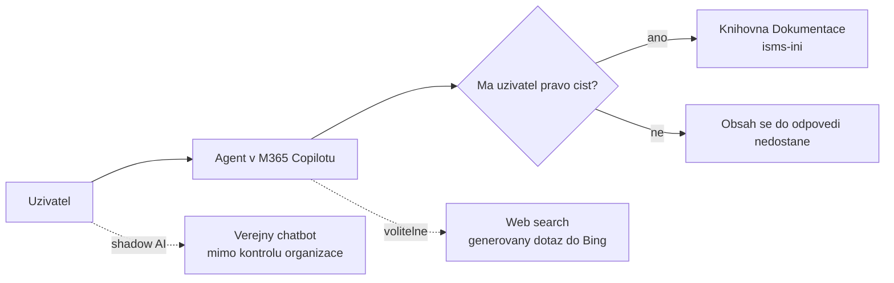

# AI agenti uvnitř tenantu

> Typ: povinný · Den: 5 · Odhad: 90 min (35 výklad + 55 lab)
> Tenant: B `spdemo.online` · Režim: hands-on, vlastní scope (web `isms-<ini>` na B)
> Prostředí: [`../../environment.md`](../../environment.md) · Názvosloví: [`../../GLOSSARY.md`](../../GLOSSARY.md)

Celý týden platí podmínka vedení Vltava Servis: **data firmy zůstávají v tenantu firmy**.
Tenhle blok ji obrací do praxe — místo veřejného chatbota postaví student agenta, který
odpovídá jen z řízené dokumentace na vlastním webu a nikomu neukáže víc, než ten člověk
smí vidět i bez agenta.

## Cíle

- Vysvětlit rozdíl mezi datovou hranicí Copilotu a veřejným chatbotem (shadow AI) a doložit
  ho odkazem na dokumentaci, ne dojmem.
- Postavit declarative agenta v Agent Builderu se znalostním zdrojem omezeným na knihovnu
  `Dokumentace` na webu `isms-<ini>`.
- Ověřit agenta evaluační sadou s očekávaným zdrojovým dokumentem a negativním testem
  (sdílený agent nesmí prozradit obsah, ke kterému tazatel nemá přístup).
- Pojmenovat, kde Agent Builder končí a kdy přichází na řadu Copilot Studio.

## Výklad

### Datová hranice Copilotu vs. shadow AI

| Otázka | Microsoft 365 Copilot / Copilot Chat v tenantu | Veřejný chatbot mimo smlouvu organizace |
|---|---|---|
| Co smí vidět | jen obsah, ke kterému má **přihlášený uživatel** aspoň právo čtení | to, co do něj uživatel vloží |
| Kde se ukládají prompty a odpovědi | v Microsoft 365, podle smluvních závazků k ostatnímu obsahu tenantu | podle podmínek poskytovatele |
| Trénink modelů | prompty, odpovědi a data z Microsoft Graph se na trénink základních modelů nepoužívají | podle podmínek poskytovatele |
| Kdo to řídí | Purview (audit, retence, DLP, štítky), admin center | nikdo z organizace |

Zdroj tvrzení v levém sloupci:
[Data, Privacy, and Security for Microsoft Copilot](https://learn.microsoft.com/en-us/microsoft-365/copilot/microsoft-365-copilot-privacy).

Dvě výjimky, které patří do výkladu, ne pod koberec:

- **Webové vyhledávání.** Když Copilot doplňuje odpověď z webu, posílá do služby Bing
  **vygenerovaný dotaz** (pár slov odvozených z promptu, bez identifikátorů uživatele
  a tenantu), ne celý prompt ani dokumenty. Na tyto dotazy se ale **nevztahuje Data
  Protection Addendum ani EU Data Boundary**. Správce to řídí politikou *Allow web search
  in Copilot*
  ([Learn: web search](https://learn.microsoft.com/en-us/microsoft-365/copilot/manage-public-web-access)).
- **Agenti třetích stran.** U agenta jiného vydavatele platí jeho privacy statement a terms
  of use — přesně to hodnotí další blok
  [`../normiqa-navigator-demo/`](../normiqa-navigator-demo/).

**Shadow AI** není „AI jako taková", ale zpracování firemních dat nástrojem mimo kontrolu
organizace. Zákon č. 264/2025 Sb. ani ISO/IEC 27001 AI nezakazují — vyžadují, aby
zpracování informací bylo řízené. Pro Vltava Servis to pravidlo nese dokument
`SME-02 Používání AI nástrojů` — a agent z labu na něj umí odpovědět.

### Declarative agent

Declarative agent = **instrukce + znalostní zdroje (+ případně akce)** nad platformou
Copilotu. Model, orchestraci, vyhledávání i oříznutí podle oprávnění dodává platforma; tvůrce
agenta jen **deklaruje**, co má agent dělat a kde smí hledat.

**Agent Builder** je nejjednodušší cesta k declarative agentovi: přímo v aplikaci Microsoft 365
Copilot (web `microsoft365.com/chat` nebo Teams desktop / web, ne mobil), bez kódu
([Learn: Agent Builder](https://learn.microsoft.com/en-us/microsoft-365/copilot/extensibility/agent-builder)).

Co je pro compliance agenta podstatné
([Learn: knowledge v Agent Builderu](https://learn.microsoft.com/en-us/microsoft-365/copilot/extensibility/agent-builder-add-knowledge)):

- **SharePoint jako zdroj**: až 100 souborů, složek nebo webů; URL webu zahrne i podcesty.
  Agent respektuje existující oprávnění a sensitivity labels.
- **Nové soubory** mají chvíli stav *Preparing* — agent je do odpovědí nezahrne, dokud nejsou
  připravené.
- **Only use specified sources** zdroje **upřednostní**, ale obecné znalosti modelu
  **neblokuje**. Přísnější kontrolu nabízí Copilot Studio.
- **Nahrané soubory (embedded files) jsou past**: kdo má přístup k agentovi, má přístup
  i k jejich obsahu. V labu se proto nenahrává nic, zdrojem je knihovna.
- Je-li zapnuté **Restricted SharePoint Search**, SharePoint jako zdroj použít nejde.

### Sdílení agenta nesdílí obsah — pokud to nedovolíš

Agent se sdílí rolí **Can chat** (jen konverzace) nebo **Can edit** (spoluvlastník)
([Learn: sdílení agentů](https://learn.microsoft.com/en-us/microsoft-365/copilot/extensibility/agent-builder-share-manage-agents)).
Uživatel, který k souboru nemá přístup, z něj odpověď nedostane. **Ale**: dialog sdílení
umí soubory a složky ze znalostních zdrojů **automaticky nasdílet** novým uživatelům. Tím
by agent přesdílel dokumentaci — to je přesně oversharing, před kterým má ISMS chránit.
V labu se automatické sdílení souborů **nezaškrtává** a negativní checkpoint to dokládá.

### Kde Agent Builder končí — Copilot Studio

Agent Builder nemá akce do externích služeb, neumí zablokovat obecné znalosti modelu
a sdílení nenahrazuje nasazení do organizace. Další krok je
[Copilot Studio](https://learn.microsoft.com/en-us/microsoft-copilot-studio/fundamentals-what-is-copilot-studio)
— low-code nástroj pro agenty a workflow s analytikou, evaluacemi a správou. V kurzu jen
zmínka; publikace agenta do organizace prochází schválením správce (viz
[`../copilot-governance-dspm/`](../copilot-governance-dspm/)).

## Klíčové rozlišení

- **Instrukce vs. znalostní zdroj** — instrukce říkají, *jak* se agent chová; politika
  `POL-01` patří do knihovny, ne do instrukcí. Instrukce v obsahu dokumentů jsou vektor
  cross-prompt injection.
- **Sdílení agenta vs. sdílení obsahu** — role Can chat nedává přístup k souborům; dá ho
  až zaškrtnuté automatické sdílení nebo nahraný soubor.
- **Upřednostnit zdroje vs. omezit na zdroje** — *Only use specified sources* je
  upřednostnění. Odmítnutí dotazu mimo rozsah je prosba v instrukcích, ne vynucení.
- **Copilot (datová hranice tenantu) vs. veřejný chatbot (shadow AI)** — rozdíl není
  v kvalitě odpovědí, ale v tom, kdo řídí data.

## Licence

| Funkce v bloku | Business Premium | E3 | E5 / add-on | Zdroj |
|---|---|---|---|---|
| Copilot Chat bez agentů nad daty | ano | ano | ano | [Agent capabilities and licensing](https://learn.microsoft.com/en-us/microsoft-365/copilot/extensibility/prerequisites) |
| Agent se znalostním zdrojem SharePoint | jen s licencí Microsoft 365 Copilot nebo s PAYG (Copilot Credits) | totéž | totéž | [Agent capabilities and licensing](https://learn.microsoft.com/en-us/microsoft-365/copilot/extensibility/prerequisites) |
| Agent se zdrojem e-mail, Teams, People | jen s licencí Microsoft 365 Copilot (PAYG nestačí) | totéž | totéž | [Agent capabilities and licensing](https://learn.microsoft.com/en-us/microsoft-365/copilot/extensibility/prerequisites) |

PAYG s SharePointem jako zdrojem vyžaduje billing policy **připojenou ke službě SharePoint
agents** a uživatele ve **skupině přiřazené k billing policy** (tamtéž). Rozpočet billing
policy jen posílá upozornění — **útratu nezastaví**
([Learn: nastavení PAYG](https://learn.microsoft.com/en-us/microsoft-365/copilot/pay-as-you-go/setup)).

## Naše prostředí

- **Tenant B**, účet `user.NN@spdemo.online`, profil prohlížeče pro B. Student je **jen
  vlastník webu** `isms-<ini>` — žádné admin role.
- Web `isms-<ini>` na B založil lektor skriptem s kopií fiktivní dokumentace Vltava Servis
  v knihovně `Dokumentace` (`POL-01` až `POL-04`, `SME-01`, `SME-02`, `ZAZ-01`). Nic
  z Tenant A tam není.
- Licence: Business Basic + Copilot PAYG. Každý dotaz agenta nad SharePointem stojí
  Copilot Credits — evaluační sada má 11 dotazů, ne „zkoušej, dokud to nevyjde".
- Go/no-go: [`../../environment.md`](../../environment.md) — položka „Vytvoření a sdílení
  declarative agenta běžným uživatelem".

## Lab

Viz [`lab-compliance-agent.md`](lab-compliance-agent.md). Referenční instrukce, evaluační
sada a řádky SoA: [`reseni-lab-compliance-agent.md`](reseni-lab-compliance-agent.md).

## Nosná linka

Na Tenant B přibyl **agent `<ini>-ISMS Asistent`** nad knihovnou `Dokumentace` a výsledek
jeho evaluace. Do SoA na Tenant A jde **odkaz a screenshot**, žádná data
([`../../scenario-isms-vltava.md`](../../scenario-isms-vltava.md)):

| Opatření | Capability M365 | Důkaz |
|---|---|---|
| A.5.23 | declarative agent v tenantu místo veřejného chatbota; znalosti jen z řízené knihovny; oříznutí podle oprávnění | screenshot konfigurace agenta + výsledek evaluační sady (B) |
| A.5.23 (`SME-02`) | pravidlo pro používání AI nástrojů je řízený dokument a agent na něj odpovídá s citací | screenshot odpovědi na dotaz 7 s citací `SME-02` (B) |
| kap. 9.1 | evaluační sada s očekávaným zdrojem jako opakovatelné měření kvality agenta | tabulka výsledků evaluace (B) |

A.5.23 — vlastní parafráze: organizace řídí bezpečnost cloudových služeb po celou dobu jejich
používání, od výběru po ukončení. Kap. 9.1 — organizace určuje, co a jak monitoruje a měří,
a výsledky vyhodnocuje.

## Zdroje

- [Data, Privacy, and Security for Microsoft Copilot](https://learn.microsoft.com/en-us/microsoft-365/copilot/microsoft-365-copilot-privacy)
- [Data, privacy, and security for web search in Microsoft Copilot](https://learn.microsoft.com/en-us/microsoft-365/copilot/manage-public-web-access)
- [Agent Builder overview](https://learn.microsoft.com/en-us/microsoft-365/copilot/extensibility/agent-builder)
- [Add knowledge sources to an agent in Agent Builder](https://learn.microsoft.com/en-us/microsoft-365/copilot/extensibility/agent-builder-add-knowledge)
- [Share and manage agents built in Agent Builder](https://learn.microsoft.com/en-us/microsoft-365/copilot/extensibility/agent-builder-share-manage-agents)
- [Agent capabilities and licensing models](https://learn.microsoft.com/en-us/microsoft-365/copilot/extensibility/prerequisites)
- [Set up Microsoft Copilot pay-as-you-go services](https://learn.microsoft.com/en-us/microsoft-365/copilot/pay-as-you-go/setup)
- [Copilot Studio overview](https://learn.microsoft.com/en-us/microsoft-copilot-studio/fundamentals-what-is-copilot-studio)

## Stav produktu / delta

> [!WARNING] Ověřit k datu běhu — stav k 2026-10.
> Že uživatel s Business Basic + PAYG smí v Agent Builderu **vytvořit** agenta se
> SharePointem jako zdrojem a **nasdílet** ho: Learn popisuje přístup PAYG uživatelů
> k agentům nad SharePointem, tvorbu v Agent Builderu výslovně nepopisuje. V sesterském
> kurzu to fungovalo empiricky (2026-07), na tomto kurzu **neověřeno na tenantu**. Popisky
> Agent Builderu (*Configure*, *Only use specified sources*, *Can chat*) se mění po měsících.

> [!IMPORTANT] Názvosloví
> Microsoft 365 Copilot -> **Microsoft Copilot**, Microsoft 365 Copilot Chat -> **Microsoft
> Copilot Chat** (Learn, 2026-10). Licence a část UI mohou po přechodnou dobu nést starý
> název. Kurz drží název z [`../../GLOSSARY.md`](../../GLOSSARY.md).
