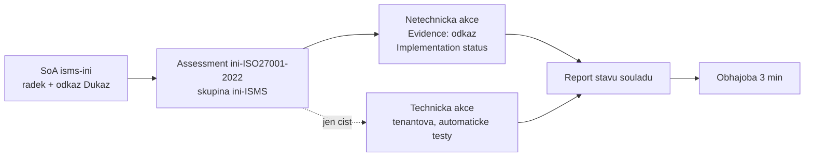

# Compliance Manager a capstone

> Typ: povinný · Den: 5 · Odhad: 90 min (10 výklad + 80 capstone vč. obhajob)
> Tenant: A `cloudedu.cz` · Režim: hands-on, vlastní scope (assessment `<ini>-...` ve vlastní skupině)
> Prostředí: [`../../environment.md`](../../environment.md) · Názvosloví: [`../../GLOSSARY.md`](../../GLOSSARY.md)

Konec týdne. SoA má řádky ze všech dnů a u každého odkaz na důkaz. Capstone z toho dělá dvě
věci: **důkazy navázané na kontroly** v Compliance Manageru a **report stavu souladu** pro
vedení Vltava Servis — obhájený za tři minuty.

> [!IMPORTANT] Report není razítko
> Report z capstonu je **podklad pro vedení a auditora**. Není to atest souladu se zákonem
> č. 264/2025 Sb. ani certifikace ISO/IEC 27001 — a Microsoft totéž říká o svém nástroji:
> doporučení Compliance Manageru nejsou zárukou souladu a účinnost opatření musí posoudit
> organizace
> ([Learn: scoring](https://learn.microsoft.com/en-us/purview/compliance-manager-scoring)).

## Cíle

- Založit assessment podle šablony ISO/IEC 27001:2022 ve vlastní skupině a vysvětlit, co
  v něm je tenantové a co jen tvoje.
- Navázat aspoň 5 důkazů z SoA na improvement actions a nastavit stav implementace — bez
  zásahu do tenantových (technických) akcí.
- Vysvětlit, jak se počítá compliance score a proč se po labu nepohne.
- Sepsat report stavu souladu podle šablony a obhájit ho za 3 minuty.

## Výklad

### Pojmy Compliance Manageru

| Pojem | Co to je | Pozor |
|---|---|---|
| **Regulation** (šablona) | sada kontrol a improvement actions pro normu nebo předpis | prémiové šablony se licencují |
| **Assessment** | instance šablony pro vybrané služby | **viditelná všem s rolí v Compliance Manageru** — proto prefix `<ini>-` |
| **Group** | kontejner assessmentů | **nejde smazat**; název je unikátní v tenantu |
| **Control** | jednotlivý požadavek šablony | stav se odvozuje z akcí |
| **Improvement action** | co máš udělat ty | technická / netechnická (dokumentační, provozní) |
| **Microsoft action** | co dělá Microsoft jako poskytovatel cloudu | přispívá do skóre, ty ji neměníš |
| **Evidence** | soubory a odkazy u improvement action | po stavu testu *Passed* / *Failed* / *Out of scope* už nejdou smazat |

Zdroje: [assessments](https://learn.microsoft.com/en-us/purview/compliance-manager-assessments),
[improvement actions](https://learn.microsoft.com/en-us/purview/compliance-manager-improvement-actions).

### Proč jen netechnické akce a vlastní skupina

Na Tenant A pracuje 15 Global Administratorů v jednom Compliance Manageru. Learn
k tomu říká tři věci, které určují celý postup labu
([assessments](https://learn.microsoft.com/en-us/purview/compliance-manager-assessments),
[improvement actions](https://learn.microsoft.com/en-us/purview/compliance-manager-improvement-actions),
[setup](https://learn.microsoft.com/en-us/purview/compliance-manager-setup)):

- Změnu detailu nebo stavu **technické** improvement action převezmou assessmenty **ve všech
  skupinách** — technická akce je tenantová.
- Změnu **netechnické** akce převezmou jen assessmenty **ve stejné skupině**.
- Když do akce přidáš vlastní testovací data nebo důkaz, **automatické testování té akce se
  vypne**.

Proto: vlastní skupina `<ini>-ISMS`, důkazy jen k netechnickým akcím, technické akce se
v reportu jen citují.

### Šablony a licence

- **Data Protection Baseline** je zahrnutá pro všechny. **ISO/IEC 27001:2022** a **NIS2
  Directive (EU) 2022/2555** jsou **prémiové** šablony
  ([regulations list](https://learn.microsoft.com/en-us/purview/compliance-manager-regulations-list)).
- Při licencích **A5/E5/G5** si organizace zdarma vybere **tři** prémiové šablony (tamtéž).
- Licence se počítá **na šablonu (rodinu šablon), ne na assessment** — nad licencovanou
  šablonou jde vytvořit libovolně mnoho assessmentů
  ([regulations](https://learn.microsoft.com/en-us/purview/compliance-manager-regulations)).
  15 studentů nad ISO/IEC 27001:2022 = jedna šablona.
- Šablona NIS2 je **směrnice EU**, ne česká transpozice. Česká šablona *Czech - On Cyber
  Security and Change of Related Acts (Act on Cyber Security) - Act No. 181* odkazuje
  na **předchozí** zákon o kybernetické bezpečnosti, ne na zákon č. 264/2025 Sb. — v kurzu
  se nepoužívá.

### Jak se počítá compliance score

([Learn: scoring](https://learn.microsoft.com/en-us/purview/compliance-manager-scoring))

- Body se přidělují za **dokončené improvement actions**; hodnota akce podle typu:

  | Typ akce | Body |
  |---|---|
  | preventivní povinná | 27 |
  | preventivní dobrovolná | 9 |
  | detekční povinná | 3 |
  | detekční dobrovolná | 1 |
  | nápravná povinná | 3 |
  | nápravná dobrovolná | 1 |

- Do celkového skóre se Microsoft actions a technické akce počítají **jednou za tenant**,
  netechnické akce **jednou za skupinu**. Proto se celkové skóre liší od průměru
  assessmentů.
- Výchozí skóre vychází z assessmentu **Data Protection Baseline**.
- Stav akce se na dashboardu aktualizuje **do 24 hodin** — během capstonu se skóre
  nepohne. Skóre se v reportu uvádí jako „stav k datu", ne jako výsledek labu.

Bod pro obhajobu: skóre měří **pokrok v doporučených akcích**, ne soulad. Vysoké skóre
s prázdnou SoA je horší než nižší skóre s doloženou SoA.

## Klíčové rozlišení

- **Compliance score vs. soulad** — skóre je metrika řízení, ne právní ani certifikační
  závěr.
- **Technická vs. netechnická improvement action** — technická je tenantová a často
  testovaná automaticky; netechnická patří skupině a dokládá se dokumentem nebo záznamem.
- **Implementation status vs. Test status** — stav implementace nastavuje ten, kdo opatření
  zavedl; stav testu patří posuzovateli (assessor). V kurzu student test status
  **nenastavuje**.
- **Šablona NIS2 vs. vyhláška č. 410/2025 Sb.** — šablona mapuje směrnici; povinnosti Vltava
  Servis plynou z české vyhlášky. Mapování dělá student v SoA, ne nástroj.

## Licence

| Funkce v bloku | Business Premium | E3 | E5 / add-on | Zdroj |
|---|---|---|---|---|
| Compliance Manager, Data Protection Baseline | ano | ano | ano | [Purview service description](https://learn.microsoft.com/en-us/office365/servicedescriptions/microsoft-365-service-descriptions/microsoft-365-tenantlevel-services-licensing-guidance/microsoft-purview-service-description) |
| Prémiové šablony (ISO/IEC 27001:2022, NIS2) | nákup add-onu | nákup add-onu | 3 prémiové šablony zdarma (A5/E5/G5), další nákupem | [regulations list](https://learn.microsoft.com/en-us/purview/compliance-manager-regulations-list), [regulations](https://learn.microsoft.com/en-us/purview/compliance-manager-regulations) |
| Zkušební verze prémiových šablon | ? | ? | až 25 šablon na 90 dní | [regulations](https://learn.microsoft.com/en-us/purview/compliance-manager-regulations) |

Licenční nit kurzu končí tady: v reportu student u každé mezery napíše, jakou licenci
by organizace potřebovala (např. DLP pro Copilot podle štítku jen s E5 / Purview Suite,
viz [`../copilot-governance-dspm/`](../copilot-governance-dspm/)).

## Naše prostředí

- **Tenant A**, Global Administrator — Compliance Manager je plně přístupný, a proto platí
  přísná disciplína: assessment `<ini>-ISO27001-2022`, skupina `<ini>-ISMS`, důkazy jen
  k netechnickým akcím, žádný test status *Passed*, žádné jiné šablony.
- Assessmenty i skupiny jsou vidět celému tenantu. **Skupiny po kurzu nejdou smazat**
  — prefix `<ini>-` je jediný úklidový klíč.
- Šablona ISO/IEC 27001:2022 musí být v tenantu dostupná (go/no-go v
  [`../../environment.md`](../../environment.md)); NIS2 jen jako volitelná druhá, pokud lektor
  potvrdí volnou licenci.
- Důkazy z Tenant B jsou v SoA jako odkaz na screenshot ve workspace na A — do Compliance
  Manageru se navazuje tentýž odkaz.

## Lab

Viz [`lab-capstone.md`](lab-capstone.md). Šablona reportu:
[`template-report-souladu.md`](template-report-souladu.md).

## Nosná linka

Uzavření týdne: SoA -> důkazy v assessmentu -> report. Ve workspace přibyl report stavu
souladu a v Compliance Manageru assessment s navázanými důkazy. Do SoA
([`../../scenario-isms-vltava.md`](../../scenario-isms-vltava.md)):

| Opatření | Capability M365 | Důkaz |
|---|---|---|
| kap. 9.1 | assessment ISO/IEC 27001:2022 v Compliance Manageru se stavem implementace a důkazy | odkaz na assessment `<ini>-ISO27001-2022` |
| A.5.36 | pravidelné ověřování souladu s politikami a normami přes assessment a report | odkaz na report stavu souladu |

Kap. 9.1 — organizace určuje, co a jak monitoruje a měří, a výsledky vyhodnocuje.
A.5.36 — organizace pravidelně ověřuje, že se dodržují její bezpečnostní politiky, pravidla
a normy. (Vlastní parafráze.)

## Zdroje

- [Build and manage assessments in Compliance Manager](https://learn.microsoft.com/en-us/purview/compliance-manager-assessments)
- [Working with improvement actions](https://learn.microsoft.com/en-us/purview/compliance-manager-improvement-actions)
- [Compliance Manager scoring](https://learn.microsoft.com/en-us/purview/compliance-manager-scoring)
- [Learn about regulations in Compliance Manager](https://learn.microsoft.com/en-us/purview/compliance-manager-regulations)
- [Compliance Manager regulations list](https://learn.microsoft.com/en-us/purview/compliance-manager-regulations-list)
- [Get started with Compliance Manager](https://learn.microsoft.com/en-us/purview/compliance-manager-setup)
- [Microsoft Purview service description](https://learn.microsoft.com/en-us/office365/servicedescriptions/microsoft-365-service-descriptions/microsoft-365-tenantlevel-services-licensing-guidance/microsoft-purview-service-description)

## Stav produktu / delta

> [!WARNING] Ověřit k datu běhu — stav k 2026-10.
> Dostupnost šablon ISO/IEC 27001:2022 a NIS2 a stav počítadla **Free regulation licenses
> used** na Tenant A (Developer tenant sdílený s jiným kurzem — sloty už mohou být obsazené).
> Seznam šablon: stránka Learn má datum 2025-03 — ověřit aktuální nabídku v tenantu.
> Zda Compliance Manager nabídne šablonu podle zákona č. 264/2025 Sb. (k 2026-10 v seznamu
> jen předchozí zákon). Tvar *Control ID* u kontrol šablony ISO/IEC 27001:2022
> (vyhledávání podle čísla opatření) — **neověřeno na tenantu**.
