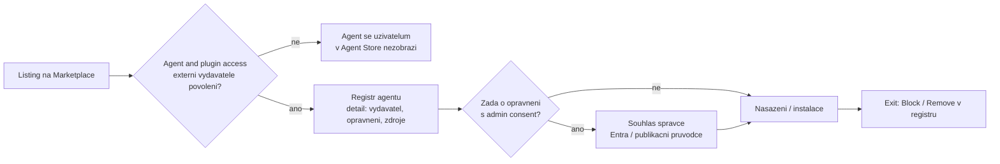

# Hotový agent z Microsoft Marketplace — Normiqa Navigator

> Typ: povinný · Den: 5 · Odhad: 30 min (5 kritéria + 20 demo + 5 verdikt)
> Tenant: B `spdemo.online` · Režim: instruktorské demo, studenti vyplňují hodnoticí šablonu
> Prostředí: [`../../environment.md`](../../environment.md) · Názvosloví: [`../../GLOSSARY.md`](../../GLOSSARY.md)

V předchozím bloku si student agenta **postavil**. Tady stojí před druhou cestou: hotového
agenta **nainstalovat** z Microsoft Marketplace. Pro ISMS je to rozhodnutí o dodavateli —
a hodnotí se stejně jako každý jiný cloudový dodavatel: podle kritérií, která jsou na stole
**dřív**, než se agent ukáže.

> [!IMPORTANT] Neutralita
> **Normiqa Navigator** je agent produktu Normiqa společnosti Malach IS — autora tohoto kurzu.
> Proto se v bloku nepoužívá žádné tvrzení o produktu z jiného zdroje než z toho, co student
> **sám uvidí** na listingu a na tenantu. Kritéria jsou stejná pro jakéhokoli agenta a student
> je v témže bloku aplikuje i na svého agenta z [`../ai-agents-tenant/`](../ai-agents-tenant/).
> Pravidla: [`../../CONVENTIONS.md`](../../CONVENTIONS.md).

## Cíle

- Ohodnotit hotového agenta sedmi kritérii (vydavatel, oprávnění, tok dat, schválení,
  cena a licence, podpora, exit) a každé hodnocení opřít o místo, kde je to vidět.
- Porovnat „postavit" a „nainstalovat" na stejné šabloně — vlastní agent vs. hotový agent.
- Zapsat rozhodnutí o nasazení jako podmíněný verdikt (ano / ne / ano za podmínek)
  s konkrétními podmínkami.

## Výklad

### Sedm kritérií — stejná pro každého agenta

| Kritérium | Otázka pro ISMS | Kde se to zjišťuje |
|---|---|---|
| **Vydavatel** | Kdo agenta vydává a odpovídá za něj? Je to tentýž subjekt, se kterým bychom měli smluvní vztah? | listing na Marketplace, detail agenta v admin center (*Publisher*, *Publisher type*) |
| **Oprávnění** | O jaká oprávnění agent žádá (Graph, akce)? Žádá o víc, než jeho účel potřebuje? | detail agenta v admin center (oprávnění, zdroje dat, akce); souhlasová obrazovka, pokud nějaká je |
| **Tok dat** | Odkud agent bere znalosti (data tenantu, web, služba vydavatele)? Odcházejí data tenantu mimo Microsoft 365? | detail agenta (zdroje dat, akce), privacy statement vydavatele |
| **Schválení** | Kdo v organizaci rozhoduje, že agent smí být k dispozici, a kde je to zaznamenáno? | nastavení *Agent and plugin access* (agenti externích vydavatelů), registr agentů, admin consent v Entra |
| **Cena a licence** | Kolik stojí agent? Jakou licenci Copilotu potřebují uživatelé pro jeho schopnosti? | listing; tabulka schopností podle licence na Learn |
| **Podpora** | Je k dispozici kontakt na podporu, privacy statement a terms of use na veřejné URL? | listing, detail agenta |
| **Exit** | Jak agenta zablokovat a odebrat? Co po něm zůstane (historie konverzací, data u vydavatele)? | registr agentů (*Block*, *Remove*), privacy statement |

Proč zrovna tato kritéria:

- Microsoft výslovně upozorňuje, že u agentů třetích stran platí **privacy statement a terms
  of use vydavatele** a že **data zpracovaná službami mimo Microsoft nejsou krytá smlouvami
  Microsoftu**
  ([Learn: Copilot privacy](https://learn.microsoft.com/en-us/microsoft-365/copilot/microsoft-365-copilot-privacy),
  [Learn: agent settings](https://learn.microsoft.com/en-us/microsoft-365/admin/manage/agent-settings)).
- V admin center správce vidí u agenta požadovaná oprávnění, přístup k datům, terms of use
  a privacy statement a rozhoduje, kteří agenti jsou v organizaci povolení (tamtéž).

### Kde se v tenantu rozhoduje

- **Agent and plugin access** v Microsoft 365 admin center (*Agents* > *Settings*) určuje,
  zda uživatelé smí instalovat agenty **externích vydavatelů**. Když je volba vypnutá, tito
  agenti se v Agent Store nezobrazí
  ([Learn: agent settings](https://learn.microsoft.com/en-us/microsoft-365/admin/manage/agent-settings)).
- **Registr agentů** (*Agents* > *All agents* > *Registry*) eviduje i agenty typu *External
  partner-built agents* a umožňuje je blokovat nebo odebrat
  ([Learn: agent registry](https://learn.microsoft.com/en-us/microsoft-365/admin/manage/agent-registry)).
- Pracovní tok **Requests** v admin center se týká agentů postavených v organizaci a agentů
  Microsoftu — o přístup k **agentům třetích stran** přes něj uživatel požádat nemůže
  ([Learn: agent requests](https://learn.microsoft.com/en-us/microsoft-365/admin/manage/agent-requests)).
- Declarative agent nemusí žádat o **žádná** oprávnění Graph. „Žádná souhlasová obrazovka"
  je platný výsledek kritéria Oprávnění — pak je podstatné kritérium Tok dat.

### Postavit vs. nainstalovat

| | Vlastní agent (`ai-agents-tenant`) | Hotový agent z Marketplace |
|---|---|---|
| Kdo odpovídá za chování | tvůrce v organizaci | vydavatel |
| Znalostní zdroje | vybrané tvůrcem, v tenantu | určuje vydavatel; zjistit z detailu agenta |
| Změny | kdy chce tvůrce | aktualizace vydavatele |
| Vztah k ISMS | interní aktivum | **dodavatel** — hodnocení jako u jiné cloudové služby |
| Exit | smazat agenta | zablokovat / odebrat + co zůstane u vydavatele |

Žádná cesta není „správná". Hotový agent šetří čas na stavbu, ale přidává dodavatele;
vlastní agent šetří hodnocení dodavatele, ale přidává údržbu.

## Klíčové rozlišení

- **Listing vs. detail v tenantu** — listing píše vydavatel (marketing); detail agenta
  v admin center ukazuje, co agent v tenantu skutečně deklaruje. Hodnotit podle obojího,
  rozpor zapsat.
- **Publikace v Marketplace vs. schválení v organizaci** — to, že agent prošel do
  Marketplace, neznamená, že ho organizace schválila. To je rozhodnutí správce.
- **Bez souhlasové obrazovky ≠ bez rizika** — declarative agent bez oprávnění Graph může
  pořád odpovídat z webu nebo ze služby vydavatele.

## Licence

| Funkce v bloku | Business Premium | E3 | E5 / add-on | Zdroj |
|---|---|---|---|---|
| Správa agentů v Microsoft 365 admin center (registr, nastavení) | ? | ? | ? | [Manage agents in the Microsoft 365 admin center](https://learn.microsoft.com/en-us/microsoft-365/admin/manage/manage-copilot-agents-integrated-apps) — „enabled by default in all Microsoft Copilot licensed tenants"; bez Copilota neověřeno |
| Použití agenta uživatelem | podle schopností agenta: web / instrukce v Copilot Chat; data tenantu s licencí Copilot nebo PAYG | totéž | totéž | [Agent capabilities and licensing](https://learn.microsoft.com/en-us/microsoft-365/copilot/extensibility/prerequisites) |
| Cena samotného agenta | podle listingu vydavatele | totéž | totéž | listing (lektor doplní) |

## Naše prostředí

- **Instruktorské demo na Tenant B.** Instalace a nasazení agenta pro organizaci je
  tenantový zásah — studenti jsou na B jen vlastníci webu.
- Studenti v profilu pro B sledují projekci a vyplňují
  [`template-hodnoceni-agenta.md`](template-hodnoceni-agenta.md) — **dvakrát**: pro hotového
  agenta a pro svého agenta z bloku `ai-agents-tenant`.
- Odkaz na listing doplní lektor v den běhu. V repu není — existence listingu je otevřená
  go/no-go položka v [`../../environment.md`](../../environment.md).

## Lab

Bez hands-on labu. Postup dema: [`demo-instalace-agenta.md`](demo-instalace-agenta.md).
Studentský výstup: [`template-hodnoceni-agenta.md`](template-hodnoceni-agenta.md).

## Nosná linka

Ve workspace přibude vyplněná hodnoticí šablona jako postup výběru AI dodavatele. Do SoA
na Tenant A ([`../../scenario-isms-vltava.md`](../../scenario-isms-vltava.md)):

| Opatření | Capability M365 | Důkaz |
|---|---|---|
| A.5.23 | hodnocení hotového agenta jako cloudové služby před nasazením; kontrolní body v admin center (externí vydavatelé, registr, blokace) | vyplněná šablona hodnocení (dokument ve workspace na A) |

A.5.23 — vlastní parafráze: organizace řídí bezpečnost cloudových služeb po celou dobu jejich
používání, od výběru po ukončení. Kdo chce, přidá řádek A.5.19 (bezpečnost ve vztazích
s dodavateli) — návrh, ne povinnost bloku.

## Zdroje

- [Data, Privacy, and Security for Microsoft Copilot](https://learn.microsoft.com/en-us/microsoft-365/copilot/microsoft-365-copilot-privacy)
- [Manage agents in the Microsoft 365 admin center](https://learn.microsoft.com/en-us/microsoft-365/admin/manage/manage-copilot-agents-integrated-apps)
- [Agent Registry in Microsoft 365 admin center](https://learn.microsoft.com/en-us/microsoft-365/admin/manage/agent-registry)
- [Agent settings in Microsoft 365 admin center](https://learn.microsoft.com/en-us/microsoft-365/admin/manage/agent-settings)
- [Agent requests in Microsoft 365 admin center](https://learn.microsoft.com/en-us/microsoft-365/admin/manage/agent-requests)
- [Configure the admin consent workflow](https://learn.microsoft.com/en-us/entra/identity/enterprise-apps/configure-admin-consent-workflow)

## Stav produktu / delta

> [!WARNING] Ověřit k datu běhu — stav k 2026-10.
> **Listing Normiqa Navigator na Microsoft Marketplace nebyl při přípravě (2026-10-17)
> ověřen** — vyhledávání ho nenašlo a Marketplace na automatizovaný dotaz vrací HTTP 403.
> Lektor ověří v prohlížeči a doplní odkaz v den běhu; bez listingu běží blok jako
> srovnávací tabulka (kompresní ventil 1). Názvy v admin center (*Agents*, *Registry*,
> *Agent and plugin access*) se mění po měsících.
