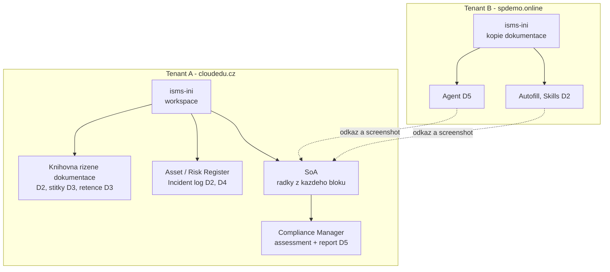

# Scénář — ISMS Vltava Servis

Nosná linka celého týdne. Každý modul na tento soubor odkazuje: co do ISMS workspace přidává,
které řádky SoA zapsal a co se tím změnilo.

## Zadání

**Vltava Servis s.r.o.** je fiktivní servisní firma s 240 zaměstnanci v 6 odděleních (stejná
firma jako v kurzech GOC222 a SPO_DEV_1). Pracuje v Microsoft 365, dokumenty má v SharePoint
Online. Má **Microsoft 365 Business Premium** pro všech 240 zaměstnanců — co z kurzu by
s touto licencí neudělala, je součástí reportu v capstonu.

Pro účely kurzu firma **vyhodnotila, že poskytuje regulovanou službu v režimu nižších
povinností** podle zákona č. 264/2025 Sb.; bezpečnostní opatření pro ni proto stanoví vyhláška
č. 410/2025 Sb. Jak se k zařazení dospěje, je látka kurzu GOC240 — tady je to výchozí stav.

Vedení zadalo tři věci:

1. **ISMS, které žije v Microsoft 365** — politiky, evidence a záznamy na jednom místě,
   pod verzováním, schvalováním a retencí, ne v souborech na disku ředitele IT.
2. **Doložitelnost** — ke každému opatření umět ukázat, čím je v tenantu zavedené a kde je
   důkaz. Auditor ani NÚKIB nechtějí slyšet „máme to nastavené".
3. **Postup pro incident** — když se něco stane, do 24 hodin od vyhodnocení události jako
   incidentu sestavit prvotní hlášení z podkladů, které tenant už má.

Podmínka, která se táhne celým týdnem: **data firmy zůstávají v tenantu firmy.** Žádný
veřejný chatbot, žádný export registrů mimo Microsoft 365.

## Co student staví

ISMS workspace `isms-<iniciály>` na Tenant A a v něm **prohlášení o aplikovatelnosti (SoA)**
jako seznam. Každý blok do SoA zapíše řádky ve tvaru:

| Sloupec | Obsah |
|---|---|
| Opatření | číslo opatření ISO/IEC 27001:2022 Annex A (např. A.5.12) — bez citace textu normy |
| Požadavek | ustanovení vyhlášky č. 410/2025 Sb. — doplňuje se v `requirements-mapping-m365` |
| Aplikovatelné | ano / ne |
| Zdůvodnění | vlastní text studenta |
| Capability M365 | co v tenantu opatření zavádí |
| Důkaz | odkaz na konfiguraci, dokument nebo záznam v workspace |
| Modul | slug bloku, ve kterém řádek vznikl |
| Tenant | A / B — kde důkaz vznikl |

| Den | Co přibude ve workspace | Řádky SoA (opatření ISO) | Moduly |
|---|---|---|---|
| 1 | web `isms-<ini>`, informační architektura, mapovací matice, seznam SoA | A.5.31, kap. 6.1.3 | `requirements-mapping-m365`, `isms-design-m365` |
| 2 | knihovna řízené dokumentace se schvalováním, typy obsahu Politika a Záznam, Asset Register, Risk Register, Incident log; na Tenant B Autofill a Skills nad kopií dokumentace | A.5.1, A.5.9, A.5.24, A.5.37, kap. 7.5, 6.1, 8.2 | `document-libraries-governance`, `content-type-hub`, `lists-registers-workflow` |
| 3 | štítky na knihovně, DLP politika v simulaci, retenční politika pro záznamy | A.5.12, A.5.13, A.8.12, A.5.33, A.8.10 | `sensitivity-labels`, `dlp`, `retention-lifecycle` |
| 4 | CA politiky pro vlastní skupinu, PIM pro vlastní skupinu, záznam incidentu s podkladem z auditu | A.5.15, A.5.17, A.5.18, A.8.2, A.8.5, A.8.15, A.8.16, A.5.24–A.5.26, A.5.28 | `conditional-access`, `privileged-access-pim`, `audit-incident-response` |
| 5 | agent nad kopií dokumentace (B), politiky pro Copilot (A), důkazy v assessmentu Compliance Manageru, report | A.5.23, A.8.12, A.5.12, A.5.36, kap. 9.1 | `ai-agents-tenant`, `copilot-governance-dspm`, `compliance-manager-capstone` |

> [!WARNING] Ověřit k datu běhu — stav k 2026-10.
> Čísla opatření ISO odpovídají revizi 2022. Přiřazení ustanovení vyhlášky č. 410/2025 Sb.
> k opatřením se dělá v `requirements-mapping-m365` proti aktuálnímu znění na
> [e-Sbírce](https://e-sbirka.gov.cz/) — v tomto souboru záměrně není.

## Kanonické názvy

Laby, skripty i referenční řešení používají tyto názvy. Interní názvy jsou ASCII, zobrazované
názvy česky (interní název se zakládá jednou a už se nemění).

| Objekt | Interní název / URL | Zobrazovaný název | Tenant | Vzniká v |
|---|---|---|---|---|
| Web | `/sites/isms-<ini>` | ISMS `<ini>` | A | `isms-design-m365` |
| Seznam SoA | `/Lists/SoA` | SoA | A | `isms-design-m365` |
| Knihovna důkazů | `/Shared Documents` (výchozí knihovna webu) | Documents | A | s webem; sem jdou snímky a exporty, na které odkazuje sloupec Důkaz |
| Knihovna řízené dokumentace | `/ControlledDocs` | Řízená dokumentace | A | `document-libraries-governance` |
| Seznam aktiv | `/Lists/AssetRegister` | Asset Register | A | `lists-registers-workflow` |
| Seznam rizik | `/Lists/RiskRegister` | Risk Register | A | `lists-registers-workflow` |
| Evidence incidentů | `/Lists/IncidentLog` | Incident log | A | `lists-registers-workflow` |
| Sdílené sloupce hubu | kategorie `VS ISMS` | — | A | lektor před během |
| Typy obsahu | `<ini>-Politika`, `<ini>-Směrnice`, `<ini>-Záznam` | — | A | `content-type-hub` |
| Web s kopií dokumentace | `/sites/isms-<ini>` | ISMS `<ini>` | B | skript před během |
| Knihovna vzorové dokumentace | `/Dokumentace` | Dokumentace | B | skript před během |

Schémata seznamů jsou závazně v referenčních řešeních labů
[`isms-design-m365`](./day-1/isms-design-m365/) (SoA) a
[`lists-registers-workflow`](./day-2/lists-registers-workflow/) (registry, Incident log).

## Dva tenanty, jeden ISMS

- **Hlavní kopie je na Tenant A.** SoA, registry a knihovna žijí jen tam.
- **Na Tenant B je sesterský web** `isms-<ini>` s kopií řízené dokumentace Vltava Servis.
  Založí ho skript z fiktivních vzorových dokumentů v repu — **nic se nekopíruje z Tenant A**.
  Slouží jen tomu, co Tenant A nemá: Autofill columns, Skills a agentům.
- **Výsledky z Tenant B se do SoA dokládají odkazem a screenshotem**, ne přenosem dat.
  Mezi tenanty se nestěhují žádná data — i to je teaching point datové hranice.

## Kdo nestihne

Každý den má výchozí stav, ze kterého lze navázat:

- **Workspace a seznamy** zakládá skript (plán: `scripts/New-IsmsWorkspace.ps1`) — kdo ztratí
  den 1 nebo 2, dostane workspace ve stavu po daném dni.
- **Řádky SoA** pro každý den jsou v referenčním řešení labu (`reseni-*.md`) — kdo nestihne,
  doplní je ručně podle něj a pokračuje.
- Tenantové politiky (štítky, DLP, retence, CA, PIM) se nepřebírají — kdo nestihne, dokládá
  v SoA politiku lektora a v capstonu to uvede jako nález.

## Co kurz záměrně nestaví

- **Žádné reálné osobní ani firemní údaje.** Vltava Servis, zaměstnanci, aktiva i incidenty
  jsou fiktivní.
- **Žádné vynucené politiky na celý tenant.** Vše je scopované na vlastní skupinu nebo web
  studenta, CA v režimu report-only, DLP v simulaci. Pravidla v
  [`CONVENTIONS.md`](./CONVENTIONS.md).
- **Žádné „razítko".** Report z capstonu je podklad pro vedení a auditora, ne atest souladu
  s NIS2 ani certifikace ISO 27001.
